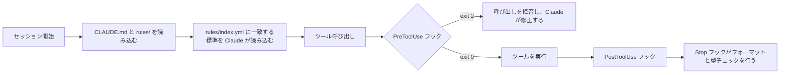

<div align="center">

<strong>Claude Codeのための、方針のはっきりしたエンジニアリング設定です。ルール、ランタイムフック、スラッシュコマンドのスキルが、CLIを厳格なペアプログラマーに変えます。</strong>

[English](README.md) | 日本語 | [简体中文](README.zh-Hans.md) | [繁體中文 (香港)](README.zh-HK.md)

[](https://github.com/gufranco/claude-engineering-rules/actions/workflows/ci.yml)
[](https://github.com/gufranco/claude-engineering-rules/actions/workflows/release.yml)
[](https://scorecard.dev/viewer/?uri=github.com/gufranco/claude-engineering-rules)
[](https://github.com/gufranco/claude-engineering-rules/releases/latest)
[](https://www.conventionalcommits.org)
[](https://github.com/semantic-release/semantic-release)
[](LICENSE)

</div>

<p align="center">
  <a href="#クイックスタート">クイックスタート</a> |
  <a href="CONTRIBUTING.md">コントリビュート</a> |
  <a href="SECURITY.md">セキュリティ</a> |
  <a href="https://github.com/gufranco/claude-engineering-rules/issues">Issue</a> |
  <a href="https://github.com/gufranco/claude-engineering-rules/releases">リリース</a>
</p>

常時ロードされるルール48件、オンデマンドの標準142件、スキル42件、フック95件、エージェント18件に加え、71カテゴリ・905項目のレビューチェックリストを備えています。

---

## 使い方

ガードレールにはコマンドが要りません。Bash、Write、Editの呼び出しはすべて実行前にフックを通り、ブロックされた呼び出しは実行されません。Claudeは拒否の理由を読み、方針を変えます。同じ拒否は、このリポジトリのフィクスチャを使ってシェルから再現できます。

```console
$ python3 ~/.claude/hooks/dangerous-command-blocker.py < ~/.claude/tests/fixtures/bash-force-push.json
BLOCKED: Use --force-with-lease instead of --force
Command: git push --force origin main
$ echo $?
2
```

ワークフローはスキルで、セッション内でスラッシュコマンドとして入力します。

```text
/plan add rate limiting to the login endpoint
/review --local
/ship commit --push
/investigate why the import job times out
```

## 仕組み

各レイヤーは、上のレイヤーが見逃したものを捕まえます。



| レイヤー | 強制する内容 | 実行タイミング |
|:------|:-----------------|:-------------|
| [`CLAUDE.md`](CLAUDE.md) + [`rules/`](rules) | 常時有効なエンジニアリングルール、文体、ハルシネーション対策、検証ゲート | すべての会話 |
| [`standards/`](standards) + [`rules/index.yml`](rules/index.yml) | トリガーキーワードで読み込まれる専門分野の知識 | タスクが必要とするとき |
| [`hooks/`](hooks) | 破壊的なコマンド、シークレット、禁止パターンを実行時にブロック | すべてのツール呼び出しの前 |
| [`skills/`](skills) | ship、review、plan、auditなど、手順が文書化された複数ステップのワークフロー | ユーザーが`/<name>`を呼び出したとき |
| [`agents/`](agents) | 特定のレビュー作業に特化したサブエージェント | 明示的に委任されたとき |
| [`checklists/`](checklists) | コード、インフラ、プロセスを対象とする905項目のレビューチェックリスト | レビュー中に必要に応じて |

## 含まれるもの

### 常時ロードされるルール

[`rules/`](rules/)に48件、[`rules/lang/`](rules/lang/)に5件のルールがあります。[`rules/`](rules/)以下のファイルは、言語別ファイルと表の後に挙げる6件を含め、すべて短いコアとしてすべての会話に読み込まれます。各コアは通常のタスクで振る舞いを変える義務だけを残し、全文は[`standards/`](standards/)にリンクします。そのため常時ロードされるセットは56ファイルで108,127文字に収まり、CIが強制する120,000文字の予算と、ハーネスの上限である150,000文字を下回っています。

| ルール | 対象 |
|:-----|:---------------|
| [`architecture-defaults`](rules/architecture-defaults.md) | 6つの質問からなるアーキテクチャゲートです。タスクが必要とする場合に、DDD、ヘキサゴナル、冪等性、重複排除、ステートマシンの標準を強制的に読み込みます。ハードルールの基準でもあります |
| [`code-style`](rules/code-style.md) | DRY、SOLID、KISS、イミュータビリティ、エラー分類、ブランド型、完全性のルール、プラットフォーム優先のAPI選択、コメント禁止ポリシーです。コメント禁止は、JSDocやドキュメントコメントを明示的に求めるプロジェクトの指示ファイルにだけ譲ります |
| [`design-philosophy`](rules/design-philosophy.md) | 複雑さの現れ方と根本原因、深いモジュール、戦略的と戦術的の違い、2回設計すること、危険信号、設計のセンス |
| [`testing`](rules/testing.md) | 統合テスト優先、厳格なモックポリシー、ラベルなしのArrange-Act-Assert構造、コードの再計算ではなく独立した情報源からの期待値、フェイクデータ、決定的なテストです。変更を通すためにアサーション、テストケース、テストファイルを弱めたり、スキップしたり、削除したりすることはありません。手書きのファイルはすべて除外指示なしでカバレッジ100%とし、ユーザー向けのエントリーポイントと要件のシナリオにはすべてエンドツーエンドテストを用意します |
| [`security`](rules/security.md) | シークレット、認証、暗号化、データプライバシー、監査ログ、サプライチェーン |
| [`git-workflow`](rules/git-workflow.md) | Conventional Commits、ブランチ、CIの監視、変更前後のEvidenceとMerge Dangerの判断（一方向か双方向の扉か、影響範囲）を記載したPRの説明 |
| [`verification`](rules/verification.md) | 証拠に基づく完了ゲート、応答の自己チェック、分析の最初の段階での対象ファイルすべての通読 |
| [`writing-precision`](rules/writing-precision.md) | すべての出力テキストの精度ゲートです。代名詞の規律、能動態、トーンの調整、示した判断にはその根拠となる計測値を添えること、用語は自作せずコードかユーザーから取ることも含みます |
| [`anti-slop`](rules/anti-slop.md) | 禁止フレーズのリストの下にある構造の層です。3つの判定テスト、WikiProject AI Cleanupのフィールドガイドから集めた修辞と文法の兆候の一覧、人間による技術文書の肯定的な特徴、行き過ぎた修正への歯止めを含みます |
| [`normative-keywords`](rules/normative-keywords.md) | BCP 14（RFC 2119とRFC 8174）のキーワード用語集です。小文字が基本で、正しさ、セキュリティ、データの完全性、不可逆性が重要な場合に限り大文字を使います |
| [`repo-analysis`](rules/repo-analysis.md) | 外部リポジトリは`gh`やraw URLでファイルを取得せず、一時ディレクトリにクローンします。必須のシャロークローン手順、Issue、PR、検索操作の例外、サブエージェントへの指示を定めます |
| [`pre-flight`](rules/pre-flight.md) | 重複チェック、市場調査、アーキテクチャとの適合、インターフェースの検証、既存コードから写したしきい値の意味の検証、最初の編集前のテストのベースラインと関連テストの通読 |
| [`surgical-edits`](rules/surgical-edits.md) | 変更したすべての行が依頼にさかのぼれること |
| [`ai-guardrails`](rules/ai-guardrails.md) | AIの出力のレビュー、生成前の計画、マルチエージェントによる検証 |
| [`memory-supersede`](rules/memory-supersede.md) | プロジェクトとフィードバックのメモリは削除せず置き換えること |
| [`language`](rules/language.md) | 応答言語の強制です。出力はすべて英語にします |
| [`smart-questions`](rules/smart-questions.md) | 質問の形式、選択肢を示すときの推奨の義務、状況報告、FIXED、RESOLVED、DONEによるループの完了、Tathamのバグ報告の要点 |
| [`found-fix`](rules/found-fix.md) | 検証の過程で見つかった問題はすべて現在のタスクの対象です。修正を後のセッションに先送りする言い訳の言い回しを禁止します |
| [`same-turn-persistence`](rules/same-turn-persistence.md) | 訂正を受けたターンは、終わる前にファイルへの書き込みを行います。自分で気付いた誤りもユーザーに指摘された誤りと同じに扱い、書き込みは症状ではなく根本の振る舞いを対象にします。受け入れ基準があるため、必須の記録で設定が膨らむことはありません |
| [`rule-provenance`](rules/rule-provenance.md) | すべてのルールに、拘束力を持った日付とその原因となった失敗を記します。教訓はまず記録し、3回目の再発でルールに昇格させます。不可逆、暗黙、壊滅的な失敗は例外です。来歴があるからこそルールを整理できます |
| [`relay-not-source`](rules/relay-not-source.md) | サブエージェントの報告、検索結果の抜粋、要約は中継です。中継は内容だけでなく引用の位置情報も崩すため、具体的な主張が正しく読めても、別の行、タイムスタンプ、レコードを指していることがあります |
| [`agent-operating-limits`](rules/agent-operating-limits.md) | バックストップと予算の区別、計測値を伴うターン上限、超過分を捨てずに報告する上限、拒否された呼び出しと無条件のコンテキスト注入のコスト、実行できなかったチェックは失敗として扱うこと |
| [`deviation-waivers`](rules/deviation-waivers.md) | ルールから外れることは許されますが、黙って外れることは許されません。範囲、承認者、代替案、見直し条件を備えた構造化された免除で、別の問いに答えるため機械的なバイパスとは区別されます。プロジェクト自身の指示ファイルは、そのプロジェクト内でグローバルルールを明示的に上書きできますが、セキュリティ、法務、データ損失、検証、誠実さの一線は越えられません |
| [`no-ai-process-leak`](rules/no-ai-process-leak.md) | コミットメッセージ、PRの説明、公開ドキュメント、同僚へのメッセージから、フェーズ番号、計画ファイルのパス、仕様フォルダへのリンク、誇張表現、自己批判を排除します |
| [`no-committed-symlinks`](rules/no-committed-symlinks.md) | どのリポジトリもシンボリックリンクを追跡しません。共有するソースはビルドを通じて参照し、2か所で必要なファイルは1回だけコミットし、サブモジュール由来のファイルはそのバイト列としてコミットします |
| [`doc-truth`](rules/doc-truth.md) | コードを説明するドキュメントは、コードについての主張です。主張を偽にする変更は、同じコミットでそれを訂正します。`git commit`時に機械的に確実な4つのチェックを行い、履歴の記録は対象外です。コードが一貫して従わなくなった慣習を説明するプロジェクトのドキュメントは古いものとして扱い、コードを優先して不一致をすべて報告します |
| [`markdown-links`](rules/markdown-links.md) | 公開Markdownで言及するファイルはすべてクリックできるリンクにします。バリデーターとPreToolUseフックが強制します |
| [`living-specs`](rules/living-specs.md) | 自明でない変更は、`specs/current/`の生きた振る舞い仕様を保守します。要件、Given/When/Thenのシナリオ、ローカルワークスペース内の計画フォルダに置くADDED、MODIFIED、REMOVEDの差分、完了した変更を仕様に取り込む締めくくりのマージを含みます |
| [`project-workspace`](rules/project-workspace.md) | すべてのリポジトリは、ユーザーの作業資料をコミットしないローカルワークスペースに置きます。プロジェクトが所有していなければ`<repo>/docs/`、所有していれば`<repo>/.work/`で、無視の設定は`.git/info/exclude`だけで行います。そこにある`PROMPT.md`は、新しいセッションにそのまま貼り付けられる状態を保ちます。READMEがプロジェクトの唯一の情報源です |
| [`compliance-defaults`](rules/compliance-defaults.md) | コンプライアンス関連ルールの総括です。適用できる中で最も厳しいルールを採用し、公開された標準は施行日の前から拘束力があるものとして扱います |
| [`accessibility-defaults`](rules/accessibility-defaults.md) | WCAG 2.2 AAを最低基準とし、矛盾しない範囲でAAAに従います。キーボード操作、44x44のタップ領域、モーションの軽減、画像CAPTCHAの禁止 |
| [`frontend-render-gate`](rules/frontend-render-gate.md) | 描画結果への変更は、何かが描画するまで未検証です。静的レビューとjsdomでは届かない領域として、カスケードの結果、描画順序、アクセシビリティツリー、フォーカス順序、サードパーティのiframeを挙げます。証拠の段階を順位付けし、まずプロジェクト自身のブラウザやシミュレーターのハーネスを拡張します。目に見える変更についてのPR、レビューの返信、Issue、トラッカーのコメントには、Web、モバイル、デスクトップGUI、TUIのいずれでも、高解像度のBeforeとAfterのスクリーンショットを添付します |
| [`ai-review-convergence`](rules/ai-review-convergence.md) | 自動レビュアーがコメントするときのループを制限します。ボットのコメントをゼロにすることはできないため、検証された失敗のないラウンドを停止条件とします。修正前の失敗シナリオのゲート、応答コミットでの最小限の差分 |
| [`pr-comment-discipline`](rules/pr-comment-discipline.md) | プルリクエストに公開してよいコメントは、人が開いたスレッドの中の返信だけです。サマリー本文、会話コメント、コミットコメントへの返信、ボットへの返信はどんな長さでも書きません。ボットのスレッドは読み、正しければ修正し、黙って解決します。返信は4文までで、開いている変更の中で直せるものは記録に回さずその場で直します |
| [`functional-index-fidelity`](rules/functional-index-fidelity.md) | データベースが式インデックスを使うのは、クエリの式がインデックスの式と完全に同一の場合だけです。そのため等価な書き換えは、エラーも失敗するテストもなく、静かにシーケンシャルスキャンになります |
| [`privacy-defaults`](rules/privacy-defaults.md) | すべての市場でGDPR水準を基本にします。法的根拠、30日以内のDSAR対応、真の消去、24か月の保持期間、仮名化データを個人データとして扱うこと |
| [`cookie-discipline`](rules/cookie-discipline.md) | 必須でないCookieはすべてオプトイン、すべて拒否をすべて承諾と同じ操作数にし、Cookieウォールも事前チェックのボックスも使いません |
| [`cybersecurity-baseline`](rules/cybersecurity-baseline.md) | フロントエンドのセキュリティの基本値です。nonceベースのCSP、TLS 1.3、NISTのパスワードポリシー、セッションのタイムアウト、侵害通知の期限 |
| [`consumer-defaults`](rules/consumer-defaults.md) | 14日間の撤回期間、最初からの総額表示、解約を契約と同じ操作数にすること、偽の品薄表示や偽のレビューの禁止 |
| [`children-privacy-defaults`](rules/children-privacy-defaults.md) | プロファイリングと広告は18歳、アカウントは16歳、13歳未満は検証可能な保護者の同意が必要です。未成年への利用を煽るパターンを禁止します |
| [`ai-compliance-defaults`](rules/ai-compliance-defaults.md) | EU AI法のリスク区分、モデル出力への目に見える開示、自動化された判断への人によるレビュー、年1回のバイアス監査 |
| [`anti-spam-defaults`](rules/anti-spam-defaults.md) | マーケティングのオプトイン同意、ワンクリックの配信停止、恒久的な配信停止リスト、トランザクションとマーケティングの厳格な分離 |

ほかに[`rules/lang/`](rules/lang/)に言語別のファイルが5件あります。`typescript-immutability`、`typescript-types`、`typescript-strict`、`orm-migrations`、`python`です。

[`rules/`](rules/)にはさらに6件のルールがあり、ほかと同じくすべてのセッションで読み込まれ、条件が成り立つときだけ適用されます。それぞれ[`rules/index.yml`](rules/index.yml)に全文を持つオンデマンドの標準があります。プロジェクトが配布できないため利用者が自分で用意するファイルを扱う[`artifact-identity`](rules/artifact-identity.md)、エミュレーターを全画面ではなくヘッドレスか最小化で起動する[`emulator-runs`](rules/emulator-runs.md)、プロジェクトの依存関係をホストではなくすべてDockerイメージに入れる[`docker-dependencies`](rules/docker-dependencies.md)、そして[`knowledge-notes`](rules/knowledge-notes.md)、[`everyday-engineering`](rules/everyday-engineering.md)、[`project-glossary`](rules/project-glossary.md)です。

### オンデマンドで読み込まれる標準

[`standards/`](standards/)に142件の標準があります。[`rules/index.yml`](rules/index.yml)の各エントリーがトリガーキーワードを宣言しており、タスクが一致したときにその標準だけが読み込まれます。

扱うテーマは、API設計、認証、キャッシュ、コードレビュー、並行性と競合状態、コンテナのセキュリティ、コントラクトテスト、データベース、DDD、デバッグ、分散システム、冪等性と重複排除、言語ごとのイミュータビリティ、ドキュメント、フロントエンド、GraphQL、ヘキサゴナルアーキテクチャ、i18n、インフラ、低レイテンシのエンジニアリング、メッセージキュー、モバイル、モノレポ、オブザーバビリティ、エージェント向け指示ファイルの書き方、OpenTelemetry、パフォーマンス、Postgres、PRコメントのチャネル、印刷デザイン、プライバシー、Redis、レジリエンス、シークレット管理、SRE、ステートマシン、Twelve-Factor、TypeScript 5.x、WebSocket、ゼロダウンタイムデプロイなどです。

### スキル

[`skills/`](skills/)に42件のスキルがあります。それぞれが`SKILL.md`を持つフォルダで、手順、出力形式、ルールを、[`tools/lint-skills.py`](tools/lint-skills.py)がCIで`--strict`付きで強制する6セクションのテンプレートに沿って記述しています。Overview、When to Use、Process、Common Rationalizations、Red Flags、Verificationの6つです。リンターはフロントマターを厳密なYAMLとして解析し、` #`によって黙って切り詰められる説明も拒否します。

**スキルは2種類です。** モデルが呼び出すスキルは、トリガーフレーズを含む説明をすべてのセッションのコンテキストに置くため、Claudeが自分で使えます。ユーザーが呼び出すスキルは`disable-model-invocation: true`を設定します。説明がコンテキストから外れ、入力されるまでコストがかからず、起動できるのはユーザーだけです。手動で使うものはユーザー呼び出しです。`/deploy`、`/cleanup`、`/hotfix`、`/guard`、`/setup`、`/skill-new`、`/incident`、`/readme`、`/gan`、`/migrate`、`/assessment`、`/module-audit`、`/benchmark`、`/session-log`がこれにあたります。ほかのスキルから呼ばれる必要があるスキルはモデル呼び出しのままにするため、`/pr-summary`と`/fix-issue`はそうしています。`/morning`がこの2つに作業を渡すからです。

| スキル | 内容 |
|:------|:-------------|
| [`/ship`](skills/ship/SKILL.md) | デリバリーパイプライン。コミット、PR、リリース、CIのチェック、ワークツリー |
| [`/review`](skills/review/SKILL.md) | 3段階のコードレビュー、QA分析、ビジュアル監査 |
| [`/respond`](skills/respond/SKILL.md) | 届いたレビューコメントへの対応。分類、検証、返信の下書き、ローカルでの確認、投稿、解決、CIの監視 |
| [`/assessment`](skills/assessment/SKILL.md) | アーキテクチャの完全性の監査です。欠けているパターン、仕込まれた欠陥、際立たせられる機会を見つけます。[`tools/slop-scan.py`](tools/slop-scan.py)でAIの冗長な文章を評価し、削除で取り除きます。このツールは`ai-slop-blocker`の検出器をすべてのMarkdownファイルとコミット範囲に適用します。`/respond`が読み込める機械可読の指摘表を出力します |
| [`/plan`](skills/plan/SKILL.md) | 発見、スコープの見直し、ADR、スキャフォールドを含む仕様フォルダ |
| [`/audit`](skills/audit/SKILL.md) | セキュリティ監査、脅威モデリング、サプライチェーンのチェックです。`/audit trust`は、[`trust-patterns.md`](skills/audit/trust-patterns.md)のIOCカタログを使って、信頼できないプロジェクトの安全性スキャンを追加します |
| [`/test`](skills/test/SKILL.md) | テストの実行、パフォーマンス、リント、CIのスモーク、スタブの生成 |
| [`/deploy`](skills/deploy/SKILL.md) | マージ後のランディングとカナリアの監視 |
| [`/investigate`](skills/investigate/SKILL.md) | 仮説検証による体系的なデバッグ、3回までの試行制限 |
| [`/research`](skills/research/SKILL.md) | エンティティ解決と引用の規律を伴う複数ソースの調査 |
| [`/design`](skills/design/SKILL.md) | デザインの相談、バリエーション、デザインシステムの作業 |
| [`/refactor`](skills/refactor/SKILL.md) | 振る舞いを保つガイド付きのリファクタリング |
| [`/migrate`](skills/migrate/SKILL.md) | 段階的なテストを伴うフレームワークやライブラリの移行 |
| [`/infra`](skills/infra/SKILL.md) | コンテナのオーケストレーション、IaC、データベースのマイグレーション |
| [`/hotfix`](skills/hotfix/SKILL.md) | 迅速化したワークフローによる本番環境の緊急修正 |
| [`/incident`](skills/incident/SKILL.md) | インシデントの状況収集、非難しないポストモーテム |
| [`/resolve`](skills/resolve/SKILL.md) | 検証を伴うマージコンフリクトの解決 |
| [`/cleanup`](skills/cleanup/SKILL.md) | 古いブランチ、PR、ワークツリーの整理 |
| [`/checkpoint`](skills/checkpoint/SKILL.md) | セッションをまたいだ状態の保存と再開です。リポジトリ内ではワークスペースの`PROMPT.md`を書き込みます |
| [`/explain`](skills/explain/SKILL.md) | Mermaid図を使ったコードの説明 |
| [`/fix-issue`](skills/fix-issue/SKILL.md) | GitHubのIssueを番号で指定し、テスト付きで修正 |
| [`/guard`](skills/guard/SKILL.md) | ディレクトリの凍結とスコープの強制 |
| [`/benchmark`](skills/benchmark/SKILL.md) | ベースラインを使ったパフォーマンス後退の検出 |
| [`/profile`](skills/profile/SKILL.md) | N+1クエリ、欠けているインデックス、複雑さのホットスポット |
| [`/onboard`](skills/onboard/SKILL.md) | コードベースのオンボーディング。アーキテクチャの地図と「Start Here」です。フェーズ0で信頼性スキャンを実行する前に確認し、`--trust`と`--verify`フラグで対話なしに事前決定できます |
| [`/gan`](skills/gan/SKILL.md) | 採点基準に対して機能を作り込むGenerator-Evaluatorの反復ループです。しきい値に達するまで、プランナー、ジェネレーター、エバリュエーターのサブエージェントを繰り返します |
| [`/pr-summary`](skills/pr-summary/SKILL.md) | レビュアーの提案を含むPRの要約 |
| [`/readme`](skills/readme/SKILL.md) | コードベースの分析によるREADMEの生成です。すべての主張はコードに基づき、英語のファイルは[`tools/slop-scan.py`](tools/slop-scan.py)を通過する必要があります。毎回、言語切り替え付きで日本語、簡体字中国語、香港の繁体字中国語の翻訳も書き込み、`--languages es`でスペイン語を追加します |
| [`/retro`](skills/retro/SKILL.md) | パターン抽出を伴うセッションの振り返り |
| [`/morning`](skills/morning/SKILL.md) | アカウントを横断した作業のトリアージです。認証済みのすべてのgitアイデンティティとその組織を巡回し、誰が止まっているかで順位付けして報告し、項目ごとの同意を得てキューを処理します。実行中はマージが機械的にブロックされます |
| [`/session-log`](skills/session-log/SKILL.md) | 引き継ぎのためのセッション活動ログ |
| [`/setup`](skills/setup/SKILL.md) | 対話式のプロジェクト環境のセットアップ |
| [`/tdd`](skills/tdd/SKILL.md) | テスト駆動開発のループです。縦方向に分割し、先にテストをすべて書いてから実装をすべて書く横方向の進め方はしません |
| [`/zoom-out`](skills/zoom-out/SKILL.md) | 戦術的な作業から一歩引いて戦略的な視点に立つ |
| [`/spike`](skills/spike/SKILL.md) | 設計上の問いに1つ答えるための使い捨ての成果物です。状態ブランチのターミナルプログラムと、表示ブランチの並列比較という2つの進め方があります |
| [`/module-audit`](skills/module-audit/SKILL.md) | 浅いモジュールを探すコードベース監査です。変更前後のMermaidによる推奨と、削除テストによる分類を示します |
| [`/concise-mode`](skills/concise-mode/SKILL.md) | オプトインの簡潔な応答モードです。前置きや社交辞令を省き、コードブロック、エラー文字列、破壊的な操作の確認はそのまま残します |
| [`/cross-model`](skills/cross-model/SKILL.md) | 重大な判断、特に確信があるときに、別のモデルへ直交する推論を求めます。ベンダーを決めつけず、インストールされているモデルのCLIを探し、回答は中継として再検証します |
| [`/brain`](skills/brain/SKILL.md) | セカンドブレインのボールトの読み書きです。capture、ingest、ask、link、health、refresh、falsify、wrong、compile、evalがあります。`falsify`は古いだけでなく誤っている事実を探し、`wrong`は原因付きで取りこぼしを記録するため、主な失敗のパターンが見えるようになります |
| [`/interview-me`](skills/interview-me/SKILL.md) | 指定が不十分な依頼について、1問ずつ意図を明確にし、実装の前に高い確信度まで詰めます |
| [`/aside`](skills/aside/SKILL.md) | 進行中のタスクを凍結し、状態を変えずに横道の質問に答え、止めたところから正確に再開します |
| [`/skill-new`](skills/skill-new/SKILL.md) | 強制されるフロントマターとセクションのテンプレートで新しいスキルを作成し、スキルのリンターで検証します |

### フック

[`hooks/`](hooks/)に95件のフックがあり、[`settings.json`](settings.json)で接続されています。それぞれがツール呼び出しの前、後、または前後に実行されます。

**バイパスの経路。** すべてのフックが2つの経路に対応しています。どちらでも通過でき、両方を併用できます。

1. 親シェルの環境変数`<NAME>_DISABLE=1`（Claude Codeを起動する前に設定）。
2. セッション内のファイルレジストリ`~/.claude/.bypass-state.json`。実行中のセッションから`python scripts/bypass.py set <hook> --ttl 600 --reason "<why>"`で有効にし、`python scripts/bypass.py clear [<hook>]`で解除し、`list`で確認します。TTLは[60, 3600]秒に制限されます。60分の上限は意図的なもので、バイパスの消し忘れが残り続けることはありません。ワイルドカードのエントリー（`set "*"`）は期限まですべてのフックを素通りさせ、TTLの既定値は5分、上限は20分です。読み取り側も同じ上限を適用するため、遠い期限を手書きしたエントリーは無視され、設定の保護がレジストリファイルへのWriteとEditをブロックします。ファイルのモードは0600です。[`hooks/_lib/bypass.py`](hooks/_lib/bypass.py)を参照してください。

**ブロックメッセージのスキーマ。** 新しいフックは、[`hooks/_lib/output.py`](hooks/_lib/output.py)の`block(...)`でstderrを出力します。決まった順序の5セクション（`What was detected`、`Why this rule exists`、`How to fix`、`If the rule does not apply here`、`Decision guidance for Claude`）と、4つの判断の動詞（`STOP-AND-ASK`、`FIX-AND-RETRY`、`BYPASS-ONCE`、`BYPASS-WITH-REASON`）のいずれか1つを持ち、すべてのメッセージで両方のバイパス経路を示します。バリデーターは`output.validate_block_message(...)`です。実例は[`hooks/large-file-blocker.py`](hooks/large-file-blocker.py)を参照してください。

**フックの追加。** 5つの手順を順に行います。手順2を飛ばすと、気付きにくい失敗になります。フックは実行されてもすべてのペイロードでexit 0を返し、通過しているように見えます。

1. まず`tests/hooks/<hook-name>/`にテストスイートを書きます。[`hooks/tdd-gate.py`](hooks/tdd-gate.py)は、対応するテストが存在するまでソースファイルをブロックします。フィクスチャの`tool_use`、`assert_blocks`、`assert_allows`、`run_hook`は[`tests/conftest.py`](tests/conftest.py)から提供されます。自前でサブプロセスを呼び出す場合は`COVERAGE_PROCESS_START`と`PYTHONPATH`を引き継がないと、その行は計測されません。
2. フックIDを[`hooks/_lib/hook_profile.py`](hooks/_lib/hook_profile.py)の`STANDARD_HOOKS`に登録します。`should_run`は有効なプロファイルに含まれないIDに対してFalseを返すため、登録されていないフックは黙って何もしません。
3. ツールごとに1エントリーずつ、`Write`、`Edit`、`MultiEdit`のマッチャーを[`settings.json`](settings.json)に接続します。
4. 共有の基盤は`_lib`からインポートします。`read_hook_payload`のための`_lib.hook_input`（ガードが読めないペイロードはブロックします）、サードパーティの指示のための`_lib.suppression`、ファイルレジストリのための`_lib.bypass`、記録のための`_lib.audit_log`、`block(...)`と`warn(...)`のための`_lib.output`、サブコマンドの照合前に`-C`や`-c`などのgitグローバルオプションを取り除く`_lib.git_invocation`です。モジュールは`_lib.suppression`で、素の`suppression`ではありません。素の形は解決されず、フォールバックによって指示のサポートが黙って無効になります。
5. 検出の多いフックは、まず警告モードで出荷し、`<NAME>_ENFORCE=1`環境変数の後ろでブロックします。実際のコードに対する誤検知の割合が分かってから昇格させます。

| フック | トリガー | 内容 |
|:-----|:--------|:-------------|
| [`accessibility-mechanical-checks.py`](hooks/accessibility-mechanical-checks.py) | PreToolUse Write/Edit/MultiEdit | ソースから判定できるWCAGの不備を捕まえます。`alt`のない画像、アクセシブルな名前のないアイコンだけのボタン、ラベルのない入力欄、roleやキーハンドラーのない`div`のクリックハンドラー、ゼロより大きい`tabindex`、`lang`の欠落です。アロー関数や入れ子の式を含むJSXタグをそのまま読み、`<Input>`のような大文字のコンポーネントは無視し、該当する`jsx-a11y`ルールを指定した`eslint-disable-next-line`に従います。バイパスは`ACCESSIBILITY_CHECKS_DISABLE=1` |
| [`ai-attribution-blocker.py`](hooks/ai-attribution-blocker.py) | PreToolUse Bash/Write/Edit | コミットとPRのAI共著者トレーラー、`Claude-Session`トレーラー、claude.aiのセッションリンクをブロックし、送信するコミットにそれを含む`git push`もブロックします |
| [`ai-disclosure-checks.py`](hooks/ai-disclosure-checks.py) | PreToolUse Write/Edit/MultiEdit | AIであることを目に見える形で開示せずにモデルの出力を描画することと、何であるかを示すラベルのないチャットボットUIをブロックします。EU AI法第52条、カリフォルニア州SB 942。バイパスは`AI_DISCLOSURE_DISABLE=1` |
| [`ai-process-leak-blocker.py`](hooks/ai-process-leak-blocker.py) | PreToolUse Bash/Write/Edit | コミット、PR、リリースノート、コードコメントに含まれるAIの作業過程の言葉をブロックします。フェーズ番号、計画ファイルのパスへの言及、仕様フォルダやローカルワークスペースへのリンク、誇張表現を捕まえます。ソースファイルではコメントだけを走査するため、ステップのラベルのような製品の文字列は通過します。ワークスペースやセッションのスクラッチパッドへの書き込みは対象外で、Bashコマンドが公開とみなされるのは、公開するコマンドが引用符の外にある場合だけです |
| [`ai-review-request.py`](hooks/ai-review-request.py) | PostToolUse Bash | 実行しているアカウントが作成した開いているPRで`gh pr create`、`gh pr ready`、`git push`を行った後、リポジトリが対応するすべてのAIレビューを依頼します。Claude Appが手動モードで動く場所では`@claude review always`を1回、ワークフローがラベルで制御される場所では`claude-review`ラベルを付けます。CodeRabbitとCodexはプッシュのたびにレビューするため何もしません。ブロックはせず、`ai-review:`の行を1行報告します。CLIとしても使えます：`--repo owner/name --pr N --account login [--dry-run]`。作成されたプルリクエストをセッションごとの台帳に記録し、`pr-comment-discipline.py`がそれを読みます。バイパスは`AI_REVIEW_REQUEST_DISABLE=1` |
| [`ai-slop-blocker.py`](hooks/ai-slop-blocker.py) | PreToolUse Bash/Write/Edit/MultiEdit | 禁止フレーズのリストをすり抜ける構造上の冗長さの兆候をブロックします。否定の対句、重要性の誇張、評価を加える分詞句、出典のない権威、ぼかした推測、`is`や`has`を置き換えるマーケティング用語、前置き、末尾の要約、チャットの名残、埋められていないプレースホルダー、カーリー引用符、拒否したサイトや確認した日付などの検索の経緯です。太字ラベルの箇条書きと見出しは、公開するPRコメントの中でだけブロックします。コードは`SLOP001`から`SLOP015`です。検索の経緯は、ボールト、プロジェクトのワークスペース、`PROMPT.md`では許可されます。照合の前にコードスパンを隠し、すべての検出器は、rules、standards、checklists、skills、agents、docsの各ディレクトリとルートの文書にある333件のMarkdownファイルで調整されています。バイパスは`AI_SLOP_DISABLE=1` |
| [`as-any-blocker.py`](hooks/as-any-blocker.py) | PreToolUse Write/Edit | TypeScriptの`as any`とジェネリックの`any`をブロックします。許可マーカーはなく、サードパーティのツールの指示だけに従います。 |
| [`aws-profile-guard.py`](hooks/aws-profile-guard.py) | PreToolUse Bash | `--profile`なしの`aws configure set`をブロックします |
| [`banned-phrases-blocker.py`](hooks/banned-phrases-blocker.py) | PreToolUse Bash/Write/Edit | PRとドキュメントでの会話的な前置きや戦術的な誇張をブロックします |
| [`banned-prose-chars.py`](hooks/banned-prose-chars.py) | PreToolUse Write/Edit/Bash | emダッシュ、enダッシュ、文中の丸括弧、絵文字、ASCIIアート、Markdownの文中でダッシュの代わりに使うスペース付きハイフンをブロックします |
| [`bulk-resolve-blocker.py`](hooks/bulk-resolve-blocker.py) | PreToolUse Bash | GitHubやGitLabで複数のスレッドに`resolveReviewThread`を繰り返すループをブロックします |
| [`comment-blocker.py`](hooks/comment-blocker.py) | PreToolUse Write/Edit/MultiEdit/Bash | 所有者のリポジトリで使うすべての言語で、ソースコードへのコメントの追加をブロックします。C系、Python、シェル、YAML、Make、Docker、Terraform、SQL、Lua、Clojure、TeX、Vim script、HTMLとそのテンプレート方言、CSS、方言ごとのアセンブリ、Jupyterのコードセルなどで、拡張子、ベース名、シバン、内容で判別します。docstringとドキュメントコメントのブロックもコメントとして扱います。編集はディスク上のファイルと照合するため、新たに追加したコメントだけが報告されます。Bashの`git commit`では、ステージされたすべてのファイルを`HEAD`と比較して走査するため、WriteやEditのツール以外で書かれた内容も捕まえます。対象外は、`eslint-disable`、`@ts-expect-error`、`noqa`、アクションのバージョン固定などのツールの指示、テストファイルの素の`Arrange`、`Act`、`Assert`マーカー、`.env.example`ファイルです。運用者向けのバイパスは`COMMENT_BLOCKER_DISABLE=1` |
| [`test-aaa-markers.py`](hooks/test-aaa-markers.py) | PreToolUse Write/Edit/MultiEdit/Bash | Python、JS/TS、Go、batsで追加または変更したすべてのテストに、素の`Arrange`、`Act`、`Assert`マーカーをそれぞれ1回ずつ順番に置き、空行1つで区切った3つのブロックにすることを求めます。手を付けていない既存のテストはチェックしません。Bashの`git commit`ではステージされたファイルをチェックします。バイパスは`TEST_AAA_MARKERS_DISABLE=1` |
| [`compact-context-saver.py`](hooks/compact-context-saver.py) | SessionStart / PreCompact / PostCompact | コンパクションをまたいでgitの状態をプロジェクトごとに保持します |
| [`config-protection.py`](hooks/config-protection.py) | PreToolUse Write/Edit/MultiEdit | tsconfig、eslint、ruff、mypyなど、リンター、フォーマッター、型チェッカーの設定の編集をブロックします。設定を緩めるのではなくコードを直させます |
| [`console-log-blocker.py`](hooks/console-log-blocker.py) | PreToolUse Write/Edit | テスト以外のコードでの`console.*`をブロックします。許可マーカーはなく、サードパーティのツールの指示だけに従います。 |
| [`conventional-commits.py`](hooks/conventional-commits.py) | PreToolUse Bash | Conventional Commitsの形式を検証します |
| [`coverage-exclusion-guard.py`](hooks/coverage-exclusion-guard.py) | PreToolUse Write/Edit/MultiEdit | `istanbul ignore`、`c8 ignore`、`pragma: no cover`、`#[coverage(off)]`、`LCOV_EXCL_LINE`など、ソースにカバレッジ除外の指示を加える編集と、カバレッジ設定のしきい値を100未満にする編集をブロックします。除外できるのは生成コードとベンダーのパスだけなので、新しいomitやexcludeのエントリーには確認を求めます。文章のファイルは対象外です。バイパスは`COVERAGE_EXCLUSION_GUARD_DISABLE=1`。 |
| [`dangerous-command-blocker.py`](hooks/dangerous-command-blocker.py) | PreToolUse Bash | 190のパターンです。破壊的なシェルコマンド、リバースシェル、クラウドの削除、IaCのdestroyを扱います。`cat`、`tee`、`git`、`gh`、`glab`に渡すヒアドキュメントの本文はデータとして扱い照合しませんが、シェルに渡す本文は照合します。照合の前に`-C`や`-c`などのgitグローバルオプションを取り除くため、`git -C <dir> push --force`も素の形と同じくブロックされ、`-f`や`-fu`のような組み合わせも強制プッシュとみなします。ビルドディレクトリの掃除が残りのチェックを飛ばせるのは、コマンドのすべてのセグメントがその掃除である場合だけです。有効なJSONでない入力はブロックします。保護されたブランチへのプッシュは、`cd`と`-C`をたどったプッシュ先のリポジトリが、[`solo-repos.example.txt`](solo-repos.example.txt)から作るマシンローカルの`solo-repos.txt`に載っている場合に許可されます。プッシュ先が特定できない場合は対象になりません。テストファイルの削除と、`find`、`grep -r`、`rg`、`fd`による`/`やホームディレクトリの検索には確認を求めます。ただし、追跡されておらずどのコミットにも含まれないテストファイルは除きます |
| [`doc-sync-guard.py`](hooks/doc-sync-guard.py) | PreToolUse Bash | ステージした差分が既存のドキュメントを偽にする`git commit`をブロックします。確実な4つのチェックです。コードが読むのに`.env.example`に記載のない変数と、追跡されているMarkdownがまだ名前を挙げているのに削除されたエクスポート、CLIフラグ、パッケージスクリプトです。先頭の`cd`や`git -C`が指すリポジトリをチェックし、`commit -a`ではステージしていない変更も含めます。変更履歴、ADR、仕様は履歴の記録として対象外です。バイパスは`DOC_SYNC_DISABLE=1` |
| [`frontend-render-gate.py`](hooks/frontend-render-gate.py) | PreToolUse Bash, Linear `save_issue` and `save_comment` | 描画結果を変える`git commit`（`.tsx`、`.html`、`.dart`、スタイル、テーマトークン、`*View.swift`や`*Screen.kt`などのネイティブビュー、`.qml`や`.xaml`などのデスクトップレイアウト、ターミナルUIライブラリをインポートするソース）が、描画レベルのチェック（e2eやブラウザのスイート、XCUITest、`androidTest`、ターミナルのスナップショット）に触れていない場合にブロックします。`*.spec.tsx`の単体テストは数えません。カスケードの結果、描画順序、アクセシビリティツリー、フォーカス順序、サードパーティのiframeはソースからは見えず、jsdomにもありません。公開時にはブランチの差分をベースと比較して読みます。目に見える変更があるブランチでの`gh pr create`や`edit`、`gh issue create`、`edit`、`comment`、レビュースレッドへの返信、`glab mr create`や`update`、LinearのIssueやコメントは、`After:`の画像と、既存の画面が変わった場合は`Before:`の画像を、それぞれ長辺1600ピクセル以上で添付するまでブロックします。画像も目に見える変更もない画面の文言には確認を求めます。1組の画像はすべて同じピクセル幅である必要があり、1つのラベルがデバイスを示したら、すべてのラベルがデバイスとビューポートを示します。ちょうど1ビューポート分の高さの画像には、ページ全体のキャプチャを求めます。添付のパスは`$VAR`と`cd`をたどり、トラッカーの項目はその本文だけで判断します。バイパスは`FRONTEND_RENDER_GATE_DISABLE=1`、または共有のバイパスレジストリにあるTTL付きのエントリーです。 |
| [`docker-context-guard.py`](hooks/docker-context-guard.py) | PreToolUse Bash | 呼び出しごとに`--context`か`DOCKER_CONTEXT`を強制します |
| [`dockerfile-compose-quality.py`](hooks/dockerfile-compose-quality.py) | PreToolUse Write/Edit/MultiEdit | `.env`や鍵と証明書のコピー、値がリテラルのシークレット名の`ENV`と`ARG`、Composeの`privileged: true`、ホストの名前空間の切り替えをブロックします。固定されていないタグ、`USER root`、非推奨のトップレベルの`version:`、`environment:`のリテラルのシークレットは警告します。バイパスは`DOCKERFILE_QUALITY_DISABLE=1` |
| [`drizzle-raw-sql-blocker.py`](hooks/drizzle-raw-sql-blocker.py) | PreToolUse Write/Edit | `tx`と`trx`のレシーバーやテストファイルも含め、Drizzleの生クエリの抜け道をブロックします |
| [`drizzle-schema-sync.py`](hooks/drizzle-schema-sync.py) | PreToolUse Write/Edit | Drizzleのスキーマとマイグレーションの一致を強制します |
| [`english-only-reminder.py`](hooks/english-only-reminder.py) | UserPromptSubmit | アシスタントの出力を英語にするシステムリマインダーを注入します |
| [`env-file-guard.py`](hooks/env-file-guard.py) | PreToolUse Write/Edit | `.env`、秘密鍵、クラウドの認証情報、tfstateの編集をブロックします |
| [`force-push-during-review.py`](hooks/force-push-during-review.py) | PreToolUse Bash | コマンドが対象とするリポジトリで、レビュアーのプルリクエストに対する最新のレビューが`CHANGES_REQUESTED`のとき、履歴を書き換えるプッシュをブロックします。レビューの状態が読めない場合はブロックし、プルリクエストのないブランチは許可します。強制フラグのパターンを危険コマンドのブロッカーと共有するため、`-fu`やグローバルオプションも同じように捕まえます |
| [`foreign-session-guard.py`](hooks/foreign-session-guard.py) | PreToolUse Write/Edit/MultiEdit/NotebookEdit | 別の稼働中のClaude Codeセッションの作業ディレクトリ内に書き込む前に確認を求めます。セッションは`~/.claude/sessions/`から読み取ります。そのセッションはファイルを自分の変更として報告するためです。このセッションを含むディレクトリのセッションは無視します。バイパスは`FOREIGN_SESSION_GUARD_DISABLE=1` |
| [`found-fix-rationalization-blocker.py`](hooks/found-fix-rationalization-blocker.py) | PreToolUse Bash/Write/Edit | 検証で見つかった問題を後のセッションに先送りする言い訳の言い回しをブロックします。対象はコミットメッセージ、PRの本文、リリースノート、コードコメントです。ソースファイルではコメントだけを走査し、セッションのスクラッチパッドは対象外です。引用符の中やヒアドキュメントの本文にある公開コマンドはデータであり、コミットではありません |
| [`gateguard-fact-force.py`](hooks/gateguard-fact-force.py) | PreToolUse Write/Edit/MultiEdit | ユーザーがパスを指定した場合を除き、セッションごとに最初の編集の前にファイルを読むことを強制します。pre-flightの「Confidence」ルールを実装するものです |
| [`gcloud-config-guard.py`](hooks/gcloud-config-guard.py) | PreToolUse Bash | 呼び出しごとに`--configuration`を強制します |
| [`gh-run-watch-blocker.py`](hooks/gh-run-watch-blocker.py) | PreToolUse Bash | 3秒ごとにポーリングしてAPIのレート予算を使い切る`gh run watch`とその同等品をブロックします。`glab ci view --live`、`glab ci status --wait`や`--live`も含みます。単一引用符の中や引用符付きヒアドキュメントの本文のテキストはコマンドとして読みません。バイパスは`GH_RUN_WATCH_DISABLE=1` |
| [`gh-short-sha-guard.py`](hooks/gh-short-sha-guard.py) | PreToolUse Bash | 40文字より短いSHAを使う`gh run list --commit`をブロックします。この呼び出しはどの実行にも一致せずexit 0で終わるため、それに基づくCIの待機は完了または未開始と報告してしまいます |
| [`gh-token-guard.py`](hooks/gh-token-guard.py) | PreToolUse Bash | インラインの`GH_TOKEN`を必須にし、`gh auth switch`をブロックします。`gh auth`と、APIに届かない呼び出し（`--version`、呼び出し中のどこかにある`--help`や`-h`、`config`、`alias`、`completion`）は対象外です。すべての行のコマンドを読み、単一引用符の中や引用符付きヒアドキュメントの本文にある`gh`のテキストは無視します |
| [`knowledge-note-guard.py`](hooks/knowledge-note-guard.py) | PreToolUse Write/Edit/MultiEdit/Bash | セカンドブレインの中でナレッジノートの仕様を強制します。フロントマターの欠落、`## For future agent`の前文の欠落、日付のない変わりうる主張、存在しないノートへのウィキリンク、解決できる参照先のないポインター（FRESH-3）、変更できないrawフォルダへの書き込み、trash以外での削除です。ノートではなく計画の成果物を置く`specs/`、`eval/`、[`tests/`](tests/)と、`.git/info/exclude`が登録しているボールトのローカルワークスペースのフォルダは飛ばします。バイパスは`KNOWLEDGE_NOTE_DISABLE=1` |
| [`memory-write-guard.py`](hooks/memory-write-guard.py) | PreToolUse Write/Edit/MultiEdit | セカンドブレインのボールトが設定されている間、セッションのメモリディレクトリを生成物として保ちます。メモリディレクトリは`/brain compile`がスクリプトとして書くため、そこへのWriteとEditはすべてブロックし、`MEMORY.md`の編集はコンパイルされたブロックを変えない場合だけ通します。`SECOND_BRAIN_VAULT`が未設定か解決できない場合は完全に何もしないため、ボールトのないクローンはハーネスの既定の動作を保ちます。バイパスは`MEMORY_WRITE_GUARD_DISABLE=1` |
| [`privacy-leakage-checks.py`](hooks/privacy-leakage-checks.py) | PreToolUse Write/Edit/MultiEdit | `console.log`の個人データ、`localStorage`の識別子、同意の確認なしに設定するCookie、同意のガードがないハードコードされた分析やマーケティングのトラッカーIDを捕まえます。バイパスは`PRIVACY_CHECKS_DISABLE=1` |
| [`repo-fetch-blocker.py`](hooks/repo-fetch-blocker.py) | PreToolUse Bash | `gh api .../contents`、`gh repo view <o>/<r> <path>`、`glab api .../repository/files`、`raw.githubusercontent.com`へのcurlやwgetによる、ファイル単位のソース取得をブロックします。代わりにシャロークローンを強制し、プライベートリポジトリ向けの助言では、トークンをURLではなく認証情報ヘルパーで渡します。単一引用符の中や引用符付きヒアドキュメントの本文のテキストはコマンドとして読みません。バイパスは`REPO_FETCH_DISABLE=1` |
| [`git-author-guard.py`](hooks/git-author-guard.py) | PreToolUse Bash | アイデンティティが解決されていない、またはプレースホルダーの作成者によるコミットをブロックします |
| [`glab-token-guard.py`](hooks/glab-token-guard.py) | PreToolUse Bash | インラインの`GITLAB_TOKEN`を必須にし、GitLabのauth loginをブロックします。`auth`、`config`、`version`と、呼び出し中のどこかにある`--help`や`-h`は対象外です |
| [`interactive-cmd-blocker.py`](hooks/interactive-cmd-blocker.py) | PreToolUse Bash | `-f`のない`cp`、`mv`、`rm`をブロックします。macOSではこれらに`-i`のエイリアスがあり、確認プロンプトでエージェントが止まってしまいます。`command`を前に付けた呼び出しはエイリアスを飛ばすため通過し、引用されたテキストとヒアドキュメントの本文はコマンドとして読みません。macOSでは`kcov`と、Makefileがkcovを呼ぶ`make coverage`もブロックします。そこではstderrを通じてトレースし、44 GBを使ったことがあり、誤った数値を報告するため、代わりにLinuxコンテナでの手順を示します。ウィンドウを開いてしまう`mame`の起動もブロックします。`-window`がない場合、ヘッドレスの実行に`SDL_VIDEODRIVER=dummy`、`-video none`、`-sound none`のいずれかが欠けている場合、`MAME_WATCHED=1`を付けた実行に`-nomaximize`がない場合です。`-listxml`などの情報取得のコマンドは通過します。バイパスは`INTERACTIVE_CMD_DISABLE=1` |
| [`zsh-special-name-guard.py`](hooks/zsh-special-name-guard.py) | PreToolUse Bash | zshの下でだけ、ルールだけでは防げなかった2つの罠をブロックします。`path`、`status`、`argv`などのzshの特殊な名前を変数として使うと、シェルの状態が置き換わり、`path=`は以降のすべてのコマンドを壊します。先頭に`=`のある引用されていない単語は、zshがコマンドのパスに展開し、コマンドの残りを中断させます。引用されたテキスト、ヒアドキュメントの本文、`[[ ]]`や`(( ))`の比較は無視します。読めない入力はブロックします。バイパスは`ZSH_SPECIAL_NAME_GUARD_DISABLE=1` |
| [`internal-config-leakage.py`](hooks/internal-config-leakage.py) | PreToolUse Bash/Write/Edit | 外部への出力に内部の設定への参照が入るのを防ぎます。`view`、`list`、`--help`、`api`のGETなど、読み取るだけの`gh`や`glab`の呼び出しは公開ではありません |
| [`kubectl-context-guard.py`](hooks/kubectl-context-guard.py) | PreToolUse Bash | 呼び出しごとに`--context`か`KUBECONFIG`を強制します |
| [`large-file-blocker.py`](hooks/large-file-blocker.py) | PreToolUse Bash | 5MBを超えるファイルを含むコミットをブロックします。ステージされたblobに加え、`commit -a`や同じコマンド内の`git add`が含めるファイルも、先頭の`cd`や`git -C`が指すリポジトリで対象にします |
| [`markdown-link-discipline.py`](hooks/markdown-link-discipline.py) | PreToolUse Write/Edit/MultiEdit | パスが実在するリポジトリのファイルを指すのに、リンクになっていない新しいファイルの言及をMarkdownでブロックします |
| [`mcp-health-check.py`](hooks/mcp-health-check.py) | PreToolUse/PostToolUse `mcp__*` | MCPサーバーの健全性を`cache/mcp-health.json`で追跡します。失敗回数のしきい値を超えて不健全になったサーバーへの呼び出しは即座に打ち切ります |
| [`migration-idempotency.py`](hooks/migration-idempotency.py) | PreToolUse Write/Edit | 冪等なDDLを強制します。PostgreSQLが対応する場所では`IF NOT EXISTS`、関数、ビュー、トリガー、プロシージャには`OR REPLACE`、型、ポリシー、ロール、ユーザーにはガード付きの`DO`ブロック、すべての`DROP`には`IF EXISTS`です |
| [`mise-global-guard.py`](hooks/mise-global-guard.py) | PreToolUse Bash | `mise use --global`をブロックし、プロジェクトローカルの設定を強制します |
| [`mock-internal-blocker.py`](hooks/mock-internal-blocker.py) | PreToolUse Write/Edit | Pythonのドット区切りの`patch`対象やルート直下の`test_*.py`ファイルも含め、テストでの自前のサービス、DB、Redis、キューのモックをブロックします |
| [`mutation-method-blocker.py`](hooks/mutation-method-blocker.py) | PreToolUse Write/Edit/MultiEdit | JS/TSの105のインプレース変更パターンをブロックします。許可マーカーはなく、サードパーティのツールの指示だけに従います。 |
| [`normative-keyword-discipline.py`](hooks/normative-keyword-discipline.py) | PreToolUse Write/Edit/MultiEdit | rules、standards、checklists、[`CLAUDE.md`](CLAUDE.md)で、`Should `や`should `で始まる箇条書きをブロックします。BCP 14のあいまいな語のルールを強制します。バイパスは`NORMATIVE_KEYWORD_DISABLE=1` |
| [`notify-webhook.py`](hooks/notify-webhook.py) | Stop | 応答の完了時に`CLAUDE_NOTIFY_WEBHOOK`へPOSTします |
| [`package-manager-guard.py`](hooks/package-manager-guard.py) | PreToolUse Bash | npm、npx、yarn、pipによるインストールをブロックし、代わりに実行するpnpmまたはuvのコマンドを示します。`npm --version`のようなバージョン確認、`uv pip`、引用符内の文字列は通します。バイパスは`PACKAGE_MANAGER_GUARD_DISABLE=1` |
| [`pr-comment-discipline.py`](hooks/pr-comment-discipline.py) | PreToolUse Bash | スレッドの外にプルリクエストのコメントを公開するコマンドをすべてブロックします。`gh pr`のcommentサブコマンド、本文付きの`gh pr review`、空でないサマリーを持つreviewsへのPOST、`in_reply_to`のない`pulls/<n>/comments`へのPOST、`issues/<n>/comments`へのPOST、コミットコメントのPOST、GitLabのMRノートや新しいディスカッション、親のないBitbucketのコメントです。`--input`と`--body-file`のペイロードも読みます。ヒアドキュメントの本文にあるコメントのコマンドはデータです。スレッドへの返信、本文が空のレビューの提出、説明の編集はそのままにします。同じセッションがすでにプルリクエストを開いたリポジトリで、2つ目の`gh pr create`の前に確認を求めます。バイパスは`PR_COMMENT_DISCIPLINE_DISABLE=1` |
| [`pr-merge-blocker.py`](hooks/pr-merge-blocker.py) | PreToolUse Bash | `/morning`の巡回がセッションのロックを持っている間、あらゆる形式のプルリクエストのマージを拒否します。`gh pr merge`、`glab mr merge`、RESTのマージエンドポイント、GraphQLのマージのミューテーションです。巡回中以外は何もしないため、`/deploy land`は引き続き動きます。`git merge`と`gh pr update-branch`はそのままにします。バイパスは`PR_MERGE_BLOCKER_DISABLE=1` |
| [`prisma-raw-sql-blocker.py`](hooks/prisma-raw-sql-blocker.py) | PreToolUse Write/Edit | テストファイルも含め、Prismaの生クエリの抜け道をブロックします |
| [`prisma-schema-sync.py`](hooks/prisma-schema-sync.py) | PreToolUse Write/Edit | 複数列の`ALTER TABLE`のすべての列と、フィールドレベルの`@unique(map:)`の名前も含め、schema.prismaとマイグレーションの一致を強制します |
| [`read-injection-scanner.py`](hooks/read-injection-scanner.py) | PostToolUse Read/WebFetch/WebSearch | 取得した内容を、プロンプトインジェクションのパターン（指示の上書き、ツールの転用、権威の主張、base64の連続、Unicodeの紛らわしい文字）について走査し、警告を出します。バイパスは`READ_INJECTION_DISABLE=1` |
| [`redis-atomicity.py`](hooks/redis-atomicity.py) | PreToolUse Write/Edit | LuaやMULTIによるRedisの一連の操作のアトミック化を強制し、TTLなしで取得するロックを指摘します。読み取りと書き込みが競合とみなされるのは同じレシーバーの場合だけで、`Map`では競合とみなしません。許可マーカーはなく、サードパーティのツールの指示だけに従います。 |
| [`check-then-act-blocker.py`](hooks/check-then-act-blocker.py) | PreToolUse Write/Edit/MultiEdit | 書き込みを決める読み取りと、それに続く書き込みを指摘します。既定ではモデルが読む`additionalContext`で警告し、`CHECK_THEN_ACT_ENFORCE=1`のときはブロックします |
| [`transaction-scope-guard.py`](hooks/transaction-scope-guard.py) | PreToolUse Write/Edit/MultiEdit | トランザクション内のネットワークI/Oとタイマー、依存する書き込みを含む配列モードのトランザクションを指摘します |
| [`dedup-store-guard.py`](hooks/dedup-store-guard.py) | PreToolUse Write/Edit/MultiEdit | 再起動で空になるインメモリの重複排除の台帳を、TypeScript、JavaScript、Python、Go、Java、Kotlin、C#、Ruby、Dart、Rust、Elixir、Clojureでブロックします |
| [`concurrent-fanout-guard.py`](hooks/concurrent-fanout-guard.py) | PreToolUse Write/Edit/MultiEdit | 呼び出し側から渡された入力に対する、上限のない`Promise.all`を指摘します |
| [`python-mutation-guard.py`](hooks/python-mutation-guard.py) | PreToolUse Write/Edit/MultiEdit | ASTに基づくPythonのイミュータビリティです。変更可能な既定値、引数を通じたコレクションの変更、`global`、モジュールやクラスレベルのコンテナ、`object.__setattr__`による抜け道をブロックし、引数の属性への書き込みとfrozenでないdataclassは警告します |
| [`polyglot-immutability-guard.py`](hooks/polyglot-immutability-guard.py) | PreToolUse Write/Edit/MultiEdit | Go、Rust、C、C++、Swift、Java、Kotlin、C#、Dart、Ruby、Luaの共有された変更可能な状態 |
| [`idempotency-guard.py`](hooks/idempotency-guard.py) | PreToolUse Write/Edit/MultiEdit | 繰り返すと安全でない操作です。素の`mkdir`と`ln -s`、ガードのないrcファイルへの追記、Terraformの`timestamp()`と`uuid()`、無効にしたKafkaの冪等プロデューサー |
| [`immutability-analyzers.py`](hooks/immutability-analyzers.py) | PostToolUse Write/Edit/MultiEdit, Stop | ターン内で編集したファイルに対し、[`analyzers/`](analyzers/)の設定でclang-tidy、golangci-lint、ruff、pyright、rubocop、luacheck、detekt、PMD、swiftlint、Dartのアナライザーを実行します。変更した行への指摘はブロックし、アナライザーがない場合もブロックします |
| [`retro-pointer.py`](hooks/retro-pointer.py) | Stop | ブロックが溜まったとき、セッションの終わりに1行の要約を`systemMessage`としてユーザーに表示します |
| [`review-state-guard.py`](hooks/review-state-guard.py) | PreToolUse Bash | ユーザーが書いていないレビューへの、誤ったREQUEST_CHANGES、DISMISS、DELETEをブロックします |
| [`rtk-rewrite.py`](hooks/rtk-rewrite.py) | PreToolUse Bash | トークンを節約するため、CLIコマンドをRTK経由に書き換えます |
| [`scope-guard.py`](hooks/scope-guard.py) | PreToolUse Write/Edit/MultiEdit | ワークスペースの`plans/`か`specs/`にある最新の有効な`plan.md`（60分以内に変更されたもの）を読みます。ヘッダーに`Archived:`か`Superseded:`の印がある計画は閉じたものとして何も制御しません。編集の対象が計画の宣言したファイル一覧にない場合はブロックします。一覧にはパスと`Makefile`のような拡張子のない名前を書けます。ボールトなど、仕様を持つリポジトリの外のファイルはチェックしません。バイパスは`SCOPE_GUARD_DISABLE=1` |
| [`secret-scanner.py`](hooks/secret-scanner.py) | PreToolUse Bash | git commitの前に38のシークレットのパターンを照合します |
| [`sequelize-raw-sql-blocker.py`](hooks/sequelize-raw-sql-blocker.py) | PreToolUse Write/Edit | テストファイルも含め、Sequelizeの生クエリの抜け道をブロックします |
| [`sequelize-schema-sync.py`](hooks/sequelize-schema-sync.py) | PreToolUse Write/Edit | Sequelizeのモデルとマイグレーションの一致を強制します |
| [`session-resume-context.py`](hooks/session-resume-context.py) | SessionStart | ローカルワークスペースの名前を示してその`PROMPT.md`を全文表示し、続いて最新のチェックポイントか有効な計画（7日以内）を、起動時、clear時、compact時に`additionalContext`として示します。セッションは進行中の作業への手がかりを持って再開します |
| [`project-workspace.py`](hooks/project-workspace.py) | SessionStart / Stop / PreToolUse Bash | ローカルワークスペースを`.git/info/exclude`に登録し、`PROMPT.md`が最新の変更より古い間はターンの終了を1回ブロックし、ワークスペースへの強制的な`git add`を拒否し、どこであれ`PROMPT.md`をバージョン管理してしまうaddやcommitを拒否します。バイパスは`PROJECT_WORKSPACE_DISABLE=1` |
| [`settings-hygiene.py`](hooks/settings-hygiene.py) | PreToolUse Write/Edit/MultiEdit | 設定内の認証情報とホームディレクトリの絶対パスをブロックします |
| [`smart-formatter.py`](hooks/smart-formatter.py) | PostToolUse Edit/Write | 編集した各ファイルを、フォーマットを担うStopフックのためにセッションごとのバッチへ記録します |
| [`stop-format-typecheck.py`](hooks/stop-format-typecheck.py) | Stop | `smart-formatter.py`からセッションのバッチを名前の変更で引き取り、プロジェクトが設定するフォーマッターで各ファイルを1回ずつ整形します。ruffはblackより先で、prettier、shfmt、rubocopは設定ファイルがある場所でだけ使います。その後、触れたワークスペースごとに`tsc`を1回実行し、失敗をモデルに報告します |
| [`subagent-brief-quality.py`](hooks/subagent-brief-quality.py) | PreToolUse Task | サブエージェントへの指示の品質を、形、ファイル参照、長さの上限で強制します |
| [`symlink-commit-blocker.py`](hooks/symlink-commit-blocker.py) | PreToolUse Bash | シンボリックリンクを記録するコミットをブロックします。対象はステージ済みのモード`120000`のエントリーと、`commit -a`や同じコマンド内の`git add`が含めるパスです。追跡中のリンクの削除は許可します |
| [`tdd-gate.py`](hooks/tdd-gate.py) | PreToolUse Write/Edit/MultiEdit | 対応するテストファイルが見つからない場合、新しい本番用ソースファイルの作成をブロックします。設定ファイル、`__init__.py`、`conftest.py`、`setup.py`、型だけのモジュール、再エクスポートだけの`index`、`scratchpad/`ディレクトリか共有の`/tmp`直下の使い捨てスクリプトは対象外です。pytestの`tmp_path`はユーザーごとの`TMPDIR`にあるため、そこはゲートの対象のままです。バイパスは`TDD_GATE_DISABLE=1`。テストファイルのアサーションやテストケースの数を減らす編集や、スキップのマーカーを加える編集も、[`assertion_weakening.py`](hooks/_lib/assertion_weakening.py)によってブロックし、専用のバイパス`TEST_WEAKENING_DISABLE=1`を持ちます |
| [`terraform-workspace-guard.py`](hooks/terraform-workspace-guard.py) | PreToolUse Bash | `-chdir`などのグローバルオプションの後も含め、呼び出しごとに`TF_WORKSPACE`を強制します |
| [`todo-marker-blocker.py`](hooks/todo-marker-blocker.py) | PreToolUse Write/Edit/MultiEdit | Issue番号やほかの括弧書きを伴うものも含め、ソースコードのTODO、FIXME、HACK、XXX、WIPのマーカーをブロックします。許可マーカーはなく、サードパーティのツールの指示だけに従います。 |
| [`typeorm-raw-sql-blocker.py`](hooks/typeorm-raw-sql-blocker.py) | PreToolUse Write/Edit | テストファイルも含め、TypeORMの生クエリの抜け道をブロックします |
| [`typeorm-schema-sync.py`](hooks/typeorm-schema-sync.py) | PreToolUse Write/Edit | TypeORMのエンティティとマイグレーションの一致を強制します |
| [`user-supplied-artifact-guard.py`](hooks/user-supplied-artifact-guard.py) | PreToolUse Bash | 利用者が自分で用意すべきファイルをgitの履歴に入れないようにします。`artifacts.manifest.json`で宣言されたダイジェストに一致するファイルや、ROM、ディスクイメージ、ファームウェア、モデルの重みであることが明らかな拡張子を持つファイルについて、`git commit`と、パスを明示した`git add`をブロックします。ダイジェストのチェックの前にサイズで絞り込みます。バイパスは`USER_SUPPLIED_ARTIFACT_DISABLE=1` |
| [`vault-compile.py`](hooks/vault-compile.py) | SessionStart | カタログを注入する前に、このプロジェクトのメモリディレクトリをボールトから再コンパイルするため、メモリがコマンドの実行忘れで1回分遅れることはありません。コンパイルで何かが変わったときだけ出力し、失敗の経路はすべてexit 0です。1回分遅れたメモリディレクトリのほうが、起動できないセッションよりましだからです。コンパイルは`VAULT_COMPILE_TIMEOUT_SECONDS`（既定は20）で打ち切られ、タイムアウトは記録されます。バイパスは`VAULT_COMPILE_DISABLE=1` |
| [`vault-context-loader.py`](hooks/vault-context-loader.py) | SessionStart | セカンドブレインのカタログをセッションごとに1回注入するため、ボールトの内容は最初の質問の後に探すのではなく、その前から分かっています。ボールトの保守が遅れていることも報告します。止まったループは、することのないループと同じく黙っているからです。以前のセッションがキューに入れたキャプチャも示します |
| [`vault-recall.py`](hooks/vault-recall.py) | UserPromptSubmit | プロンプトに最も近いセカンドブレインのノートを、タイトルと前文だけ注入します。`/brain eval`が採点するのと同じ関数で順位付けするため、想起の後退を計測できます。読み取り専用で、ボールトが解決でき、ノートが最低スコアを超えたときだけ出力します。バイパスは`VAULT_RECALL_DISABLE=1` |
| [`vault-session-capture.py`](hooks/vault-session-capture.py) | PreCompact | トランスクリプトがコンパクションで消える前に、セッションで作業した内容を今日のボールトのノートに追記します。詳細が残っている最後の瞬間だからです。ロックを取って追記するため、並行するセッションが互いに上書きすることはありません |
| [`vault-capture-queue.py`](hooks/vault-capture-queue.py) | Stop | ターンが思い込みを正したか原因を明らかにしたかを判断し、そうであれば次のセッションが記録するようにキューに入れます。次のセッションは尋ねずに、ユーザーのタスクと並行してキューを処理します。追記専用の行を1行書くだけで何も起動しません。プロセスには長く残る教訓と余談を見分けられず、その判断を持つ無人の書き手は推測を事実として記録してしまうからです。バイパスは`VAULT_CAPTURE_QUEUE_DISABLE=1` |
| [`workflow-guard.py`](hooks/workflow-guard.py) | PreToolUse Write/Edit/MultiEdit | GitHub Actionsのワークフローで、macOSランナーや`-latest`ラベル、完全なコミットSHAに固定されていないサードパーティのアクション、npm、npx、yarn、pipのステップ、キャンセルするconcurrencyグループのない`push`や`pull_request`のワークフローをブロックします。`ubuntu-26.04`より古いUbuntu LTSと、`step-security/harden-runner`のないジョブには警告します。バイパスは`WORKFLOW_GUARD_DISABLE=1` |

### カスタムエージェント

[`agents/`](agents/)に18件の専門サブエージェントがあります。それぞれ[`TEMPLATE.md`](agents/TEMPLATE.md)のエージェントテンプレートに従い、[`_shared-principles.md`](agents/_shared-principles.md)の共通の規律を引き継ぎます。

トークンの使用を減らすため、エージェントの起動は無効にしています。[`settings.json`](settings.json)は`Agent`、`Workflow`、`CronCreate`、`RemoteTrigger`、`SendMessage`を拒否し、`disableWorkflows`、`enableWorkflows: false`、`workflowKeywordTriggerEnabled: false`、`disableAgentView`を設定しています。上のエージェントはディスクに残りますが起動できず、サブエージェントに委任するスキルはその手順をインラインで実行します。再び有効にするには、これらの拒否エントリーとキーを削除します。

| エージェント | 目的 |
|:------|:--------|
| [`accessibility-auditor`](agents/accessibility-auditor.md) | WCAG 2.1 AAのアクセシビリティレビュー |
| [`concurrency-auditor`](agents/concurrency-auditor.md) | 書き込み経路ごとのアクターのタイムライン、競合状態、冪等性と重複排除の永続性 |
| [`api-reviewer`](agents/api-reviewer.md) | APIの後方互換性と設計のレビュー |
| [`blast-radius`](agents/blast-radius.md) | 変更したインターフェースのすべての利用者をたどる |
| [`conversation-analyzer`](agents/conversation-analyzer.md) | セッションのトランスクリプトを読み、直感、フック、ルールの改訂として残す価値のあるパターンを示す |
| [`documentation-checker`](agents/documentation-checker.md) | ドキュメントとコードベースの一致 |
| [`gan-planner`](agents/gan-planner.md) | `/gan`ループの第1段階です。依頼を受け入れ基準、ファイル一覧、5行の採点基準に展開します |
| [`gan-generator`](agents/gan-generator.md) | `/gan`ループの第2段階です。指定されたファイルに対して計画を実装します。差分を提案するだけで書き込みはしません |
| [`gan-evaluator`](agents/gan-evaluator.md) | `/gan`ループの第3段階です。プランナーの採点基準に対して実装を採点し、行ごとの点数と具体的なフィードバックを返します |
| [`i18n-validator`](agents/i18n-validator.md) | 翻訳ファイルの検証 |
| [`migration-planner`](agents/migration-planner.md) | データベースのマイグレーションの安全性と順序 |
| [`opensource-sanitizer`](agents/opensource-sanitizer.md) | 公開リポジトリへのプッシュ前の安全網です。漏れたシークレット、個人情報、内部の参照など、公開リポジトリに現れてはならないものを差分から探します |
| [`red-team`](agents/red-team.md) | 敵対的な分析です。正常系の経路を攻撃します |
| [`critic`](agents/critic.md) | ほぼ完成した変更への最後の厳しい確認で、誤りよりも欠けているものに注目します |
| [`privacy-auditor`](agents/privacy-auditor.md) | 個人データの流れ、欠けている同意のゲート、保持期間の違反、自動化された判断の透明性 |
| [`scope-drift-detector`](agents/scope-drift-detector.md) | 差分を計画と比較し、スコープのずれを見つける |
| [`test-scenario-generator`](agents/test-scenario-generator.md) | 優先度と追跡可能性を持つテストシナリオ |
| [`type-design-analyzer`](agents/type-design-analyzer.md) | TypeScriptの型設計を、カプセル化、不変条件の表現、実行時の安全性の観点でレビューする |

### ワークフローの選び方

スキルは名前ではなく、やろうとしていることで選びます。シナリオは目的ごとにまとめています。2つのスキルが当てはまりそうなときは、最後の小節に選び方があります。

#### 作る、計画する、試作する

| シナリオ | 最初に使うもの |
|:---------|:-----------|
| 「Xを作りたい」 | `/plan --discover`の後に実装 |
| 「コードを書く前に考えたい」 | `/plan` |
| 「アーキテクチャの判断を記録したい」 | `/plan adr new <title>` |
| 「プロジェクトのパターンに合う雛形を作りたい」 | `/plan scaffold <type> <name>` |
| 「このプロジェクトを初めてセットアップしたい」 | `/setup` |
| 「ローカル開発用にDockerやデータベースを立ち上げたい」 | `/infra docker`または`/infra db` |
| 「初めてコードベースを案内してほしい」 | `/onboard` |
| 「先にテストを書き、それからコードを書きたい」 | `/tdd` |
| 「このコードの仕組みを説明してほしい」 | `/explain` |
| 「見慣れないコードで迷っている」 | `/zoom-out` |

#### レビュー、検証、対応

| シナリオ | 最初に使うもの |
|:---------|:-----------|
| 「このPRをレビューしてほしい」 | `/review <PR>` |
| 「プッシュ前にローカルのブランチをレビューしたい」 | `/review --local` |
| 「テストカバレッジの穴とQAシナリオ」 | `/review qa` |
| 「UIのアクセシビリティ、パフォーマンス、SEOの監査」 | `/review design` |
| 「テスト、カバレッジ、リント、ビルドを実行したい」 | `/test` |
| 「負荷テストやHTTPのパフォーマンス計測」 | `/test perf` |
| 「UIを実装する前にデザインを相談したい」 | `/design` |
| 「比較のためにUIデザインのバリエーションを作りたい」 | `/design variants` |
| 「レビュアーがPRにコメントを残した」 | `/respond` |
| 「提出前の監査や持ち帰り課題の確認」 | `/assessment` |
| 「面接官のように欠けているものを見つけたい」 | `/assessment --focus <area>` |
| 「プロジェクトからAIの冗長な文章を取り除きたい」 | `/assessment --focus slop` |
| 「レビュアー向けにこのPRを要約したい」 | `/pr-summary` |
| 「安全かどうか知りたい」 | `/audit` |
| 「脅威モデリングやSTRIDE分析」 | `/audit threat` |
| 「依存関係の脆弱性スキャン」 | `/audit deps` |

#### 出荷とデリバリー

| シナリオ | 最初に使うもの |
|:---------|:-----------|
| 「コミットしてプッシュしたい」 | `/ship commit --push` |
| 「PRを開きたい」 | `/ship pr` |
| 「タグ付きのリリースを作りたい」 | `/ship release` |
| 「コードを出荷できる状態か知りたい」 | `/review --local`の後に`/ship` |
| 「CIが失敗している」 | `/ship checks` |
| 「CIが通るまで見守り、AIボットのスレッドに対応したい」 | `/ship commit --pipeline` |
| 「承認後にPRを取り込みたい」 | `/deploy land` |
| 「カナリアデプロイと監視」 | `/deploy canary` |
| 「ブランチをまたいで並行作業したい」 | `/ship worktree init` |

#### デバッグとインシデント対応

| シナリオ | 最初に使うもの |
|:---------|:-----------|
| 「何かが壊れている」 | `/investigate` |
| 「なぜ遅いのか」 | `/profile` |
| 「ベースラインからのパフォーマンスの後退」 | `/benchmark` |
| 「本番が壊れている、今すぐ直したい」 | `/hotfix` |
| 「ポストモーテムを書きたい」 | `/incident` |
| 「GitHubのIssueを番号で修正したい」 | `/fix-issue <number>` |

#### リファクタリングと移行

| シナリオ | 最初に使うもの |
|:---------|:-----------|
| 「このコードは構造を見直す必要がある」 | `/refactor` |
| 「フレームワークやライブラリのバージョンを上げたい」 | `/migrate` |
| 「ライブラリAをライブラリBに置き換えたい」 | `/migrate` |
| 「マージコンフリクトを解決したい」 | `/resolve` |

#### ドキュメントと調査

| シナリオ | 最初に使うもの |
|:---------|:-----------|
| 「READMEを書きたい、更新したい」 | `/readme` |
| 「READMEを翻訳したい」 | `/readme`。常に`ja`、`zh-Hans`、`zh-HK`を書き込み、`--languages <tags>`で追加できます |
| 「評価向けのREADMEを作りたい」 | `/readme --variant assessment` |
| 「Xについてコミュニティはどう言っているか」 | `/research X` |
| 「XとYはどちらが良いか」 | `/research X vs Y` |
| 「アイデアの先行事例を探したい」 | `/research <topic>` |

#### 運用と整理

| シナリオ | 最初に使うもの |
|:---------|:-----------|
| 「古いブランチ、PR、ワークツリーを整理したい」 | `/cleanup` |
| 「後で再開できるようにセッションの状態を保存したい」 | `/checkpoint save` |
| 「中断したところから再開したい」 | `/checkpoint resume` |
| 「危険な操作の前に固めておきたい」 | `/guard` |
| 「スタンドアップや引き継ぎのメモ」 | `/session-log` |
| 「セッションの振り返り」 | `/retro` |
| 「コードベースのパターンを見つけてルールにしたい」 | `/retro discover` |

#### 定期的な作業とスケジュール

| シナリオ | 最初に使うもの |
|:---------|:-----------|
| 「N分ごとに何かをポーリングしたい」 | `/loop <interval> /<command>` |
| 「タスクを自分のペースで繰り返したい」 | `/loop /<command>` |
| 「cronのようなスケジュールのリモートエージェント」 | `/schedule` |

#### 2つのスキルが当てはまるとき

| 迷う組み合わせ | 選ぶもの | 理由 |
|:----------|:-------|:--------|
| `/review`と`/assessment` | 差分レベルの指摘は`/review`、システム全体の監査は`/assessment` | `/review`は書かれたもののバグを捕まえ、`/assessment`はあるべきなのにないパターンを見つけます |
| `/review`と`/audit` | セキュリティ重視なら`/audit`、全般的な品質なら`/review` | `/audit`はSTRIDE、依存関係のスキャン、シークレットの検出を行い、`/review`は71カテゴリのチェックリストを適用します |
| `/respond`と`/ship --pipeline` | 人とAIボットのスレッドに付き添って対応するなら`/respond`（既定でボットも含み、`--humans-only`で除外）、無人でAIボットのスレッドを処理するなら`/ship --pipeline` | `RESPOND_DRIVES_PIPELINE=1`を設定すると、ボットのループを`/respond`に任せ、両方の流れで用語を統一できます |
| `/investigate`と`/profile` | 正しさなら`/investigate`、パフォーマンスなら`/profile` | `/investigate`は失敗する理由をデバッグし、`/profile`は動いているコードのボトルネックを見つけます |
| `/refactor`と`/migrate` | 内部の再構成なら`/refactor`、フレームワークやバージョンの変更なら`/migrate` | `/refactor`は自分のコードの振る舞いを保ち、`/migrate`は上流の公式のアップグレード手順に従います |
| `/explain`と`/onboard` | 1つのファイルや関数なら`/explain`、プロジェクト全体なら`/onboard` | `/explain`はMermaidでデータの流れをたどり、`/onboard`はアーキテクチャの地図を含む「start here」ガイドを作ります |
| `/explain`と`/zoom-out` | 「これは何をするのか」なら`/explain`、「これはどこに収まるのか」なら`/zoom-out` | `/explain`は1つの部分を深く掘り、`/zoom-out`は呼び出し元をたどってアーキテクチャ上の役割を示します |
| `/loop`と`/schedule` | 1つのターミナルセッション内なら`/loop`、リモートのcronのようなエージェントなら`/schedule` | `/loop`は現在のセッション内で自分のペースで繰り返すかポーリングし、`/schedule`はサーバー上で定期的にエージェントを実行します |
| `/cleanup`と`/refactor` | gitの残骸なら`/cleanup`、コードの品質なら`/refactor` | `/cleanup`は古いブランチ、PR、ワークツリーを削除し、`/refactor`は振る舞いを変えずにコードの構造を改善します |
| `/test`と`/review qa` | 実行するなら`/test`、分析するなら`/review qa` | `/test`はテストスイート、カバレッジ、リント、パフォーマンスを実行し、`/review qa`はカバレッジの穴を見つけてシナリオを書きます |

## クイックスタート

### 前提条件

| ツール | バージョン | インストール |
|:-----|:--------|:--------|
| Claude Code | 最新 | [docs.anthropic.com](https://docs.anthropic.com/en/docs/claude-code) |
| Git | >= 2.0 | macOSには最初から入っています |
| Python | 3.14。[`.mise.toml`](.mise.toml)で固定され、CIがテストする唯一のバージョンです | `mise install` |
| jq | >= 1.6 | `brew install jq` |
| RTK | >= 0.23.0 | `cargo install rtk` |

### セットアップ

リポジトリをクローンし、その中身をClaudeの設定ディレクトリにシンボリックリンクします。こうすると設定がgitと同期した状態に保たれます。

```bash
git clone git@github.com:gufranco/claude-engineering-rules.git
cd claude-engineering-rules
ln -sf "$(pwd)/"* "$HOME/.claude/"
```

### 確認

強制プッシュのフィクスチャをフックに渡します。フックは拒否してexit 2で終わります。Claude Codeはこの終了コードをブロックとして読みます。

```bash
python3 ~/.claude/hooks/dangerous-command-blocker.py < ~/.claude/tests/fixtures/bash-force-push.json; echo "exit $?"
```

期待される出力：

```text
BLOCKED: Use --force-with-lease instead of --force
Command: git push --force origin main
exit 2
```

ルールとスキルは、次に開くClaude Codeのセッションで読み込まれます。

## 設定

### MCPサーバー

[`settings.json`](settings.json)には、3種類のトランスポートで42件のMCPサーバーが接続されています。

- **Stdio、環境変数なし：** AWS、Docker、Filesystem、Kubernetes、Lighthouse、Memory、Ollama、Playwright、PostgreSQL、Puppeteer、Railway、Redis、Semgrep、Sequential Thinking
- **Stdio、環境変数あり：** Brave Search、Browserbase、Cloudflare、Discord、Exa Web Search、fal.ai、Firecrawl、GitHub、GitLab、Google Maps、LangSmith、Obsidian、Perplexity、Qdrant、Resend、Slack、Todoist
- **リモートHTTP、起動コストなし：** Asana、Atlassian、Browser Use、ClickHouse、Figma、Linear、Mermaid Chart、Notion、Sentry、Supabase、Vercel

### 権限

- **51件の拒否ルール**が、機密ファイルのReadとEditをブロックします。`.env`の各種、`secrets/`、SSH鍵、AWSの認証情報、GnuPG、kubeとDockerの設定、`.npmrc`、`.pypirc`、`.netrc`、`*.pem`、`*.key`、`*.tfstate`、`*.tfvars`と、`node_modules`のReadです
- **19件の許可ルール**が、権限の確認を省きます。範囲を限定しない`Read`、`Write`、`Edit`、`Bash`、`WebFetch`、`WebSearch`、`Skill`、`NotebookEdit`のツールを含むため、許可リストは読み取り専用ではなく広いものです。ほかに`git diff`、`git log`、`git status`、`pnpm run`、`pnpm exec`などの範囲を限定したエントリーがあります。拒否ルールはこれらの許可より優先され、破壊的なコマンドをブロックするのはフックの層です

`env-file-guard.py`フックは、どのパスにある同じ種類のファイルにも、WriteとEditへの実行時のブロックを加えます。`credentials/`ディレクトリ、`.pgpass`、`service-account*.json`も対象です。ReadやBashは対象外のため、拒否のglobに含まれないシークレットのファイルは読めてしまいます。

<details>
<summary><strong>プロジェクトの構成</strong></summary>

```
$HOME/.claude/
  CLAUDE.md              Core engineering rules, always loaded
  RTK.md                 RTK token-optimized CLI proxy reference
  settings.json          Permissions, hooks, MCP servers
  checklists/            Unified 905-item review checklist across 71 categories
  rules/                 48 short rule cores, each linking to its full text
    index.yml            Rule and standard catalog with trigger keywords
    lang/                5 language-specific cores: TypeScript, Python, ORM migrations
  standards/             142 on-demand standards, including the full text of every rule
  agents/                18 specialized subagents
  skills/                42 slash-command skills
    audit/trust-patterns.md  IOC catalog for the /audit trust scan
  hooks/                 95 runtime hooks
  .github/scripts/       Validation and maintenance scripts (CI helpers)
  hooks/_lib/            Shared hook libraries (mutation detectors, audit log, suppression, git command normaliser)
  analyzers/             Immutability configs for the end-of-turn analyzers, and their local proof suite
  tests/                 pytest suites, Node script tests, smoke cases, and fixtures
  pyproject.toml         Python dev toolchain, locked in uv.lock
  package.json           Release toolchain, locked in pnpm-lock.yaml
  .github/workflows/     Lint, validation, hook tests
```

</details>

## よくある質問

<details>
<summary><strong>ルールをカスタマイズしたり無効にしたりするには？</strong></summary>
<br>

[`rules/`](rules)のルールは自動的にコンテキストに読み込まれます。無効にするにはファイルを削除するか名前を変えます。カスタマイズするにはMarkdownを編集します。変更は次の会話から有効になります。

</details>

<details>
<summary><strong>新しいスキルを追加するには？</strong></summary>
<br>

`/skill-new <name>`を実行します。スキルをモデル呼び出しにするかユーザー呼び出しにするかを尋ね、フロントマターと6つのセクションを作成し、`python3 tools/lint-skills.py --strict skills/<name>`が通るまでブロックします。モデル呼び出しを選ぶのは、Claudeやほかのスキルが自分でそのスキルを使う必要がある場合だけです。手で入力するだけのものはユーザー呼び出しにし、コンテキストを消費しません。

</details>

<details>
<summary><strong>なぜ単体テストより統合テストなのですか？</strong></summary>
<br>

テストのルールでは、単体テストは純粋関数のための代替手段です。データベースをモックするテストは、実際のクエリが壊れていても通ることがあります。モックが証明するのはモックが動くことであり、コードが動くことではありません。[`rules/testing.md`](rules/testing.md)を参照してください。

</details>

<details>
<summary><strong>2段階のルール読み込みはどのようにコンテキストを節約しますか？</strong></summary>
<br>

142件の標準は合計27,356行あります。すべてを毎回の会話に読み込むと、コンテキストウィンドウを使い果たしてしまいます。[`rules/index.yml`](rules/index.yml)は各標準をトリガーキーワードに対応付けています。タスクが一致したとき、たとえば「データベースのマイグレーションを追加する」なら`database.md`のように、関係する標準だけが読み込まれます。

</details>

<details>
<summary><strong>危険コマンドのブロッカーは何を対象にしますか？</strong></summary>
<br>

190のパターンです。ファイルシステムの破壊、権限昇格、リバースシェル、gitの破壊的な操作、AWS、GCP、AzureのCLIでの削除、Vercel、Netlify、Firebase、DockerとKubernetesの破壊的なコマンド、データベースのCLIでのdrop、IaCのdestroy、WHEREのないSQL文、認証情報の持ち出しです。

</details>

## リリースとバージョン管理

リリースは自動です。`main`へのマージでCIが走り、CIが成功すると[`release.yml`](.github/workflows/release.yml)が起動します。前回のタグ以降のConventional Commitsから次のバージョンを導いてタグを付け、そのバージョンを[`.claude-plugin/marketplace.json`](.claude-plugin/marketplace.json)と両方のプラグインのマニフェストに反映し、GitHubのリリースノートを公開します。

| コミットの種類 | 効果 |
|-------------|--------|
| `feat` | マイナーリリース |
| `fix`、`perf`、`refactor`、`revert` | パッチリリース |
| `docs`、`test`、`style`、`build`、`ci`、`chore` | リリースなし |
| `!`または`BREAKING CHANGE:`フッター | メジャーリリース |

[`CHANGELOG.md`](CHANGELOG.md)は手で書いており、生成していません。生成されたノートには書けない、変更の背後にある理由を記録しています。

## コントリビュート

[`CONTRIBUTING.md`](CONTRIBUTING.md)に、セットアップ、ローカルのゲート、規約をまとめています。短く言うと次のとおりです。

```bash
make install
make test-all
```

`make test-all`は、テストスイート、リンター、型チェッカー、`make validate`を実行します。`make validate`はずれを検出するゲートで、すべての登録簿を実際にディスクにあるものと照合し、両者が食い違えば失敗します。[`rules/index.yml`](rules/index.yml)にないルールや標準、このREADMEにないスキルやエージェント、バイパスのスモークテストが実行してしまう[`hooks/`](hooks/)に残ったテストのようなファイル、パターンが一致しなくなった件数のチェックを対象にします。最後のものが最も重要です。何にも一致しないチェックは失敗できないため、何も検証せずに成功を報告し、古い数値が成功したCIを生き延びることになります。

すべてのプルリクエストは`ubuntu-26.04`で8つのCIジョブを実行します。リント、ワークフローのリント、型チェック、フックのテスト、除外なしでブランチカバレッジ100%のPythonスイート、Nodeスクリプトも100%に保ちレジストリの署名を検証するリリース設定のドライラン、CodeQL、依存関係のレビューです。各ジョブはharden-runnerでネットワークの外向き通信を記録します。GitHub自身のアクションはリリースタグで、サードパーティのアクションはコミットSHAで固定しています。Dependabotはアクションとnodeのパッケージを最新に保ち、[`renovate.json`](renovate.json)はPythonの固定、pre-commitのフック、actionlintのバージョン、ランナーイメージのラベルを扱います。リリースはConventional Commitsからsemantic-releaseが作成します。

## サポート

| 用件 | 窓口 |
|:-----|:------|
| バグ報告や機能の要望 | [GitHub Issues](https://github.com/gufranco/claude-engineering-rules/issues) |
| セキュリティの報告 | [非公開のセキュリティアドバイザリー](https://github.com/gufranco/claude-engineering-rules/security/advisories/new) |
| コントリビュート | [コントリビューションガイド](CONTRIBUTING.md) |
| 行動規範 | [行動規範](CODE_OF_CONDUCT.md) |

## セキュリティ

脆弱性は、公開のIssueではなく[セキュリティアドバイザリー](https://github.com/gufranco/claude-engineering-rules/security/advisories/new)で非公開に報告してください。[`SECURITY.md`](SECURITY.md)に、脅威モデル、サポートするバージョン、サプライチェーンの管理策をまとめています。

フックは助言のためのものです。誤って実行される破壊的なコマンドは止めますが、サンドボックスではなく、信頼できないコードを封じ込めることはできません。

## ライセンス

[MIT](LICENSE)
