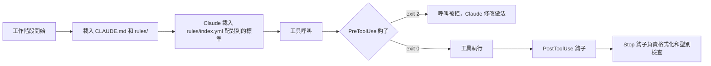

<div align="center">

<strong>一套立場鮮明的 Claude Code 工程設定。規則、執行時鈎子和斜線指令技能，讓 CLI 變成一位嚴格的結對程式員。</strong>

[English](README.md) | [日本語](README.ja.md) | [简体中文](README.zh-Hans.md) | 繁體中文 (香港)

[](https://github.com/gufranco/claude-engineering-rules/actions/workflows/ci.yml)
[](https://github.com/gufranco/claude-engineering-rules/actions/workflows/mutation-method-scan.yml)
[](https://github.com/gufranco/claude-engineering-rules/releases/latest)
[](https://github.com/gufranco/claude-engineering-rules/actions/workflows/ci.yml)
[](https://scorecard.dev/viewer/?uri=github.com/gufranco/claude-engineering-rules)
[](LICENSE)

</div>

<p align="center">
  <a href="#快速開始">快速開始</a> |
  <a href="CONTRIBUTING.md">參與貢獻</a> |
  <a href="SECURITY.md">安全</a> |
  <a href="https://github.com/gufranco/claude-engineering-rules/issues">Issues</a> |
  <a href="https://github.com/gufranco/claude-engineering-rules/releases">版本發佈</a>
</p>

49 條常駐規則、143 份按需載入的標準、42 個技能、98 個鈎子和 18 個代理，另加一份涵蓋 71 個類別、共 905 項的審查清單。

---

## 用法

防護欄不需要任何指令。每一次 Bash、Write 和 Edit 呼叫在執行前都會先經過鈎子，被攔截的呼叫不會執行：Claude 讀到拒絕的原因後會改變做法。用本儲存庫的一個測試夾具，可以在 shell 中重現同樣的拒絕：

```console
$ python3 ~/.claude/hooks/dangerous-command-blocker.py < ~/.claude/tests/fixtures/bash-force-push.json
BLOCKED: Use --force-with-lease instead of --force
Command: git push --force origin main
$ echo $?
2
```

工作流程就是技能，在工作階段中以斜線指令輸入：

```text
/plan add rate limiting to the login endpoint
/review --local
/ship commit --push
/investigate why the import job times out
```

## 運作方式

每一層都會截住上一層遺漏的問題。



| 層 | 強制執行的內容 | 執行時機 |
|:------|:-----------------|:-------------|
| [`CLAUDE.md`](CLAUDE.md) + [`rules/`](rules) | 常駐的工程規則、語氣、防幻覺、驗證關卡 | 每一次對話 |
| [`standards/`](standards) + [`rules/index.yml`](rules/index.yml) | 按觸發關鍵字載入的專業知識 | 任務需要時 |
| [`hooks/`](hooks) | 在執行時攔截破壞性指令、密鑰和禁用模式 | 每一次工具呼叫之前 |
| [`skills/`](skills) | 有文件說明的多步驟工作流程：ship、review、plan、audit | 用戶呼叫 `/<name>` 時 |
| [`agents/`](agents) | 專注於特定審查任務的子代理 | 明確委派時 |
| [`checklists/`](checklists) | 涵蓋程式碼、基礎設施和流程的 905 項審查清單 | 審查時按需使用 |

## 包含的內容

### 常駐規則

[`rules/`](rules/) 中有 49 條規則，[`rules/lang/`](rules/lang/) 中另有 5 條。[`rules/`](rules/) 下的每個檔案都會以簡短核心的形式載入每一次對話，包括語言檔案和表格後列出的 6 條。每個核心只保留會改變日常任務行為的義務，並連結到 [`standards/`](standards/) 中的全文，因此常駐集合維持在 57 個檔案、97,312 個字元，低於 CI 強制執行的 120,000 字元預算，也低於執行環境 150,000 字元的上限。

| 規則 | 涵蓋內容 |
|:-----|:---------------|
| [`architecture-defaults`](rules/architecture-defaults.md) | 由六個問題組成的架構關卡。在任務需要時強制載入 DDD、六角形架構、冪等性、去重和狀態機的標準。也是硬性規則的基準 |
| [`code-style`](rules/code-style.md) | DRY、SOLID、KISS、不可變性、錯誤分類、品牌型別、完整性規則、平台優先的 API 選擇、禁止註解的政策。禁止註解只會讓步於明確要求 JSDoc 或文件註解的項目指令檔 |
| [`design-philosophy`](rules/design-philosophy.md) | 複雜性的表現和根源、深模組、策略與戰術、設計兩次、警號、設計品味 |
| [`testing`](rules/testing.md) | 整合測試優先、嚴格的 mock 政策、不加標籤的 Arrange-Act-Assert 結構、預期值來自獨立來源而非重算程式碼邏輯、假數據、確定性測試。絕不為了讓改動通過而削弱、略過或刪除斷言、測試案例或測試檔案。每個手寫檔案在沒有任何排除指令的情況下覆蓋率都是 100%，每個面向用戶的入口和每個需求情境都有端對端測試 |
| [`security`](rules/security.md) | 密鑰、認證、加密、數據私隱、審計日誌、供應鏈 |
| [`git-workflow`](rules/git-workflow.md) | Conventional Commits、分支、CI 監察，以及在描述中寫明改動前後的 Evidence 和 Merge Danger 判斷（單向門或雙向門、影響範圍）的 PR |
| [`verification`](rules/verification.md) | 以證據為本的完成關卡、回覆自我檢查，以及在任何分析的第一遍就完整閱讀範圍內的每個檔案 |
| [`writing-precision`](rules/writing-precision.md) | 所有文字輸出的精確度關卡，亦包括代詞規範、主動語態、語氣調校、每個陳述的決定都附上背後的量度，以及術語取自程式碼或用戶而非自創 |
| [`anti-slop`](rules/anti-slop.md) | 位於禁用語句清單之下的結構層。三項判定測試、取自 WikiProject AI Cleanup 實地指南的修辭和文法痕跡目錄、人類技術寫作的正面特徵，以及防止矯枉過正的約束 |
| [`normative-keywords`](rules/normative-keywords.md) | BCP 14（RFC 2119 和 RFC 8174）關鍵字詞彙表。以小寫為主，只有在正確性、安全、數據完整性和不可逆性至關重要時才選用大寫 |
| [`repo-analysis`](rules/repo-analysis.md) | 外部儲存庫要複製到臨時目錄，不要透過 `gh` 或 raw URL 擷取檔案。訂明必須的淺層複製流程、Issue、PR 和搜尋操作的例外，以及給子代理的指示 |
| [`pre-flight`](rules/pre-flight.md) | 重複檢查、市場研究、架構契合度、介面驗證、對從現有程式碼複製的門檻值作語義驗證，以及在第一次編輯前建立測試基線並閱讀相關測試 |
| [`surgical-edits`](rules/surgical-edits.md) | 每一行改動都可追溯到要求 |
| [`ai-guardrails`](rules/ai-guardrails.md) | AI 輸出的審查、生成前先計劃、多代理驗證 |
| [`memory-supersede`](rules/memory-supersede.md) | 項目和回饋記憶以取代而非刪除的方式更新 |
| [`language`](rules/language.md) | 強制回覆語言：所有輸出都用英文 |
| [`smart-questions`](rules/smart-questions.md) | 提問格式、提出選項時必須附上建議、狀態報告、以 FIXED、RESOLVED、DONE 收尾、Tatham 有關錯誤報告的要點 |
| [`found-fix`](rules/found-fix.md) | 驗證過程中發現的任何問題都屬於目前任務的範圍。禁止把修正推到之後工作階段的推搪說法 |
| [`user-commands-one-line`](rules/user-commands-one-line.md) | 交給用戶執行的指令寫成一行安全的指令：嚴格模式的子 shell、以 `&&` 連接的步驟、按結束碼失敗的檢查，每次遞迴刪除都用 `${VAR:?}`。不可逆步驟之前需要用戶判斷的結果獨立交出，不與變更串在一起 |
| [`same-turn-persistence`](rules/same-turn-persistence.md) | 收到糾正的那一輪在結束前必須寫入檔案。自己發現的錯誤和用戶指出的錯誤同樣處理，寫入針對的是根本行為而非表面症狀，准入門檻防止強制記錄令設定膨脹 |
| [`rule-provenance`](rules/rule-provenance.md) | 規則的來歷記錄在私人的 vault 中，從不放進儲存庫：檔案只陳述目前的規則。教訓先記錄下來，第三次重現時才升格為規則，不可逆、無聲或災難性的失誤除外 |
| [`relay-not-source`](rules/relay-not-source.md) | 子代理的報告、搜尋片段或摘要都是轉述。轉述不只會弄亂內容，也會弄亂引用的位置，因此一個具體的說法讀起來正確，卻可能指向錯誤的行、時間戳或記錄 |
| [`agent-operating-limits`](rules/agent-operating-limits.md) | 保底上限和預算的分別、附有量度的輪次上限、超出部分要報告而非丟棄的配額、被拒呼叫和無條件注入上下文的成本，以及無法執行的檢查一律當作失敗 |
| [`deviation-waivers`](rules/deviation-waivers.md) | 偏離規則是容許的，靜靜偏離則不行。一份結構化的豁免，寫明範圍、批准人、替代方案和覆檢條件，它回答的問題與機械式繞過不同，因此兩者有別。項目本身的指令檔可以在該項目內明確凌駕全局規則，但不能越過安全、法律、數據遺失、驗證和誠實這幾條底線 |
| [`no-ai-process-leak`](rules/no-ai-process-leak.md) | 從提交訊息、PR 描述、公開文件和給同事的訊息中排除階段編號、計劃檔案路徑、規格資料夾連結、誇張字眼和自我批評 |
| [`no-committed-symlinks`](rules/no-committed-symlinks.md) | 任何儲存庫都不追蹤符號連結。共用原始碼透過建置引用，兩處都需要的檔案只提交一次，來自子模組的檔案按其本身位元組提交 |
| [`doc-truth`](rules/doc-truth.md) | 描述程式碼的文件就是對程式碼的聲明。令聲明變假的改動要在同一次提交中修正。在 `git commit` 時進行四項機械上肯定的檢查；歷史記錄不在此列。如果項目文件描述的慣例程式碼已一貫不再遵守，就視為過時：以程式碼為準，並報告每一處不一致 |
| [`markdown-links`](rules/markdown-links.md) | 公開 Markdown 中提到的每個檔案都是可點擊的連結。由驗證器和 PreToolUse 鈎子強制執行 |
| [`living-specs`](rules/living-specs.md) | 非簡單的改動要維護 `specs/current/` 中活的行為規格：需求、Given/When/Then 情境、放在本地工作區計劃資料夾中的 ADDED、MODIFIED、REMOVED 差異，以及把完成的改動併入規格的收尾合併 |
| [`project-workspace`](rules/project-workspace.md) | 每個儲存庫都把用戶的工作資料放在一個從不提交的本地工作區：項目不使用 `<repo>/docs/` 時用它，否則用 `<repo>/.work/`，只透過 `.git/info/exclude` 忽略。當中的 `PROMPT.md` 一直可以直接貼到新的工作階段。README 是項目唯一的事實來源 |
| [`compliance-defaults`](rules/compliance-defaults.md) | 合規規則系列的總綱。採用適用規則中最嚴格的一條，已公佈的標準在生效日期前已視為具約束力 |
| [`accessibility-defaults`](rules/accessibility-defaults.md) | 以 WCAG 2.2 AA 為底線，在不衝突時採用 AAA。鍵盤可操作、44x44 的觸控範圍、減少動畫、禁止圖片驗證碼 |
| [`frontend-render-gate`](rules/frontend-render-gate.md) | 對渲染輸出的改動在真正渲染之前都算未驗證。點出靜態審查和 jsdom 觸及不到的盲區：層疊結果、繪製次序、無障礙樹、焦點次序、第三方 iframe。為證據分級，優先擴展項目本身的瀏覽器或模擬器測試框架。凡涉及可見改動的 PR、審查回覆、Issue 和工作單評論，都要附上高解析度的 Before 和 After 截圖，網頁、流動裝置、桌面 GUI 和 TUI 一律適用 |
| [`ai-review-convergence`](rules/ai-review-convergence.md) | 限制自動審查者發表評論時的循環。機械人評論不可能歸零，所以停止條件是出現一輪沒有經驗證失誤的審查。修正前先過失誤情境關卡，回應的提交只作最小的差異 |
| [`pr-comment-discipline`](rules/pr-comment-discipline.md) | 拉取請求上唯一可以發佈的評論，是在別人開啟的討論串內的回覆。不寫總結正文，不寫對話評論，不回覆提交評論，亦不以任何長度回覆機械人。機械人的討論串要讀，屬實就修正，然後靜靜解決。回覆最多四句，能在目前改動中修好的就在這裏修，不另行記錄 |
| [`functional-index-fidelity`](rules/functional-index-fidelity.md) | 只有當查詢表達式與索引表達式完全相同時，數據庫才會使用表達式索引，所以一個等價的改寫會靜靜變成順序掃描，既不報錯，也沒有測試失敗 |
| [`privacy-defaults`](rules/privacy-defaults.md) | 在所有市場預設採用 GDPR 級別。合法依據、30 天內回應 DSAR、真正的刪除、24 個月的保留期，假名化數據視作個人數據 |
| [`cookie-discipline`](rules/cookie-discipline.md) | 每個非必要 Cookie 都須選擇加入，全部拒絕與全部接受的操作次數相同，不設 Cookie 牆，不預先剔選 |
| [`cybersecurity-baseline`](rules/cybersecurity-baseline.md) | 前端安全預設：以 nonce 為本的 CSP、TLS 1.3、NIST 密碼政策、工作階段逾時、外洩通知時限 |
| [`consumer-defaults`](rules/consumer-defaults.md) | 14 天撤回期、一開始就顯示總價、取消與訂閱的操作次數相同、禁止虛假短缺和虛假評價 |
| [`children-privacy-defaults`](rules/children-privacy-defaults.md) | 剖析和廣告以 18 歲為界，帳戶以 16 歲為界，13 歲以下須取得可核實的家長同意。禁止針對未成年人的誘導使用模式 |
| [`ai-compliance-defaults`](rules/ai-compliance-defaults.md) | 歐盟《人工智能法》的風險等級、在模型輸出上作可見的披露、對自動化決定作人手審查、每年一次的偏見審計 |
| [`anti-spam-defaults`](rules/anti-spam-defaults.md) | 推廣須選擇加入、一鍵取消訂閱、永久的取消訂閱名單、嚴格區分交易類和推廣類訊息 |

另外，[`rules/lang/`](rules/lang/) 中有 5 個特定語言的檔案：`typescript-immutability`、`typescript-types`、`typescript-strict`、`orm-migrations`、`python`。

[`rules/`](rules/) 中還有 6 條規則，與其他規則一樣在每個工作階段載入，只在條件成立時適用；每條在 [`rules/index.yml`](rules/index.yml) 中都有一份載有全文的按需標準：處理項目不能分發、須由用戶自行提供的檔案的 [`artifact-identity`](rules/artifact-identity.md)，以無介面或最小化方式而非全螢幕啟動模擬器的 [`emulator-runs`](rules/emulator-runs.md)，把項目所有依賴都放進 Docker 映像檔而不放在主機上的 [`docker-dependencies`](rules/docker-dependencies.md)，以及 [`knowledge-notes`](rules/knowledge-notes.md)、[`everyday-engineering`](rules/everyday-engineering.md) 和 [`project-glossary`](rules/project-glossary.md)。

### 按需載入的標準

[`standards/`](standards/) 中有 143 份標準。[`rules/index.yml`](rules/index.yml) 中的每個項目都宣告了觸發關鍵字，任務配對時只載入相關的標準。

主題包括：API 設計、認證、快取、程式碼審查、並行與競爭條件、容器安全、合約測試、數據庫、DDD、除錯、分散式系統、冪等性與去重、各語言的不可變性、文件、前端、GraphQL、六角形架構、國際化、基礎設施、低延遲工程、訊息佇列、流動裝置、單一儲存庫、可觀察性、撰寫代理指令檔、OpenTelemetry、效能、Postgres、PR 評論渠道、印刷設計、私隱、Redis、韌性、密鑰管理、SRE、狀態機、十二要素、TypeScript 5.x、WebSocket、零停機部署等。

### 技能

[`skills/`](skills/) 中有 42 個技能。每個技能都是一個載有 `SKILL.md` 的資料夾，按照 [`tools/lint-skills.py`](tools/lint-skills.py) 在 CI 中以 `--strict` 強制執行的六部分範本記錄步驟、輸出格式和規則：Overview、When to Use、Process、Common Rationalizations、Red Flags、Verification。這個檢查工具亦會把 frontmatter 當作嚴格的 YAML 解析，並拒絕會被 ` #` 靜靜截斷的描述。

**技能有兩類。** 由模型呼叫的技能會把附有觸發字句的描述放進每個工作階段的上下文，所以 Claude 可以自行使用。由用戶呼叫的技能設定 `disable-model-invocation: true`：它的描述不會進入上下文，在輸入之前不會產生任何成本，也只有用戶可以啟動。需要手動觸發的都是用戶呼叫的技能：`/deploy`、`/cleanup`、`/hotfix`、`/guard`、`/setup`、`/skill-new`、`/incident`、`/readme`、`/gan`、`/migrate`、`/assessment`、`/module-audit`、`/benchmark` 和 `/session-log`。需要被其他技能呼叫的技能維持由模型呼叫，所以 `/pr-summary` 和 `/fix-issue` 都是這樣：`/morning` 會把工作交給它們。

| 技能 | 作用 |
|:------|:-------------|
| [`/ship`](skills/ship/SKILL.md) | 交付流程：提交、PR、發佈、CI 檢查、工作樹 |
| [`/review`](skills/review/SKILL.md) | 三輪程式碼審查、QA 分析、視覺審計 |
| [`/respond`](skills/respond/SKILL.md) | 處理收到的審查評論：分類、驗證、草擬回覆、本地驗證、發佈、解決、監察 CI |
| [`/assessment`](skills/assessment/SKILL.md) | 架構完整性審計。找出欠缺的模式、預先埋下的缺陷和可以出色發揮的機會。以 [`tools/slop-scan.py`](tools/slop-scan.py) 為 AI 冗詞評分並以刪除的方式去除，這個工具會在每個 Markdown 檔案和一段提交範圍上執行 `ai-slop-blocker` 的偵測器。輸出一份 `/respond` 可以讀取的機器可讀問題表。亦會標出與標準徽章區塊不一致的 README |
| [`/plan`](skills/plan/SKILL.md) | 包含需求探索、範圍覆檢、ADR 和骨架生成的規格資料夾 |
| [`/audit`](skills/audit/SKILL.md) | 安全審計、威脅建模、供應鏈檢查。`/audit trust` 借助 [`trust-patterns.md`](skills/audit/trust-patterns.md) 的 IOC 目錄，為不可信的項目加入安全掃描 |
| [`/test`](skills/test/SKILL.md) | 測試執行、效能、lint、CI 冒煙測試、樁程式碼生成 |
| [`/deploy`](skills/deploy/SKILL.md) | 合併後的落地和金絲雀監察 |
| [`/investigate`](skills/investigate/SKILL.md) | 以假設驗證進行有系統的除錯，最多嘗試三次 |
| [`/research`](skills/research/SKILL.md) | 附實體辨識和引用規範的多來源研究 |
| [`/design`](skills/design/SKILL.md) | 設計諮詢、多個方案、設計系統工作 |
| [`/refactor`](skills/refactor/SKILL.md) | 保持行為不變的引導式重構 |
| [`/migrate`](skills/migrate/SKILL.md) | 配合漸進測試的框架或程式庫遷移 |
| [`/infra`](skills/infra/SKILL.md) | 容器編排、IaC、數據庫遷移 |
| [`/hotfix`](skills/hotfix/SKILL.md) | 以加速流程進行的生產環境緊急修正 |
| [`/incident`](skills/incident/SKILL.md) | 收集事故背景、不追究責任的事後檢討 |
| [`/resolve`](skills/resolve/SKILL.md) | 附驗證的合併衝突處理 |
| [`/cleanup`](skills/cleanup/SKILL.md) | 清理過期的分支、PR 和工作樹 |
| [`/checkpoint`](skills/checkpoint/SKILL.md) | 跨工作階段儲存和恢復狀態。在儲存庫內會寫入工作區的 `PROMPT.md` |
| [`/explain`](skills/explain/SKILL.md) | 配合 Mermaid 圖解釋程式碼 |
| [`/fix-issue`](skills/fix-issue/SKILL.md) | 按編號修正 GitHub Issue，並附上測試 |
| [`/guard`](skills/guard/SKILL.md) | 凍結目錄並強制限定範圍 |
| [`/benchmark`](skills/benchmark/SKILL.md) | 以基線偵測效能倒退 |
| [`/profile`](skills/profile/SKILL.md) | N+1 查詢、欠缺的索引、複雜度熱點 |
| [`/onboard`](skills/onboard/SKILL.md) | 程式碼庫上手：架構圖和 Start Here 指南。第 0 階段在執行可信度掃描前先詢問。`--trust` 和 `--verify` 旗標可以不經互動預先決定 |
| [`/gan`](skills/gan/SKILL.md) | 按評分準則建構功能的生成器與評估器迭代循環。反覆執行規劃者、生成者和評估者子代理，直至達到門檻 |
| [`/pr-summary`](skills/pr-summary/SKILL.md) | 附審查人建議的 PR 摘要 |
| [`/readme`](skills/readme/SKILL.md) | 分析程式碼庫生成 README。每個說法都源自程式碼，英文檔案必須通過 [`tools/slop-scan.py`](tools/slop-scan.py)，每次執行亦會寫出附語言切換的日文、簡體中文和香港繁體中文譯本；`--languages es` 會加入西班牙文。頁首徽章由 [`tools/readme-badges.py`](tools/readme-badges.py) 生成：CI、發佈、覆蓋率、OpenSSF Scorecard 和授權，按此次序，flat-square 樣式 |
| [`/retro`](skills/retro/SKILL.md) | 提取模式的工作階段檢討 |
| [`/morning`](skills/morning/SKILL.md) | 跨帳戶的工作分流。逐一巡查每個已認證的 git 身份及其組織，按誰被卡住排序並報告，然後在逐項取得同意後處理佇列。執行期間合併會被機械式攔截 |
| [`/session-log`](skills/session-log/SKILL.md) | 用於交接的工作階段活動日誌 |
| [`/setup`](skills/setup/SKILL.md) | 互動式的項目環境設定 |
| [`/tdd`](skills/tdd/SKILL.md) | 測試驅動開發循環。縱向切分，不採用先寫完所有測試再寫完所有實作的橫向做法 |
| [`/zoom-out`](skills/zoom-out/SKILL.md) | 從戰術工作退後一步，轉向策略角度 |
| [`/spike`](skills/spike/SKILL.md) | 解答一個設計問題的即棄產物，有兩條路線（狀態分支的終端程式、視圖分支的並排變體） |
| [`/module-audit`](skills/module-audit/SKILL.md) | 尋找淺模組的程式碼庫審計，提供改動前後的 Mermaid 建議和刪除測試的分類 |
| [`/concise-mode`](skills/concise-mode/SKILL.md) | 可選的簡潔回覆模式。去掉客套和填充字句，保留程式碼區塊、錯誤字串和破壞性操作的確認 |
| [`/cross-model`](skills/cross-model/SKILL.md) | 在重大決定上，特別是很有把握的時候，請另一個模型提供正交的推理。會找出已安裝的模型 CLI 而非預設某個供應商，並把答案當作需要重新驗證的轉述 |
| [`/brain`](skills/brain/SKILL.md) | 讀寫第二大腦知識庫。包括 capture、ingest、ask、link、health、refresh、falsify、wrong、compile、eval。`falsify` 找出錯誤而不只是過時的事實；`wrong` 連同原因記錄一次失手，令主要的失誤模式浮現出來 |
| [`/interview-me`](skills/interview-me/SKILL.md) | 針對描述不足的要求，一次一條問題地釐清意圖，在動手實作前把把握提升到很高 |
| [`/aside`](skills/aside/SKILL.md) | 凍結目前的任務，在不改變狀態的情況下回答一條旁支問題，然後從停下的地方原樣繼續 |
| [`/skill-new`](skills/skill-new/SKILL.md) | 以強制的 frontmatter 和章節範本建立新技能，然後以技能檢查工具驗證 |

### 鈎子

[`hooks/`](hooks/) 中有 98 個鈎子，透過 [`settings.json`](settings.json) 接駁。每個鈎子在工具呼叫之前、之後或前後執行。

**繞過渠道。** 每個鈎子都支援兩種渠道，任何一種都可以放行，兩者可以並存。

1. 父 shell 的環境變數 `<NAME>_DISABLE=1`（在啟動 Claude Code 之前設定）。
2. 工作階段內的檔案登記冊 `~/.claude/.bypass-state.json`。在執行中的工作階段以 `python scripts/bypass.py set <hook> --ttl 600 --reason "<why>"` 啟用，以 `python scripts/bypass.py clear [<hook>]` 清除，以 `list` 查看。TTL 限制在 [60, 3600] 秒之間；60 分鐘的上限是刻意的，忘記清除的繞過不會一直生效。萬用項目（`set "*"`）會在到期前放行所有鈎子，預設 TTL 為 5 分鐘，上限為 20 分鐘。讀取端執行相同的上限，所以手寫了遙遠到期時間的項目會被忽略，設定保護亦會攔截對登記冊檔案的 Write 和 Edit。檔案權限為 0600。參閱 [`hooks/_lib/bypass.py`](hooks/_lib/bypass.py)。

**攔截訊息的格式。** 新的鈎子透過 [`hooks/_lib/output.py`](hooks/_lib/output.py) 的 `block(...)` 輸出 stderr。固定次序的五個部分（`What was detected`、`Why this rule exists`、`How to fix`、`If the rule does not apply here`、`Decision guidance for Claude`），四個決定動詞之一（`STOP-AND-ASK`、`FIX-AND-RETRY`、`BYPASS-ONCE`、`BYPASS-WITH-REASON`），每則訊息都寫明兩種繞過渠道。驗證器是 `output.validate_block_message(...)`。完整例子見 [`hooks/large-file-blocker.py`](hooks/large-file-blocker.py)。

**加入鈎子。** 按次序完成五個步驟。略過第 2 步會造成不易察覺的失誤：鈎子在執行，對每個載荷都以 exit 0 結束，看起來像是通過了。

1. 先在 `tests/hooks/<hook-name>/` 下編寫測試套件。在有相應的測試之前，[`hooks/tdd-gate.py`](hooks/tdd-gate.py) 會攔截原始碼檔案。夾具 `tool_use`、`assert_blocks`、`assert_allows` 和 `run_hook` 來自 [`tests/conftest.py`](tests/conftest.py)；自行撰寫的子程序呼叫必須傳遞 `COVERAGE_PROCESS_START` 和 `PYTHONPATH`，否則那些程式碼行永遠不會被量度。
2. 在 [`hooks/_lib/hook_profile.py`](hooks/_lib/hook_profile.py) 的 `STANDARD_HOOKS` 中登記鈎子 ID。對於目前設定檔沒有列出的 ID，`should_run` 會傳回 False，所以未登記的鈎子會靜靜地甚麼都不做。
3. 在 [`settings.json`](settings.json) 中接駁配對器，每個工具一個項目：`Write`、`Edit`、`MultiEdit`。
4. 從 `_lib` 匯入共用的基礎設施：用於 `read_hook_payload` 的 `_lib.hook_input`（它會攔截守衛讀不到的載荷），用於第三方指令的 `_lib.suppression`，用於檔案登記冊的 `_lib.bypass`，用於審計記錄的 `_lib.audit_log`，用於 `block(...)` 和 `warn(...)` 的 `_lib.output`，以及在配對子指令前去掉 `-C`、`-c` 等 git 全局選項的 `_lib.git_invocation`。模組是 `_lib.suppression`，絕不是光寫 `suppression`；光寫的方式無法解析，後備邏輯會靜靜停用指令支援。
5. 偵測量大的鈎子先以警告模式推出，把攔截放在環境變數 `<NAME>_ENFORCE=1` 之後，待掌握了在真實程式碼上的誤報率再升級。

| 鈎子 | 觸發 | 作用 |
|:-----|:--------|:-------------|
| [`accessibility-mechanical-checks.py`](hooks/accessibility-mechanical-checks.py) | PreToolUse Write/Edit/MultiEdit | 捕捉可以從原始碼判定的 WCAG 問題：沒有 `alt` 的圖片、沒有無障礙名稱的純圖示按鈕、沒有標籤的輸入欄、在沒有 role 或鍵盤處理的 `div` 上綁定點擊、大於零的 `tabindex`、欠缺 `lang`。完整讀取附箭嘴函數和巢狀表達式的 JSX 標籤，忽略 `<Input>` 這類首字母大寫的元件，並遵從指定了相應 `jsx-a11y` 規則的 `eslint-disable-next-line`。繞過：`ACCESSIBILITY_CHECKS_DISABLE=1` |
| [`ai-attribution-blocker.py`](hooks/ai-attribution-blocker.py) | PreToolUse Bash/Write/Edit | 攔截提交和 PR 中的 AI 合著者附註、`Claude-Session` 附註和 claude.ai 工作階段連結，以及外發提交帶有這些內容的 `git push` |
| [`ai-disclosure-checks.py`](hooks/ai-disclosure-checks.py) | PreToolUse Write/Edit/MultiEdit | 攔截沒有可見 AI 披露就渲染模型輸出的做法，以及沒有標明身份的聊天機械人介面。歐盟《人工智能法》第 52 條、加州 SB 942。繞過：`AI_DISCLOSURE_DISABLE=1` |
| [`ai-process-leak-blocker.py`](hooks/ai-process-leak-blocker.py) | PreToolUse Bash/Write/Edit | 攔截提交、PR、發佈說明和程式碼註解中的 AI 工作過程用語。捕捉階段編號、計劃檔案路徑的引用、指向規格資料夾或本地工作區的連結，以及誇張字眼。在原始碼檔案中只掃描註解，所以步驟標籤這類產品字串可以通過。寫入工作區或工作階段草稿區的內容不受限制，只有當發佈指令位於引號之外時，Bash 指令才算作發佈 |
| [`ai-review-request.py`](hooks/ai-review-request.py) | PostToolUse Bash | 在目前帳戶建立的開放 PR 上執行 `gh pr create`、`gh pr ready` 或 `git push` 之後，要求儲存庫支援的所有 AI 審查：在 Claude App 以手動模式執行的地方發一次 `@claude review always`，在工作流程以標籤控制的地方加上 `claude-review` 標籤。CodeRabbit 和 Codex 每次推送都會審查，所以不作處理。從不攔截，只報告一行 `ai-review:`。亦可作為 CLI 使用：`--repo owner/name --pr N --account login [--dry-run]`。把看到的每個新建拉取請求記入按工作階段劃分的台賬，供 `pr-comment-discipline.py` 讀取。繞過：`AI_REVIEW_REQUEST_DISABLE=1` |
| [`ai-slop-blocker.py`](hooks/ai-slop-blocker.py) | PreToolUse Bash/Write/Edit/MultiEdit | 攔截能避過禁用語句清單的結構性冗詞痕跡：否定式對偶、誇大重要性、附加評價的分詞短語、不具名的權威、含糊的推測、取代 `is` 和 `has` 的推銷動詞、開場鋪排、結尾覆述、聊天殘留、未填寫的佔位符、彎引號，以及搜尋經過的敘述，例如拒絕存取的網站或檢查的日期。粗體標籤的清單項目和標題只在公開的 PR 評論中攔截。編號為 `SLOP001` 至 `SLOP015`。搜尋經過的敘述在知識庫、項目工作區和 `PROMPT.md` 中是容許的。配對前會遮蓋程式碼片段，每個偵測器都在 rules、standards、checklists、skills、agents、docs 目錄和根目錄文件中的 333 個 Markdown 檔案上調校過。繞過：`AI_SLOP_DISABLE=1` |
| [`as-any-blocker.py`](hooks/as-any-blocker.py) | PreToolUse Write/Edit | 攔截 TypeScript 的 `as any` 和泛型中的 `any`。沒有放行標記，只遵從第三方工具的指令。 |
| [`aws-profile-guard.py`](hooks/aws-profile-guard.py) | PreToolUse Bash | 攔截沒有 `--profile` 的 `aws configure set` |
| [`banned-phrases-blocker.py`](hooks/banned-phrases-blocker.py) | PreToolUse Bash/Write/Edit | 攔截 PR 和文件中的口語化客套和戰術性誇張 |
| [`banned-prose-chars.py`](hooks/banned-prose-chars.py) | PreToolUse Write/Edit/Bash | 攔截長破折號、短破折號、正文中的圓括號、表情符號、ASCII 藝術，以及在 Markdown 正文中以帶空格的連字號代替破折號 |
| [`bulk-resolve-blocker.py`](hooks/bulk-resolve-blocker.py) | PreToolUse Bash | 攔截在 GitHub 或 GitLab 上對多個討論串循環呼叫 `resolveReviewThread` |
| [`comment-blocker.py`](hooks/comment-blocker.py) | PreToolUse Write/Edit/MultiEdit/Bash | 在它能辨識的每種語言中攔截在原始碼加入註解：C 系、Python、shell、YAML、Make、Docker、Terraform、SQL、Lua、Clojure、TeX、Vim script、HTML 及其範本方言、CSS、按方言區分的組合語言、Jupyter 程式碼儲存格等，按副檔名、檔案名稱、shebang 或內容辨識。docstring 和文件註解區塊亦算註解。編輯會與磁碟上的檔案比對，所以只報告新加的註解。在 Bash 的 `git commit` 上，它會把每個已暫存的檔案與 `HEAD` 比對掃描，從而捕捉在 Write 和 Edit 工具以外寫入的內容。合併期間，會略過合併從另一個父提交原樣取來的檔案，因為合併沒有在其中寫入任何內容。本機的 `comment-waivers.txt`（從 [`comment-waivers.example.txt`](comment-waivers.example.txt) 複製）中列出的路徑不檢查。不受限制的有：`eslint-disable`、`@ts-expect-error`、`noqa` 和 action 版本固定等工具指令，測試檔案中光寫的 `Arrange`、`Act`、`Assert` 標記，以及 `.env.example` 檔案。營運繞過：`COMMENT_BLOCKER_DISABLE=1` |
| [`test-aaa-markers.py`](hooks/test-aaa-markers.py) | PreToolUse Write/Edit/MultiEdit/Bash | 要求 Python、JS/TS、Go 和 bats 中每個新增或修改的測試都帶有光寫的 `Arrange`、`Act`、`Assert` 標記，各出現一次並依次排列，組成以一個空行分隔的三個區塊。不檢查沒有改動的舊測試。在 Bash 的 `git commit` 上檢查已暫存的檔案，略過合併從另一個父提交原樣取來的檔案。繞過：`TEST_AAA_MARKERS_DISABLE=1` |
| [`compact-context-saver.py`](hooks/compact-context-saver.py) | SessionStart / PreCompact / PostCompact | 按項目在上下文壓縮前後保留 git 狀態 |
| [`config-protection.py`](hooks/config-protection.py) | PreToolUse Write/Edit/MultiEdit | 攔截對 tsconfig、eslint、ruff、mypy 等 lint、格式化和型別檢查設定的編輯。迫使修正程式碼，而不是放寬設定 |
| [`console-log-blocker.py`](hooks/console-log-blocker.py) | PreToolUse Write/Edit | 攔截非測試程式碼中的 `console.*`。沒有放行標記，只遵從第三方工具的指令。 |
| [`conventional-commits.py`](hooks/conventional-commits.py) | PreToolUse Bash | 驗證 Conventional Commits 格式 |
| [`commit-test-weakening.py`](hooks/commit-test-weakening.py) | PreToolUse Bash | 把所有定義了測試案例的已改動和未追蹤測試檔案加總，與上一次提交相比，測試案例或斷言減少、或略過標記增加的提交會被攔截。它讀取工作區，因此用 shell 腳本刪除的測試和用 Edit 刪除的一樣會被發現，移到另一個檔案的測試則互相抵消。繞過方式為 `COMMIT_TEST_WEAKENING_DISABLE=1` |
| [`coverage-exclusion-guard.py`](hooks/coverage-exclusion-guard.py) | PreToolUse Write/Edit/MultiEdit | 攔截在原始碼加入覆蓋率排除指令的編輯，例如 `istanbul ignore`、`c8 ignore`、`pragma: no cover`、`#[coverage(off)]` 或 `LCOV_EXCL_LINE`，亦攔截把覆蓋率設定的門檻寫到 100 以下的編輯。只有生成的程式碼和第三方程式碼的路徑可以排除，所以新增 omit 或 exclude 項目時會要求確認。文字檔案不受限制。繞過：`COVERAGE_EXCLUSION_GUARD_DISABLE=1`。 |
| [`dangerous-command-blocker.py`](hooks/dangerous-command-blocker.py) | PreToolUse Bash | 190 種模式：破壞性的 shell 指令、反向 shell、雲端資源刪除、IaC 的 destroy。傳給 `cat`、`tee`、`git`、`gh` 或 `glab` 的 heredoc 正文屬於數據，不作配對；傳給 shell 的正文仍會配對。Docker 或 Podman 的 `-f`、`-a`、`-v` 等旗標只有作為同一次呼叫中的獨立參數時才計算；`.git`、`.env`、`.claude` 等受保護路徑只有作為 `rm` 呼叫本身的參數時才計算；`.git` 只有作為完整的路徑組成部分時才計算，所以 `name.git` 這類裸鏡像是普通路徑；刪除字面路徑 `/tmp` 或 `/private/tmp` 下的 `.env` 檔案是容許的，除非路徑以 `..` 跳出。配對前會去掉 `-C`、`-c` 等 git 全局選項，所以 `git -C <dir> push --force` 與一般寫法一樣會被攔截，`-f` 或 `-fu` 這類組合亦算強制推送。只有當指令的每一段都是清理建置目錄時，這種清理才可以略過其餘檢查。不是有效 JSON 的輸入會被攔截。當推送的目標儲存庫（會追蹤 `cd` 和 `-C`）列在本機的 `solo-repos.txt` 中時，容許推送到受保護分支，這個檔案以 [`solo-repos.example.txt`](solo-repos.example.txt) 為範本；無法確定目標的推送不計在內。刪除測試檔案，以及以 `find`、`grep -r`、`rg` 或 `fd` 搜尋 `/` 或主目錄，會彈出確認，但未被追蹤且不在任何提交中的測試檔案除外 |
| [`doc-sync-guard.py`](hooks/doc-sync-guard.py) | PreToolUse Bash | 攔截暫存差異會令現有文件變假的 `git commit`。四項肯定的檢查：程式碼讀取了 `.env.example` 沒有列出的變數，以及刪除了已追蹤 Markdown 仍在提及的匯出、CLI 旗標或套件腳本。檢查前置的 `cd` 或 `git -C` 指定的儲存庫，並在 `commit -a` 時包括未暫存的改動。變更記錄、ADR 和規格作為歷史記錄不在此列。繞過：`DOC_SYNC_DISABLE=1` |
| [`frontend-render-gate.py`](hooks/frontend-render-gate.py) | PreToolUse Bash, Linear `save_issue` and `save_comment` | 攔截改變渲染輸出（`.tsx`、`.html`、`.dart`、樣式、主題標記、`*View.swift` 或 `*Screen.kt` 等原生視圖、`.qml` 或 `.xaml` 等桌面版面，以及匯入終端 UI 程式庫的原始碼）卻沒有觸及任何渲染層檢查（e2e 或瀏覽器測試套件、XCUITest、`androidTest`，或終端快照）的 `git commit`。`*.spec.tsx` 單元測試不算。層疊結果、繪製次序、無障礙樹、焦點次序和第三方 iframe 從原始碼看不出來，jsdom 中亦沒有。發佈時，它會把分支差異與基準分支比較：在有可見改動的分支上，`gh pr create` 或 `edit`，`gh issue create`、`edit` 或 `comment`，審查討論串的回覆，`glab mr create` 或 `update`，以及 Linear 的 Issue 或評論，都會被攔截，直至附上 `After:` 圖片，現有介面有改動時還要附上 `Before:` 圖片，每張圖片的長邊最少 1600 像素。沒有圖片亦沒有可見改動的介面文字會要求確認。同一組圖片的像素寬度必須相同；只要有一個標籤寫了裝置，每個標籤都要寫明裝置和視窗。高度剛好等於一個視窗的圖片會被要求改為整頁截圖。每張附上的 `After:` 圖片都必須顯示 `#FACC15` 變更標記：`sips` 把它縮小至 360 像素闊，並最少有 20 個像素接近該顏色。`Before:` 圖片不受此限，`sips` 無法讀取的圖片會被攔截，`CHANGE_MARKER_SIPS` 可用一條按 shell 規則拆分的指令取代 `sips`。附件路徑會跟隨 `$VAR` 和 `cd`，由指令替換構成的路徑會被標明為無法展開，追蹤器項目只按其本身文字判斷。繞過：`FRONTEND_RENDER_GATE_DISABLE=1`，或共用繞過登記冊中附 TTL 的項目。 |
| [`docker-context-guard.py`](hooks/docker-context-guard.py) | PreToolUse Bash | 每次呼叫都強制指定 `--context` 或 `DOCKER_CONTEXT` |
| [`dockerfile-compose-quality.py`](hooks/dockerfile-compose-quality.py) | PreToolUse Write/Edit/MultiEdit | 攔截 `.env` 及密鑰和證書的複製、名稱像密鑰而值為字面值的 `ENV` 和 `ARG`、Compose 中的 `privileged: true`，以及主機命名空間的切換。對不固定的標籤、`USER root`、已停用的頂層 `version:` 和 `environment:` 中的字面密鑰發出警告。繞過：`DOCKERFILE_QUALITY_DISABLE=1` |
| [`drizzle-raw-sql-blocker.py`](hooks/drizzle-raw-sql-blocker.py) | PreToolUse Write/Edit | 攔截 Drizzle 的原始查詢後門，包括 `tx` 和 `trx` 接收者以及測試檔案 |
| [`drizzle-schema-sync.py`](hooks/drizzle-schema-sync.py) | PreToolUse Write/Edit | 強制 Drizzle 架構與遷移保持一致 |
| [`english-only-reminder.py`](hooks/english-only-reminder.py) | UserPromptSubmit | 注入系統提示，強制助手以英文輸出 |
| [`env-file-guard.py`](hooks/env-file-guard.py) | PreToolUse Write/Edit | 攔截對 `.env`、私鑰、雲端憑證和 tfstate 的編輯 |
| [`force-push-during-review.py`](hooks/force-push-during-review.py) | PreToolUse Bash | 在指令所針對的儲存庫中，如果某位審查人對拉取請求的最新審查是 `CHANGES_REQUESTED`，就攔截改寫歷史的推送；讀不到審查狀態時攔截，沒有拉取請求的分支則放行。與危險指令攔截器共用強制旗標的模式，所以 `-fu` 和全局選項亦會同樣被捕捉 |
| [`foreign-session-guard.py`](hooks/foreign-session-guard.py) | PreToolUse Write/Edit/MultiEdit/NotebookEdit | 拒絕落在另一個正在執行的 Claude Code 工作階段工作目錄內的寫入，並要求代理給用戶一段提示，貼到那個工作階段中。工作階段資料讀自 `~/.claude/sessions/`，因為那個工作階段會把該檔案報告為它自己的改動。目錄包含本工作階段的工作階段會被忽略；兩個工作階段共用的目錄歸先啟動的工作階段所有。寫入 `SECOND_BRAIN_VAULT` 指向的知識庫時一律放行，因為所有工作階段都共用它。繞過：`FOREIGN_SESSION_GUARD_DISABLE=1` |
| [`found-fix-rationalization-blocker.py`](hooks/found-fix-rationalization-blocker.py) | PreToolUse Bash/Write/Edit | 攔截把驗證中發現的問題推到之後工作階段的推搪說法。針對提交訊息、PR 正文、發佈說明和程式碼註解；在原始碼檔案中只掃描註解，工作階段草稿區不受限制。位於引號字串或 heredoc 正文中的發佈指令屬於數據，不是提交 |
| [`gateguard-fact-force.py`](hooks/gateguard-fact-force.py) | PreToolUse Write/Edit/MultiEdit | 除非用戶點名了路徑，否則每個工作階段在第一次編輯檔案前都必須先讀它。這是 pre-flight 中 Confidence 規則的落實 |
| [`gcloud-config-guard.py`](hooks/gcloud-config-guard.py) | PreToolUse Bash | 每次呼叫都強制指定 `--configuration` |
| [`gh-run-watch-blocker.py`](hooks/gh-run-watch-blocker.py) | PreToolUse Bash | 攔截每 3 秒輪詢一次、耗盡 API 速率額度的 `gh run watch` 及其等效指令，包括 `glab ci view --live` 和 `glab ci status --wait` 或 `--live`。單引號內或帶引號的 heredoc 正文中的文字不會當作指令。繞過：`GH_RUN_WATCH_DISABLE=1` |
| [`gh-short-sha-guard.py`](hooks/gh-short-sha-guard.py) | PreToolUse Bash | 攔截使用短於 40 個字元的 SHA 的 `gh run list --commit`，這種呼叫配對不到任何執行並以 exit 0 結束，以它為基礎的 CI 等候會報告已完成或未開始 |
| [`gh-token-guard.py`](hooks/gh-token-guard.py) | PreToolUse Bash | 要求內嵌的 `GH_TOKEN`，攔截 `gh auth switch`。`gh auth` 以及不存取 API 的呼叫（`--version`、呼叫中任何位置的 `--help` 或 `-h`、`config`、`alias`、`completion`）不受限制。會讀取每一行的指令，並忽略單引號內或帶引號的 heredoc 正文中的 `gh` 文字 |
| [`knowledge-note-guard.py`](hooks/knowledge-note-guard.py) | PreToolUse Write/Edit/MultiEdit/Bash | 在第二大腦中強制執行知識筆記規格：欠缺 frontmatter、欠缺 `## For future agent` 前言、沒有日期而可能變動的說法、指向不存在筆記的 wiki 連結、沒有可解析目標的指標（FRESH-3）、寫入不可變的 raw 資料夾，以及在 trash 以外刪除。略過存放計劃產物而非筆記的 `specs/`、`eval/` 和 [`tests/`](tests/)，以及在 `.git/info/exclude` 中登記的知識庫本地工作區資料夾。繞過：`KNOWLEDGE_NOTE_DISABLE=1` |
| [`memory-write-guard.py`](hooks/memory-write-guard.py) | PreToolUse Write/Edit/MultiEdit | 設定了第二大腦知識庫時，令工作階段的記憶目錄維持為生成產物：記憶目錄由 `/brain compile` 以腳本寫入，因此對它的每次 Write 或 Edit 都會被攔截，對 `MEMORY.md` 的編輯只有在不改動編譯區塊時才放行。當 `SECOND_BRAIN_VAULT` 未設定或無法解析時完全不起作用，所以沒有知識庫的副本會保持執行環境的預設行為。繞過：`MEMORY_WRITE_GUARD_DISABLE=1` |
| [`privacy-leakage-checks.py`](hooks/privacy-leakage-checks.py) | PreToolUse Write/Edit/MultiEdit | 捕捉 `console.log` 中的個人數據、`localStorage` 中的識別碼、未經同意檢查就設定的 Cookie，以及周圍沒有同意守衛的硬編碼分析或推廣追蹤 ID。繞過：`PRIVACY_CHECKS_DISABLE=1` |
| [`repo-fetch-blocker.py`](hooks/repo-fetch-blocker.py) | PreToolUse Bash | 攔截透過 `gh api .../contents`、`gh repo view <o>/<r> <path>`、`glab api .../repository/files` 以及對 `raw.githubusercontent.com` 的 curl 或 wget 逐個擷取原始碼檔案。改為強制淺層複製，針對私人儲存庫的建議亦是透過憑證助手而非 URL 傳遞權杖。單引號內或帶引號的 heredoc 正文中的文字不會當作指令。繞過：`REPO_FETCH_DISABLE=1` |
| [`git-author-guard.py`](hooks/git-author-guard.py) | PreToolUse Bash | 攔截身份未解析或作者為佔位符的提交，以及在 `--global` 以外對 `user.email` 或 `user.name` 的 `git config` 寫入；不帶值的鍵屬於讀取，予以放行 |
| [`glab-token-guard.py`](hooks/glab-token-guard.py) | PreToolUse Bash | 要求內嵌的 `GITLAB_TOKEN`，攔截 GitLab 的 auth login。`auth`、`config`、`version` 以及呼叫中任何位置的 `--help` 或 `-h` 不受限制 |
| [`interactive-cmd-blocker.py`](hooks/interactive-cmd-blocker.py) | PreToolUse Bash | 攔截不帶 `-f` 的 `cp`、`mv`、`rm`。macOS 會把它們設為 `-i` 的別名，確認提示會令代理卡住。前面加上 `command` 的呼叫會略過別名而放行，引號內的文字和 heredoc 正文不會當作指令。在 macOS 上還會攔截 `kcov` 以及 Makefile 呼叫 kcov 的 `make coverage`，它們在那裏透過 stderr 追蹤，曾經佔用 44 GB 並報出錯誤的數字；它會改為提供 Linux 容器中的做法。它亦會攔截會開啟視窗的 `mame` 啟動：沒有 `-window`，無介面執行欠缺 `SDL_VIDEODRIVER=dummy`、`-video none` 或 `-sound none`，或者標記了 `MAME_WATCHED=1` 的執行沒有 `-nomaximize`；`-listxml` 等查詢類指令會放行。繞過：`INTERACTIVE_CMD_DISABLE=1` |
| [`zsh-special-name-guard.py`](hooks/zsh-special-name-guard.py) | PreToolUse Bash | 只在 zsh 下，攔截單靠規則未能防止的兩個陷阱：把 `path`、`status` 或 `argv` 等 zsh 特殊名稱當作變數，這會取代 shell 狀態，`path=` 會令之後的每條指令都失效；以及以 `=` 開頭而未加引號的字，zsh 會把它展開為指令路徑並中止指令的其餘部分。引號內的文字、heredoc 正文以及 `[[ ]]` 或 `(( ))` 比較會被忽略。讀不到的輸入會被攔截。繞過：`ZSH_SPECIAL_NAME_GUARD_DISABLE=1` |
| [`internal-config-leakage.py`](hooks/internal-config-leakage.py) | PreToolUse Bash/Write/Edit | 防止內部設定的引用出現在對外輸出中。只作讀取的 `gh` 或 `glab` 呼叫，例如 `view`、`list`、`--help` 或 `api` 的 GET，不算發佈。透過 `-F <file>` 或 `--file` 提供訊息的 `git commit`、`git tag` 或 `git notes` 會檢查該檔案，指令中的其他字詞，例如 `git add` 的路徑，則不檢查 |
| [`kubectl-context-guard.py`](hooks/kubectl-context-guard.py) | PreToolUse Bash | 每次呼叫都強制指定 `--context` 或 `KUBECONFIG` |
| [`large-file-blocker.py`](hooks/large-file-blocker.py) | PreToolUse Bash | 攔截包含超過 5MB 檔案的提交：已暫存的 blob，以及 `commit -a` 或同一指令中的 `git add` 會納入的檔案，範圍是前置的 `cd` 或 `git -C` 指定的儲存庫 |
| [`markdown-link-discipline.py`](hooks/markdown-link-discipline.py) | PreToolUse Write/Edit/MultiEdit | 當路徑指向儲存庫中真實存在的檔案時，攔截 Markdown 中新加而沒有做成連結的檔案提及 |
| [`mcp-health-check.py`](hooks/mcp-health-check.py) | PreToolUse/PostToolUse `mcp__*` | 在 `cache/mcp-health.json` 中追蹤 MCP 伺服器的健康狀況。對超過失敗次數門檻的伺服器，直接中止呼叫 |
| [`migration-idempotency.py`](hooks/migration-idempotency.py) | PreToolUse Write/Edit | 強制 DDL 冪等：在 PostgreSQL 支援的地方用 `IF NOT EXISTS`，函數、視圖、觸發器和預存程序用 `OR REPLACE`，型別、政策、角色和用戶用附守衛的 `DO` 區塊，每個 `DROP` 都帶 `IF EXISTS` |
| [`mise-global-guard.py`](hooks/mise-global-guard.py) | PreToolUse Bash | 攔截 `mise use --global`，強制使用項目本地的設定 |
| [`mock-internal-blocker.py`](hooks/mock-internal-blocker.py) | PreToolUse Write/Edit | 攔截在測試中 mock 自己的服務、數據庫、Redis 和佇列，包括 Python 以點號表示的 `patch` 目標和根目錄下的 `test_*.py` 檔案 |
| [`mutation-method-blocker.py`](hooks/mutation-method-blocker.py) | PreToolUse Write/Edit/MultiEdit | 攔截 JS/TS 中 105 種原地修改的模式。沒有放行標記，只遵從第三方工具的指令。 |
| [`normative-keyword-discipline.py`](hooks/normative-keyword-discipline.py) | PreToolUse Write/Edit/MultiEdit | 在 rules、standards、checklists 和 [`CLAUDE.md`](CLAUDE.md) 中攔截以 `Should ` 或 `should ` 開頭的清單項目。落實 BCP 14 有關含糊用字的規則。繞過：`NORMATIVE_KEYWORD_DISABLE=1` |
| [`notify-webhook.py`](hooks/notify-webhook.py) | Stop | 回覆完成時向 `CLAUDE_NOTIFY_WEBHOOK` 發送 POST |
| [`package-manager-guard.py`](hooks/package-manager-guard.py) | PreToolUse Bash | 攔截 npm、npx、yarn 和 pip 的安裝，並列出應改用的 pnpm 或 uv 指令。`npm --version` 這類版本查詢、`uv pip` 和引號內的文字會放行。繞過：`PACKAGE_MANAGER_GUARD_DISABLE=1` |
| [`pr-comment-discipline.py`](hooks/pr-comment-discipline.py) | PreToolUse Bash | 攔截每一條在討論串以外發佈拉取請求評論的指令：`gh pr` 的 comment 子指令、帶正文的 `gh pr review`、帶非空總結的 reviews POST、沒有 `in_reply_to` 的 `pulls/<n>/comments` POST、`issues/<n>/comments` POST、提交評論的 POST、GitLab 的 MR 備註或新討論，以及沒有父項的 Bitbucket 評論。會讀取 `--input` 和 `--body-file` 的載荷。heredoc 正文中的評論指令屬於數據。討論串回覆、正文為空的審查提交和描述編輯不受影響。在同一工作階段已經開過拉取請求的儲存庫裏，第二次 `gh pr create` 之前會要求確認。繞過：`PR_COMMENT_DISCIPLINE_DISABLE=1` |
| [`pr-merge-blocker.py`](hooks/pr-merge-blocker.py) | PreToolUse Bash | 在 `/morning` 巡查持有工作階段鎖期間，拒絕每一種形式的拉取請求合併。涵蓋 `gh pr merge`、`glab mr merge`、REST 合併端點和 GraphQL 合併變更。巡查以外不起作用，所以 `/deploy land` 仍然可用。`git merge` 和 `gh pr update-branch` 不受影響。繞過：`PR_MERGE_BLOCKER_DISABLE=1` |
| [`prisma-raw-sql-blocker.py`](hooks/prisma-raw-sql-blocker.py) | PreToolUse Write/Edit | 攔截 Prisma 的原始查詢後門，測試檔案亦一樣 |
| [`prisma-schema-sync.py`](hooks/prisma-schema-sync.py) | PreToolUse Write/Edit | 強制 schema.prisma 與遷移保持一致，包括多欄 `ALTER TABLE` 的每一欄和欄位層級 `@unique(map:)` 的名稱 |
| [`private-terms-guard.py`](hooks/private-terms-guard.py) | PreToolUse Write/Edit/MultiEdit/Bash | 攔截把私人拒絕清單中的詞寫進本儲存庫公開檔案的寫入，或包含這類已暫存檔案的 `git commit`。拒絕清單放在 vault 的 `.private-terms.txt`，清單本身從不公開；沒有 vault 或清單時全部放行。被 git 忽略的路徑和儲存庫以外的路徑不檢查。無法讀取的輸入和無法讀取的索引會被攔截。繞過：`PRIVATE_TERMS_GUARD_DISABLE=1` |
| [`read-injection-scanner.py`](hooks/read-injection-scanner.py) | PostToolUse Read/WebFetch/WebSearch | 掃描擷取到的內容中的提示注入模式（凌駕指令、轉用工具、權威聲稱、base64 長串、容易混淆的 Unicode 字元）並發出警告。繞過：`READ_INJECTION_DISABLE=1` |
| [`redis-atomicity.py`](hooks/redis-atomicity.py) | PreToolUse Write/Edit | 強制透過 Lua 或 MULTI 令 Redis 操作序列保持原子性，並標示沒有 TTL 的鎖。只有在同一個接收者上，讀和寫才算競爭，`Map` 上從不算。沒有放行標記，只遵從第三方工具的指令。 |
| [`check-then-act-blocker.py`](hooks/check-then-act-blocker.py) | PreToolUse Write/Edit/MultiEdit | 標示決定某次寫入的讀取以及隨後的那次寫入。預設透過模型會讀取的 `additionalContext` 發出警告；在 `CHECK_THEN_ACT_ENFORCE=1` 下攔截 |
| [`transaction-scope-guard.py`](hooks/transaction-scope-guard.py) | PreToolUse Write/Edit/MultiEdit | 標示交易中的網絡 I/O 和計時器，以及包含互相依賴寫入的陣列模式交易 |
| [`dedup-store-guard.py`](hooks/dedup-store-guard.py) | PreToolUse Write/Edit/MultiEdit | 在 TypeScript、JavaScript、Python、Go、Java、Kotlin、C#、Ruby、Dart、Rust、Elixir 和 Clojure 中，攔截重新啟動後就會清空的記憶體去重記錄 |
| [`concurrent-fanout-guard.py`](hooks/concurrent-fanout-guard.py) | PreToolUse Write/Edit/MultiEdit | 標示對呼叫方傳入數據沒有上限的 `Promise.all` |
| [`python-mutation-guard.py`](hooks/python-mutation-guard.py) | PreToolUse Write/Edit/MultiEdit | 以 AST 為本的 Python 不可變性：攔截可變的預設值、透過參數修改集合、`global`、模組和類別層級的容器，以及 `object.__setattr__` 後門；對參數屬性寫入和非 frozen 的 dataclass 發出警告 |
| [`polyglot-immutability-guard.py`](hooks/polyglot-immutability-guard.py) | PreToolUse Write/Edit/MultiEdit | Go、Rust、C、C++、Swift、Java、Kotlin、C#、Dart、Ruby 和 Lua 中共用的可變狀態 |
| [`idempotency-guard.py`](hooks/idempotency-guard.py) | PreToolUse Write/Edit/MultiEdit | 不能安全重複的操作：光寫的 `mkdir` 和 `ln -s`、沒有守衛的 rc 檔案附加、Terraform 的 `timestamp()` 和 `uuid()`、被關掉的 Kafka 冪等生產者 |
| [`immutability-analyzers.py`](hooks/immutability-analyzers.py) | PostToolUse Write/Edit/MultiEdit, Stop | 以 [`analyzers/`](analyzers/) 中的設定，對本輪編輯過的檔案執行 clang-tidy、golangci-lint、ruff、pyright、rubocop、luacheck、detekt、PMD、swiftlint 和 Dart 分析器；改動行上的問題會攔截，欠缺分析器亦會攔截，未改動行上的問題則作為待調查的提示交給模型 |
| [`retro-pointer.py`](hooks/retro-pointer.py) | Stop | 攔截累積時，在工作階段結束時以 `systemMessage` 向用戶顯示一行摘要 |
| [`review-state-guard.py`](hooks/review-state-guard.py) | PreToolUse Bash | 攔截對非用戶本人撰寫的審查誤用 REQUEST_CHANGES、DISMISS 或 DELETE |
| [`rtk-rewrite.py`](hooks/rtk-rewrite.py) | PreToolUse Bash | 把 CLI 指令改寫為經 RTK 執行，以節省 token |
| [`scope-guard.py`](hooks/scope-guard.py) | PreToolUse Write/Edit/MultiEdit | 讀取工作區 `plans/` 或 `specs/` 下最近的有效 `plan.md`（60 分鐘內修改過）。標題帶有 `Archived:` 或 `Superseded:` 標記的計劃視為已關閉，不再約束任何內容。當編輯目標不在計劃宣告的檔案清單中時攔截，清單可以寫路徑，也可以寫 `Makefile` 這類沒有副檔名的名稱。持有規格的儲存庫以外的檔案（例如知識庫）從不檢查。繞過：`SCOPE_GUARD_DISABLE=1` |
| [`secret-scanner.py`](hooks/secret-scanner.py) | PreToolUse Bash | 在 git commit 之前檢查 38 種密鑰模式 |
| [`sequelize-raw-sql-blocker.py`](hooks/sequelize-raw-sql-blocker.py) | PreToolUse Write/Edit | 攔截 Sequelize 的原始查詢後門，測試檔案亦一樣 |
| [`sequelize-schema-sync.py`](hooks/sequelize-schema-sync.py) | PreToolUse Write/Edit | 強制 Sequelize 模型與遷移保持一致 |
| [`session-resume-context.py`](hooks/session-resume-context.py) | SessionStart | 在啟動、clear 或 compact 時，以 `additionalContext` 寫明本地工作區並完整展示其中的 `PROMPT.md`，然後是最近的檢查點或有效計劃（7 天內），令工作階段帶着指向進行中工作的線索恢復 |
| [`project-workspace.py`](hooks/project-workspace.py) | SessionStart / Stop / PreToolUse Bash | 在 `.git/info/exclude` 中登記本地工作區，在 `PROMPT.md` 比最新改動還舊時攔截一次本輪結束，拒絕對工作區強制 `git add`，並拒絕任何會把任何位置的 `PROMPT.md` 納入版本控制的 add 或 commit。繞過：`PROJECT_WORKSPACE_DISABLE=1` |
| [`settings-hygiene.py`](hooks/settings-hygiene.py) | PreToolUse Write/Edit/MultiEdit | 攔截設定中的憑證和主目錄的絕對路徑 |
| [`smart-formatter.py`](hooks/smart-formatter.py) | PostToolUse Edit/Write | 把每個編輯過的檔案記錄到工作階段的批次中，交給負責格式化的 Stop 鈎子 |
| [`stop-format-typecheck.py`](hooks/stop-format-typecheck.py) | Stop | 以重新命名的方式從 `smart-formatter.py` 認領本工作階段的批次，用項目設定的格式化工具把每個檔案格式化一次，ruff 先於 black，prettier、shfmt 和 rubocop 只在有其設定檔的地方使用，然後在每個涉及的工作區執行一次 `tsc`，並把失敗報告給模型 |
| [`subagent-brief-quality.py`](hooks/subagent-brief-quality.py) | PreToolUse Task | 以結構、檔案引用和長度上限強制子代理提示的質素。兩項或以上檢查失敗會攔截，只有一項失敗時作為待調查的提示交給模型 |
| [`symlink-commit-blocker.py`](hooks/symlink-commit-blocker.py) | PreToolUse Bash | 攔截會記錄符號連結的提交：已暫存的模式 `120000` 項目，以及 `commit -a` 或同一指令中的 `git add` 會納入的路徑。容許刪除已追蹤的連結 |
| [`tdd-gate.py`](hooks/tdd-gate.py) | PreToolUse Write/Edit/MultiEdit | 找不到配套的測試檔案時，攔截建立新的生產原始碼檔案。設定檔、`__init__.py`、`conftest.py`、`setup.py`、純型別模組、只作重新匯出的 `index` 桶檔案，以及 `scratchpad/` 目錄或共用 `/tmp` 根目錄下的即棄腳本不受限制。按用戶區分的 `TMPDIR` 仍受約束，因為 pytest 的 `tmp_path` 就在那裏。繞過：`TDD_GATE_DISABLE=1`。它亦會透過 [`assertion_weakening.py`](hooks/_lib/assertion_weakening.py) 攔截減少測試檔案中斷言或測試案例數目、或加入略過標記的編輯。編輯後的檔案若不弱於最後一次提交的版本則放行，因此刪除任何提交中都沒有的測試是容許的。獨立的繞過：`TEST_WEAKENING_DISABLE=1` |
| [`terraform-workspace-guard.py`](hooks/terraform-workspace-guard.py) | PreToolUse Bash | 每次呼叫都強制指定 `TF_WORKSPACE`，包括在 `-chdir` 等全局選項之後 |
| [`todo-marker-blocker.py`](hooks/todo-marker-blocker.py) | PreToolUse Write/Edit/MultiEdit | 攔截原始碼中的 TODO、FIXME、HACK、XXX、WIP 標記，包括附有 Issue 編號或其他括號說明的標記。沒有放行標記，只遵從第三方工具的指令。 |
| [`typeorm-raw-sql-blocker.py`](hooks/typeorm-raw-sql-blocker.py) | PreToolUse Write/Edit | 攔截 TypeORM 的原始查詢後門，測試檔案亦一樣 |
| [`typeorm-schema-sync.py`](hooks/typeorm-schema-sync.py) | PreToolUse Write/Edit | 強制 TypeORM 實體與遷移保持一致 |
| [`user-commands-one-line.py`](hooks/user-commands-one-line.py) | Stop | 讀取結束本輪的回覆，當以 `! ` 開頭的行有兩行或以上、某個 `! ` 行在嚴格模式以外用 `;` 連接步驟、用 `\|\| true` 吞掉失敗，或在沒有 `${VAR:?}` 的情況下遞迴刪除由變數拼出的路徑時攔截。讀取 `last_assistant_message`，或最後一次用戶提示之後的記錄尾部。略過已被 Stop 鈎子繼續過的輪次。繞過：`USER_COMMANDS_ONE_LINE_DISABLE=1` |
| [`user-supplied-artifact-guard.py`](hooks/user-supplied-artifact-guard.py) | PreToolUse Bash | 令用戶必須自行提供的檔案不會進入 git 歷史。當檔案配對 `artifacts.manifest.json` 中宣告的摘要，或帶有明確屬於 ROM、光碟映像檔、韌體或模型權重的副檔名時，攔截 `git commit` 和附明確路徑的 `git add`。摘要檢查之前先按大小篩選。繞過：`USER_SUPPLIED_ARTIFACT_DISABLE=1` |
| [`vault-compile.py`](hooks/vault-compile.py) | SessionStart | 在注入目錄之前，從知識庫重新編譯本項目的記憶目錄，令記憶永遠不會因為忘記一條指令而落後。只有編譯改變了內容時才輸出，所有失敗路徑都以 exit 0 結束，因為落後一次編譯的記憶目錄總好過無法啟動的工作階段。編譯在 `VAULT_COMPILE_TIMEOUT_SECONDS`（預設 20）後中止，逾時會被記錄。繞過：`VAULT_COMPILE_DISABLE=1` |
| [`vault-context-loader.py`](hooks/vault-context-loader.py) | SessionStart | 每個工作階段注入一次第二大腦的目錄，所以在第一條問題之前已知道知識庫有甚麼，而不是事後才搜尋。亦會報告知識庫的維護是否逾期，因為停止運作的循環與無事可做的循環一樣安靜，並展示之前的工作階段排入佇列的記錄 |
| [`vault-recall.py`](hooks/vault-recall.py) | UserPromptSubmit | 注入與提示最接近的第二大腦筆記，只包括標題和前言。排序使用與 `/brain eval` 評分相同的函數，因此召回的倒退可以量度。唯讀，只有在知識庫可以解析而且有筆記超過分數下限時才輸出。繞過：`VAULT_RECALL_DISABLE=1` |
| [`vault-session-capture.py`](hooks/vault-session-capture.py) | PreCompact | 在對話記錄被壓縮掉之前，把本工作階段做過的事附加到當天的知識庫筆記中，這是細節仍然存在的最後時刻。加鎖附加，所以並行的工作階段不會互相覆寫 |
| [`vault-capture-queue.py`](hooks/vault-capture-queue.py) | Stop | 判斷本輪是否糾正了某個看法或發現了某個原因，如果是，就排入佇列，交給下一個工作階段記錄；下一個工作階段會在處理用戶任務的同時處理佇列，不會詢問。只寫一行附加式記錄，不啟動任何東西，因為程序分辨不到長期有效的教訓和隨口一提，而掌握這種判斷卻無人看管的寫入者會把推測當作事實記下。繞過：`VAULT_CAPTURE_QUEUE_DISABLE=1` |
| [`workflow-guard.py`](hooks/workflow-guard.py) | PreToolUse Write/Edit/MultiEdit | 攔截使用 macOS 執行器或 `-latest` 標籤、第三方 action 未固定到完整提交 SHA、含 npm、npx、yarn 或 pip 步驟，以及 `push` 或 `pull_request` 工作流程欠缺可取消的 concurrency 組的 GitHub Actions 工作流程。對早於 `ubuntu-26.04` 的 Ubuntu LTS 和欠缺 `step-security/harden-runner` 的作業發出警告。繞過：`WORKFLOW_GUARD_DISABLE=1` |

### 自訂代理

[`agents/`](agents/) 中有 18 個專門的子代理。每個代理都依照 [`TEMPLATE.md`](agents/TEMPLATE.md) 的代理範本，並承襲 [`_shared-principles.md`](agents/_shared-principles.md) 的共同規範。

為減少 token 用量，代理的啟動已關閉。[`settings.json`](settings.json) 拒絕 `Agent`、`Workflow`、`CronCreate`、`RemoteTrigger` 和 `SendMessage`，並設定了 `disableWorkflows`、`enableWorkflows: false`、`workflowKeywordTriggerEnabled: false` 和 `disableAgentView`。上面的代理仍保留在磁碟上，但無法啟動，會委派給子代理的技能改為在目前的工作階段內直接執行其步驟。要重新啟用，刪除這些拒絕項目和設定即可。

| 代理 | 用途 |
|:------|:--------|
| [`accessibility-auditor`](agents/accessibility-auditor.md) | WCAG 2.1 AA 無障礙審查 |
| [`concurrency-auditor`](agents/concurrency-auditor.md) | 每條寫入路徑的參與者時間線、競爭條件、冪等性和去重的持久性 |
| [`api-reviewer`](agents/api-reviewer.md) | API 的向後兼容性和設計審查 |
| [`blast-radius`](agents/blast-radius.md) | 追蹤已改介面的所有使用者 |
| [`conversation-analyzer`](agents/conversation-analyzer.md) | 閱讀工作階段記錄，找出值得沉澱為直覺、鈎子或規則修訂的模式 |
| [`documentation-checker`](agents/documentation-checker.md) | 文件與程式碼庫是否一致 |
| [`gan-planner`](agents/gan-planner.md) | `/gan` 循環的第一步。把要求展開為驗收準則、檔案清單和五行的評分準則 |
| [`gan-generator`](agents/gan-generator.md) | `/gan` 循環的第二步。針對指定的檔案實作計劃。只傳回建議的差異，從不寫入 |
| [`gan-evaluator`](agents/gan-evaluator.md) | `/gan` 循環的第三步。按規劃者的評分準則為實作評分，傳回逐行分數和具體回饋 |
| [`i18n-validator`](agents/i18n-validator.md) | 翻譯檔案驗證 |
| [`migration-planner`](agents/migration-planner.md) | 數據庫遷移的安全性和次序 |
| [`opensource-sanitizer`](agents/opensource-sanitizer.md) | 推送到公開儲存庫前的安全網。在差異中搜尋外洩的密鑰、個人資料、內部引用以及其他不應出現在公開儲存庫的內容 |
| [`red-team`](agents/red-team.md) | 對抗式分析：攻擊正常路徑 |
| [`critic`](agents/critic.md) | 對接近完成的改動作最後一輪嚴格把關，關注欠缺甚麼而非出錯甚麼 |
| [`privacy-auditor`](agents/privacy-auditor.md) | 個人數據的流向、欠缺的同意關卡、保留期違規、自動化決定的透明度 |
| [`scope-drift-detector`](agents/scope-drift-detector.md) | 把差異與計劃比較，找出範圍偏移 |
| [`test-scenario-generator`](agents/test-scenario-generator.md) | 附優先次序和可追溯性的測試情境 |
| [`type-design-analyzer`](agents/type-design-analyzer.md) | 從封裝、不變式表達和執行時安全的角度審查 TypeScript 型別設計 |

### 工作流程選擇指南

按你想做的事選擇技能，而不是按技能的名稱。情境按意圖分組。兩個技能都可能適用時，最後一小節說明如何選擇。

#### 建構、規劃和原型

| 情境 | 從這裏開始 |
|:---------|:-----------|
| 我要建構 X | 先 `/plan --discover`，再實作 |
| 寫程式碼前先想清楚 | `/plan` |
| 記錄一個架構決定 | `/plan adr new <title>` |
| 生成符合項目模式的樣板程式碼 | `/plan scaffold <type> <name>` |
| 第一次設定這個項目 | `/setup` |
| 為本地開發啟動 Docker 或數據庫 | `/infra docker` 或 `/infra db` |
| 第一次帶我認識程式碼庫 | `/onboard` |
| 先寫測試，再寫程式碼 | `/tdd` |
| 解釋這段程式碼如何運作 | `/explain` |
| 我在陌生的程式碼中迷了路 | `/zoom-out` |

#### 審查、驗證和回應

| 情境 | 從這裏開始 |
|:---------|:-----------|
| 審查這個 PR | `/review <PR>` |
| 推送前審查我的本地分支 | `/review --local` |
| 測試覆蓋的缺口和 QA 情境 | `/review qa` |
| 為 UI 作無障礙、效能和 SEO 審計 | `/review design` |
| 執行測試、覆蓋率、lint 和建置 | `/test` |
| 壓力測試或 HTTP 效能基準 | `/test perf` |
| 實作 UI 前的設計諮詢 | `/design` |
| 生成多個 UI 設計方案作比較 | `/design variants` |
| 審查人在我的 PR 上留了評論 | `/respond` |
| 提交前審計或帶回家作業的檢查 | `/assessment` |
| 像面試官一樣找出欠缺的東西 | `/assessment --focus <area>` |
| 去掉項目中的 AI 冗詞 | `/assessment --focus slop` |
| 為審查人總結這個 PR | `/pr-summary` |
| 我們安全嗎 | `/audit` |
| 威脅建模或 STRIDE 分析 | `/audit threat` |
| 依賴漏洞掃描 | `/audit deps` |

#### 發佈和交付

| 情境 | 從這裏開始 |
|:---------|:-----------|
| 提交並推送 | `/ship commit --push` |
| 開一個 PR | `/ship pr` |
| 建立附標籤的發佈 | `/ship release` |
| 我的程式碼可以發佈了嗎 | 先 `/review --local`，再 `/ship` |
| CI 失敗了 | `/ship checks` |
| 看着 CI 轉綠並處理 AI 機械人的討論串 | `/ship commit --pipeline` |
| 批准後落地這個 PR | `/deploy land` |
| 金絲雀部署並監察 | `/deploy canary` |
| 跨分支並行工作 | `/ship worktree init` |

#### 除錯和事故應變

| 情境 | 從這裏開始 |
|:---------|:-----------|
| 有東西壞了 | `/investigate` |
| 為甚麼這麼慢 | `/profile` |
| 相對基線的效能倒退 | `/benchmark` |
| 生產環境壞了，立即修正 | `/hotfix` |
| 寫一份事後檢討 | `/incident` |
| 按編號修正 GitHub Issue | `/fix-issue <number>` |

#### 重構和遷移

| 情境 | 從這裏開始 |
|:---------|:-----------|
| 這段程式碼需要重新組織 | `/refactor` |
| 升級框架或程式庫的版本 | `/migrate` |
| 以程式庫 B 取代程式庫 A | `/migrate` |
| 處理合併衝突 | `/resolve` |

#### 文件和研究

| 情境 | 從這裏開始 |
|:---------|:-----------|
| 編寫或更新 README | `/readme` |
| 翻譯 README | `/readme`，它一定會寫出 `ja`、`zh-Hans` 和 `zh-HK`；`--languages <tags>` 可以加入更多語言 |
| 生成評估風格的 README | `/readme --variant assessment` |
| 社群對 X 有何看法 | `/research X` |
| X 和 Y 哪個較好 | `/research X vs Y` |
| 為一個構思尋找已有的方案 | `/research <topic>` |

#### 營運和日常整理

| 情境 | 從這裏開始 |
|:---------|:-----------|
| 清理過期的分支、PR 和工作樹 | `/cleanup` |
| 儲存工作階段狀態以便之後繼續 | `/checkpoint save` |
| 從上次停下的地方繼續 | `/checkpoint resume` |
| 在高風險操作前先鎖定 | `/guard` |
| 站立會議或交接筆記 | `/session-log` |
| 工作階段檢討 | `/retro` |
| 找出程式碼庫的模式並提煉成規則 | `/retro discover` |

#### 定期和排程工作

| 情境 | 從這裏開始 |
|:---------|:-----------|
| 每隔 N 分鐘輪詢一次 | `/loop <interval> /<command>` |
| 按自己的步調重複一項任務 | `/loop /<command>` |
| 類似 cron 的排程遙距代理 | `/schedule` |

#### 兩個技能都可能適用時

| 難以取捨 | 選擇 | 原因 |
|:----------|:-------|:--------|
| `/review` 或 `/assessment` | 差異層面的問題用 `/review`；整個系統的審計用 `/assessment` | `/review` 找出已寫程式碼中的缺陷；`/assessment` 找出應該存在卻欠缺的模式 |
| `/review` 或 `/audit` | 着重安全用 `/audit`；一般質素用 `/review` | `/audit` 執行 STRIDE、依賴掃描和密鑰偵測；`/review` 套用 71 個類別的清單 |
| `/respond` 或 `/ship --pipeline` | 需要有人在場處理人和 AI 機械人的討論串時用 `/respond`，預設包括機械人，以 `--humans-only` 略過；無人在場地處理 AI 機械人討論串時用 `/ship --pipeline` | 設定 `RESPOND_DRIVES_PIPELINE=1` 可以把機械人循環交給 `/respond`，令兩條流程的用語一致 |
| `/investigate` 或 `/profile` | 正確性用 `/investigate`；效能用 `/profile` | `/investigate` 追查某件事為何失敗；`/profile` 找出正常運作程式碼中的瓶頸 |
| `/refactor` 或 `/migrate` | 內部重組用 `/refactor`；框架或版本變更用 `/migrate` | `/refactor` 在自己的程式碼中保持行為不變；`/migrate` 依照上游官方的升級文件 |
| `/explain` 或 `/onboard` | 單一檔案或函數用 `/explain`；整個項目用 `/onboard` | `/explain` 以 Mermaid 追蹤數據流；`/onboard` 生成附架構圖的 Start Here 指南 |
| `/explain` 或 `/zoom-out` | 想知道這段程式碼做甚麼用 `/explain`；想知道它在哪個位置用 `/zoom-out` | `/explain` 深入一個部分；`/zoom-out` 追蹤呼叫方並顯示它在架構中的角色 |
| `/loop` 或 `/schedule` | 在一個終端工作階段內用 `/loop`；遙距的類 cron 代理用 `/schedule` | `/loop` 在目前的工作階段內按自己的步調重複或輪詢；`/schedule` 在伺服器上定期執行代理 |
| `/cleanup` 或 `/refactor` | git 殘留物用 `/cleanup`；程式碼質素用 `/refactor` | `/cleanup` 刪除過期的分支、PR 和工作樹；`/refactor` 在不改變行為的前提下改善程式碼結構 |
| `/test` 或 `/review qa` | 要執行用 `/test`；要分析用 `/review qa` | `/test` 執行測試套件、覆蓋率、lint 和效能測試；`/review qa` 找出覆蓋缺口並編寫情境 |

## 快速開始

### 先決條件

| 工具 | 版本 | 安裝 |
|:-----|:--------|:--------|
| Claude Code | 最新版本 | [docs.anthropic.com](https://docs.anthropic.com/en/docs/claude-code) |
| Git | >= 2.0 | macOS 已預先安裝 |
| Python | 3.14，在 [`.mise.toml`](.mise.toml) 中固定，也是 CI 唯一測試的版本 | `mise install` |
| jq | >= 1.6 | `brew install jq` |
| RTK | >= 0.23.0 | `cargo install rtk` |

### 設定

複製儲存庫，然後把其中的內容以符號連結放進 Claude 的設定目錄，令設定與 git 保持同步：

```bash
git clone git@github.com:gufranco/claude-engineering-rules.git
cd claude-engineering-rules
ln -sf "$(pwd)/"* "$HOME/.claude/"
```

### 驗證

把強制推送的測試夾具交給一個鈎子。它會拒絕並以 exit 2 結束，Claude Code 把這個結束碼視為攔截：

```bash
python3 ~/.claude/hooks/dangerous-command-blocker.py < ~/.claude/tests/fixtures/bash-force-push.json; echo "exit $?"
```

預期輸出：

```text
BLOCKED: Use --force-with-lease instead of --force
Command: git push --force origin main
exit 2
```

規則和技能會在你下一次開啟的 Claude Code 工作階段中載入。

## 設定說明

### MCP 伺服器

[`settings.json`](settings.json) 透過三種傳輸方式接駁了 42 個 MCP 伺服器：

- **Stdio，沒有環境變數：** AWS、Docker、Filesystem、Kubernetes、Lighthouse、Memory、Ollama、Playwright、PostgreSQL、Puppeteer、Railway、Redis、Semgrep、Sequential Thinking
- **Stdio，有環境變數：** Brave Search、Browserbase、Cloudflare、Discord、Exa Web Search、fal.ai、Firecrawl、GitHub、GitLab、Google Maps、LangSmith、Obsidian、Perplexity、Qdrant、Resend、Slack、Todoist
- **遙距 HTTP，零啟動成本：** Asana、Atlassian、Browser Use、ClickHouse、Figma、Linear、Mermaid Chart、Notion、Sentry、Supabase、Vercel

### 權限

- **51 條拒絕規則**攔截對敏感檔案的 Read 和 Edit：各種 `.env`、`secrets/`、SSH 密鑰、AWS 憑證、GnuPG、kube 和 Docker 設定、`.npmrc`、`.pypirc`、`.netrc`、`*.pem`、`*.key`、`*.tfstate`、`*.tfvars`，以及對 `node_modules` 的 Read
- **19 條允許規則**略過權限確認。當中包括不限範圍的 `Read`、`Write`、`Edit`、`Bash`、`WebFetch`、`WebSearch`、`Skill` 和 `NotebookEdit` 工具，所以這份允許清單範圍很廣，並非唯讀；另外還有 `git diff`、`git log`、`git status`、`pnpm run` 和 `pnpm exec` 等限定範圍的項目。拒絕規則仍然優先於這些允許規則，攔截破壞性指令的是鈎子這一層

`env-file-guard.py` 鈎子會在執行時攔截對任何路徑下同類檔案的 Write 和 Edit，亦包括 `credentials/` 目錄、`.pgpass` 和 `service-account*.json`。它不涵蓋 Read 和 Bash，所以拒絕萬用字元以外的密鑰檔案仍然可以讀取。

<details>
<summary><strong>項目結構</strong></summary>

```
$HOME/.claude/
  CLAUDE.md              Core engineering rules, always loaded
  RTK.md                 RTK token-optimized CLI proxy reference
  settings.json          Permissions, hooks, MCP servers
  checklists/            Unified 905-item review checklist across 71 categories
  rules/                 49 short rule cores, each linking to its full text
    index.yml            Rule and standard catalog with trigger keywords
    lang/                5 language-specific cores: TypeScript, Python, ORM migrations
  standards/             143 on-demand standards, including the full text of every rule
  agents/                18 specialized subagents
  skills/                42 slash-command skills
    audit/trust-patterns.md  IOC catalog for the /audit trust scan
  hooks/                 98 runtime hooks
  .github/scripts/       Validation and maintenance scripts (CI helpers)
  hooks/_lib/            Shared hook libraries (mutation detectors, audit log, suppression, git command normaliser)
  analyzers/             Immutability configs for the end-of-turn analyzers, and their local proof suite
  tests/                 pytest suites, Node script tests, smoke cases, and fixtures
  pyproject.toml         Python dev toolchain, locked in uv.lock
  package.json           Release toolchain, locked in pnpm-lock.yaml
  .github/workflows/     Lint, validation, hook tests
```

</details>

## 常見問題

<details>
<summary><strong>如何自訂或停用一條規則？</strong></summary>
<br>

[`rules/`](rules) 中的規則會自動載入上下文。要停用一條，刪除檔案或為它改名即可。要自訂，就編輯其中的 Markdown。改動在下一次對話中生效。

</details>

<details>
<summary><strong>如何加入新技能？</strong></summary>
<br>

執行 `/skill-new <name>`。它會詢問這個技能由模型呼叫還是由用戶呼叫，建立 frontmatter 和六個章節，並在 `python3 tools/lint-skills.py --strict skills/<name>` 通過之前一直攔截。只有當 Claude 或另一個技能必須自行使用這個技能時，才選擇由模型呼叫；只會手動輸入的技能都由用戶呼叫，不佔用上下文。

</details>

<details>
<summary><strong>為甚麼整合測試優先於單元測試？</strong></summary>
<br>

測試規則把單元測試當作純函數的後備方法。一個 mock 了數據庫的測試，可能在真實查詢已經出錯時照樣通過。mock 證明的是 mock 能夠運作，而不是程式碼能夠運作。參閱 [`rules/testing.md`](rules/testing.md)。

</details>

<details>
<summary><strong>兩級規則載入如何節省上下文？</strong></summary>
<br>

143 份標準合共 27,366 行。如果每次對話都全部載入，會耗盡上下文視窗。[`rules/index.yml`](rules/index.yml) 把每份標準對應到觸發關鍵字。任務配對時，例如加入一次數據庫遷移會帶出 `database.md`，只會載入相關的標準。

</details>

<details>
<summary><strong>危險指令攔截器涵蓋甚麼？</strong></summary>
<br>

190 種模式：檔案系統破壞、權限提升、反向 shell、git 破壞性操作、AWS、GCP 和 Azure CLI 的刪除、Vercel、Netlify 和 Firebase、Docker 和 Kubernetes 的破壞性指令、數據庫 CLI 的 drop、IaC 的 destroy、沒有 WHERE 的 SQL 語句、憑證外洩。

</details>

## 發佈和版本

發佈是自動的。合併到 `main` 會執行 CI；CI 通過後會觸發 [`release.yml`](.github/workflows/release.yml)，它根據上一個標籤以來的 Conventional Commits 推算出下一個版本，加上標籤，把這個版本同步到 [`.claude-plugin/marketplace.json`](.claude-plugin/marketplace.json) 和兩份插件清單中，並發佈 GitHub 的發佈說明。

| 提交類型 | 效果 |
|-------------|--------|
| `feat` | 次版本發佈 |
| `fix`、`perf`、`refactor`、`revert` | 修訂版本發佈 |
| `docs`、`test`、`style`、`build`、`ci`、`chore` | 不發佈 |
| `!` 或 `BREAKING CHANGE:` 頁尾 | 主版本發佈 |

[`CHANGELOG.md`](CHANGELOG.md) 是人手撰寫的，不是生成的。它記錄了改動背後的理由，這是生成的說明做不到的。

## 參與貢獻

[`CONTRIBUTING.md`](CONTRIBUTING.md) 介紹了環境設定、本地關卡和各項慣例。簡單來說：

```bash
make install
make test-all
```

`make test-all` 會執行測試套件、各類 lint、型別檢查和 `make validate`。`make validate` 是偏移關卡：它把每份登記冊與磁碟上的實際內容逐一核對，兩者不一致就會失敗。涵蓋的情況包括：[`rules/index.yml`](rules/index.yml) 中欠缺某條規則或標準，本 README 中欠缺某個技能或代理，[`hooks/`](hooks/) 中遺留了一個繞過冒煙測試會執行的測試形狀檔案，以及某項計數檢查的模式已不再配對。最後一種最重要：甚麼都配對不到的檢查不可能失敗，它在甚麼都沒有驗證的情況下報告成功，過時的數字就是這樣在一次綠色的執行中留存下來。

每個拉取請求都在 `ubuntu-26.04` 上執行八個 CI 工作：lint、工作流程 lint、型別檢查、鈎子測試、不作任何排除而分支覆蓋率達 100% 的 Python 套件、同樣把 Node 腳本保持在 100% 並驗證登記處簽署的發佈設定預演、CodeQL，以及依賴審查。每個工作都以 harden-runner 記錄對外的網絡連線。GitHub 自家的 action 固定到發佈標籤，第三方 action 固定到提交 SHA。Dependabot 負責令 action 和 Node 套件保持最新；[`renovate.json`](renovate.json) 負責 Python 的版本固定、pre-commit 鈎子、actionlint 的版本和執行器映像檔的標籤。發佈由 semantic-release 根據 Conventional Commits 產生。

## 支援

| 需要 | 渠道 |
|:-----|:------|
| 報告錯誤或提出功能要求 | [GitHub Issues](https://github.com/gufranco/claude-engineering-rules/issues) |
| 報告安全問題 | [私人安全公告](https://github.com/gufranco/claude-engineering-rules/security/advisories/new) |
| 參與貢獻 | [貢獻指南](CONTRIBUTING.md) |
| 行為守則 | [行為守則](CODE_OF_CONDUCT.md) |

## 安全

請透過[安全公告](https://github.com/gufranco/claude-engineering-rules/security/advisories/new)私下報告漏洞，不要公開開 Issue。[`SECURITY.md`](SECURITY.md) 載有威脅模型、受支援的版本和供應鏈控制措施。

鈎子只作提示和防護之用。它們能截住意外的破壞性指令，但不是沙盒，亦無法隔離不可信的程式碼。

## 授權

[MIT](LICENSE)
