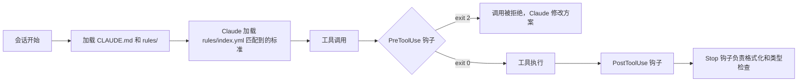

<div align="center">

<strong>一套立场鲜明的 Claude Code 工程配置。规则、运行时钩子和斜杠命令技能，把 CLI 变成一位严格的结对程序员。</strong>

[English](README.md) | [日本語](README.ja.md) | 简体中文 | [繁體中文 (香港)](README.zh-HK.md)

[](https://github.com/gufranco/claude-engineering-rules/actions/workflows/ci.yml)
[](https://github.com/gufranco/claude-engineering-rules/actions/workflows/mutation-method-scan.yml)
[](https://github.com/gufranco/claude-engineering-rules/releases/latest)
[](https://github.com/gufranco/claude-engineering-rules/actions/workflows/ci.yml)
[](https://scorecard.dev/viewer/?uri=github.com/gufranco/claude-engineering-rules)
[](LICENSE)

</div>

<p align="center">
  <a href="#快速开始">快速开始</a> |
  <a href="CONTRIBUTING.md">参与贡献</a> |
  <a href="SECURITY.md">安全</a> |
  <a href="https://github.com/gufranco/claude-engineering-rules/issues">Issues</a> |
  <a href="https://github.com/gufranco/claude-engineering-rules/releases">版本发布</a>
</p>

48 条常驻规则、142 份按需加载的标准、42 个技能、95 个钩子和 18 个代理，外加一份覆盖 71 个类别、共 905 项的审查清单。

---

## 用法

护栏不需要任何命令。每一次 Bash、Write 和 Edit 调用在执行前都会先经过钩子，被拦截的调用不会执行：Claude 读到拒绝理由后会调整做法。用本仓库中的一个测试夹具，可以在 shell 里复现同样的拒绝：

```console
$ python3 ~/.claude/hooks/dangerous-command-blocker.py < ~/.claude/tests/fixtures/bash-force-push.json
BLOCKED: Use --force-with-lease instead of --force
Command: git push --force origin main
$ echo $?
2
```

工作流就是技能，在会话中以斜杠命令的形式输入：

```text
/plan add rate limiting to the login endpoint
/review --local
/ship commit --push
/investigate why the import job times out
```

## 工作原理

每一层都会拦下上一层漏掉的问题。



| 层 | 强制执行的内容 | 运行时机 |
|:------|:-----------------|:-------------|
| [`CLAUDE.md`](CLAUDE.md) + [`rules/`](rules) | 常驻的工程规则、语气、防幻觉、验证关卡 | 每一次对话 |
| [`standards/`](standards) + [`rules/index.yml`](rules/index.yml) | 按触发关键词加载的领域知识 | 任务需要时 |
| [`hooks/`](hooks) | 在运行时拦截破坏性命令、密钥和禁用模式 | 每一次工具调用之前 |
| [`skills/`](skills) | 有文档的多步骤工作流：ship、review、plan、audit | 用户调用 `/<name>` 时 |
| [`agents/`](agents) | 专注于特定审查任务的子代理 | 显式委派时 |
| [`checklists/`](checklists) | 覆盖代码、基础设施和流程的 905 项审查清单 | 审查时按需使用 |

## 包含的内容

### 常驻规则

[`rules/`](rules/) 中有 48 条规则，[`rules/lang/`](rules/lang/) 中另有 5 条。[`rules/`](rules/) 下的每个文件都会以简短核心的形式加载到每一次对话中，包括语言文件和表格后面列出的 6 条。每个核心只保留会改变日常任务行为的义务，并链接到 [`standards/`](standards/) 中的全文，因此常驻集合保持在 56 个文件、108,127 个字符，低于 CI 强制执行的 120,000 字符预算和 150,000 字符的运行环境上限。

| 规则 | 涵盖内容 |
|:-----|:---------------|
| [`architecture-defaults`](rules/architecture-defaults.md) | 由六个问题组成的架构关卡。在任务需要时强制加载 DDD、六边形架构、幂等性、去重和状态机的标准。也是硬性规则的基线 |
| [`code-style`](rules/code-style.md) | DRY、SOLID、KISS、不可变性、错误分类、品牌类型、完整性规则、平台优先的 API 选择、禁止注释的策略。禁止注释只让步于明确要求 JSDoc 或文档注释的项目指令文件 |
| [`design-philosophy`](rules/design-philosophy.md) | 复杂性的表现与根源、深模块、战略与战术、设计两次、危险信号、设计品味 |
| [`testing`](rules/testing.md) | 集成测试优先、严格的 mock 策略、不带标签的 Arrange-Act-Assert 结构、期望值来自独立来源而不是重新计算代码逻辑、假数据、确定性测试。绝不为了让改动通过而削弱、跳过或删除断言、测试用例或测试文件。每个手写文件在没有任何排除指令的情况下覆盖率都是 100%，每个面向用户的入口和每个需求场景都有端到端测试 |
| [`security`](rules/security.md) | 密钥、认证、加密、数据隐私、审计日志、供应链 |
| [`git-workflow`](rules/git-workflow.md) | Conventional Commits、分支、CI 监控，以及在描述中写明改动前后的 Evidence 和 Merge Danger 判断（单向门还是双向门、影响范围）的 PR |
| [`verification`](rules/verification.md) | 基于证据的完成关卡、回复自检，以及在任何分析的第一遍就完整阅读范围内的每个文件 |
| [`writing-precision`](rules/writing-precision.md) | 所有文本输出的精确度关卡，还包括代词规范、主动语态、语气校准、每个已陈述的决定都附上依据的测量值，以及术语取自代码或用户而不是自造 |
| [`anti-slop`](rules/anti-slop.md) | 位于禁用短语清单之下的结构层。三项判定测试、取自 WikiProject AI Cleanup 实地指南的修辞和语法痕迹目录、人类技术写作的正面特征，以及防止矫枉过正的约束 |
| [`normative-keywords`](rules/normative-keywords.md) | BCP 14（RFC 2119 与 RFC 8174）关键词词汇表。以小写为主，只有在正确性、安全、数据完整性和不可逆性至关重要时才选用大写 |
| [`repo-analysis`](rules/repo-analysis.md) | 外部仓库要克隆到临时目录，而不是通过 `gh` 或 raw URL 获取文件。规定了必须的浅克隆流程、Issue、PR 和搜索操作的例外，以及给子代理的说明 |
| [`pre-flight`](rules/pre-flight.md) | 重复检查、市场调研、架构契合度、接口验证、对从现有代码复制来的阈值做语义验证，以及在第一次编辑前建立测试基线并阅读相关测试 |
| [`surgical-edits`](rules/surgical-edits.md) | 每一行改动都能追溯到需求 |
| [`ai-guardrails`](rules/ai-guardrails.md) | AI 输出的审查、生成前先计划、多代理验证 |
| [`memory-supersede`](rules/memory-supersede.md) | 项目和反馈记忆采用替代而不是删除 |
| [`language`](rules/language.md) | 强制回复语言：所有输出都用英语 |
| [`smart-questions`](rules/smart-questions.md) | 提问格式、给出选项时必须附带推荐、状态报告、用 FIXED、RESOLVED、DONE 收尾、Tatham 关于缺陷报告的要点 |
| [`found-fix`](rules/found-fix.md) | 验证过程中发现的任何问题都属于当前任务的范围。禁止那些把修复推迟到以后会话的托辞 |
| [`same-turn-persistence`](rules/same-turn-persistence.md) | 收到纠正的那一轮在结束前必须写入文件。自己发现的错误和用户指出的错误同样对待，写入针对的是根本行为而不是表面症状，准入门槛防止强制记录让配置膨胀 |
| [`rule-provenance`](rules/rule-provenance.md) | 每条规则都写明它生效的日期和促成它的失败。教训先记录下来，第三次重现时才升级为规则，不可逆、无声或灾难性的失败除外。有了来源记录，规则集才能被精简 |
| [`relay-not-source`](rules/relay-not-source.md) | 子代理的报告、搜索片段或摘要都是转述。转述不仅会弄乱内容，还会弄乱引用位置，所以一个具体的说法读起来正确，却可能指向错误的行、时间戳或记录 |
| [`agent-operating-limits`](rules/agent-operating-limits.md) | 兜底上限与预算的区别、附带测量值的轮次上限、超出部分要报告而不是丢弃的配额、被拒调用和无条件上下文注入的成本，以及无法运行的检查一律按失败处理 |
| [`deviation-waivers`](rules/deviation-waivers.md) | 偏离规则是允许的，悄悄偏离则不行。一份结构化的豁免，写明范围、批准人、替代方案和复查条件，它回答的问题与机械式绕过不同，因此两者有区别。项目自己的指令文件可以在该项目内明确覆盖全局规则，但不能越过安全、法律、数据丢失、验证和诚实这几条底线 |
| [`no-ai-process-leak`](rules/no-ai-process-leak.md) | 从提交信息、PR 描述、公开文档和发给同事的消息中排除阶段编号、计划文件路径、规格文件夹链接、夸张措辞和自我批评 |
| [`no-committed-symlinks`](rules/no-committed-symlinks.md) | 任何仓库都不跟踪符号链接。共享源码通过构建引用，两处都需要的文件只提交一次，来自子模块的文件按其自身字节提交 |
| [`doc-truth`](rules/doc-truth.md) | 描述代码的文档就是对代码的断言。让断言变假的改动要在同一次提交中修正它。在 `git commit` 时做四项机械上确定的检查；历史记录不在此列。如果项目文档描述的约定代码已经一贯不再遵守，就视为过时：以代码为准，并报告每一处不一致 |
| [`markdown-links`](rules/markdown-links.md) | 公开 Markdown 中提到的每个文件都是可点击的链接。由校验器和 PreToolUse 钩子强制执行 |
| [`living-specs`](rules/living-specs.md) | 非平凡的改动要维护 `specs/current/` 中活的行为规格：需求、Given/When/Then 场景、放在本地工作区计划文件夹中的 ADDED、MODIFIED、REMOVED 差异，以及把已完成改动并入规格的收尾合并 |
| [`project-workspace`](rules/project-workspace.md) | 每个仓库都把用户的工作资料放在一个从不提交的本地工作区中：项目不使用 `<repo>/docs/` 时用它，否则用 `<repo>/.work/`，只通过 `.git/info/exclude` 忽略。其中的 `PROMPT.md` 始终可以直接粘贴到新会话中。README 是项目唯一的事实来源 |
| [`compliance-defaults`](rules/compliance-defaults.md) | 合规规则家族的总纲。采用适用规则中最严格的一条，已发布的标准在生效日期之前就视为有约束力 |
| [`accessibility-defaults`](rules/accessibility-defaults.md) | 以 WCAG 2.2 AA 为底线，在不冲突时采用 AAA。键盘可操作、44x44 的点击区域、减少动画、禁止图片验证码 |
| [`frontend-render-gate`](rules/frontend-render-gate.md) | 对渲染输出的改动在被实际渲染之前都算未验证。点名了静态审查和 jsdom 无法触及的盲区：层叠结果、绘制顺序、无障碍树、焦点顺序、第三方 iframe。对证据分级，优先扩展项目自己的浏览器或模拟器测试框架。凡是涉及可见改动的 PR、审查回复、Issue 和工单评论，都要附上高分辨率的 Before 与 After 截图，Web、移动端、桌面 GUI 和 TUI 均适用 |
| [`ai-review-convergence`](rules/ai-review-convergence.md) | 限制自动审查者发表评论时的循环。机器人评论不可能归零，所以停止条件是出现一轮没有经过验证的失败。修复前先过失败场景关卡，回复提交只做最小的差异 |
| [`pr-comment-discipline`](rules/pr-comment-discipline.md) | 拉取请求上唯一允许发布的评论，是在别人开启的讨论串里的回复。不写总结正文，不写对话评论，不回复提交评论，也不以任何长度回复机器人。机器人的讨论串要读，属实就修复，然后默默解决。回复最多四句话，能在当前改动里修好的就在这里修，而不是另记一笔 |
| [`functional-index-fidelity`](rules/functional-index-fidelity.md) | 只有当查询表达式与索引表达式完全相同时，数据库才会使用表达式索引，所以一个等价的改写会悄悄退化为顺序扫描，既不报错，也没有测试失败 |
| [`privacy-defaults`](rules/privacy-defaults.md) | 在所有市场默认采用 GDPR 级别。合法依据、30 天内响应 DSAR、真正的删除、24 个月的保留期，假名化数据按个人数据对待 |
| [`cookie-discipline`](rules/cookie-discipline.md) | 每个非必要 Cookie 都需选择加入，全部拒绝与全部接受的操作次数相同，不设 Cookie 墙，不预先勾选 |
| [`cybersecurity-baseline`](rules/cybersecurity-baseline.md) | 前端安全默认值：基于 nonce 的 CSP、TLS 1.3、NIST 密码策略、会话超时、泄露通知时限 |
| [`consumer-defaults`](rules/consumer-defaults.md) | 14 天撤回期、一开始就展示总价、取消与订阅的操作次数相同、禁止虚假稀缺和虚假评价 |
| [`children-privacy-defaults`](rules/children-privacy-defaults.md) | 画像和广告以 18 岁为界，账号以 16 岁为界，13 岁以下需要可验证的家长同意。禁止针对未成年人的诱导使用模式 |
| [`ai-compliance-defaults`](rules/ai-compliance-defaults.md) | 欧盟《人工智能法》的风险等级、在模型输出上做可见的披露、对自动化决策进行人工审查、每年一次的偏见审计 |
| [`anti-spam-defaults`](rules/anti-spam-defaults.md) | 营销需选择加入、一键退订、永久的退订名单、严格区分交易类和营销类消息 |

另外，[`rules/lang/`](rules/lang/) 中有 5 个特定语言的文件：`typescript-immutability`、`typescript-types`、`typescript-strict`、`orm-migrations`、`python`。

[`rules/`](rules/) 中还有 6 条规则，和其他规则一样在每次会话中加载，只在条件成立时适用；每条在 [`rules/index.yml`](rules/index.yml) 中都有一份承载全文的按需标准：针对项目不能分发、需由用户自行提供的文件的 [`artifact-identity`](rules/artifact-identity.md)，以无界面或最小化方式而不是全屏启动模拟器的 [`emulator-runs`](rules/emulator-runs.md)，把项目的所有依赖都放进 Docker 镜像而不放在宿主机上的 [`docker-dependencies`](rules/docker-dependencies.md)，以及 [`knowledge-notes`](rules/knowledge-notes.md)、[`everyday-engineering`](rules/everyday-engineering.md) 和 [`project-glossary`](rules/project-glossary.md)。

### 按需加载的标准

[`standards/`](standards/) 中有 142 份标准。[`rules/index.yml`](rules/index.yml) 中的每个条目都声明了触发关键词，任务匹配时只加载对应的标准。

主题包括：API 设计、认证、缓存、代码审查、并发与竞态条件、容器安全、契约测试、数据库、DDD、调试、分布式系统、幂等性与去重、各语言的不可变性、文档、前端、GraphQL、六边形架构、国际化、基础设施、低延迟工程、消息队列、移动端、单体仓库、可观测性、编写代理指令文件、OpenTelemetry、性能、Postgres、PR 评论渠道、印刷设计、隐私、Redis、韧性、密钥管理、SRE、状态机、十二要素、TypeScript 5.x、WebSocket、零停机部署等。

### 技能

[`skills/`](skills/) 中有 42 个技能。每个技能都是一个带有 `SKILL.md` 的文件夹，按照 [`tools/lint-skills.py`](tools/lint-skills.py) 在 CI 中以 `--strict` 强制执行的六段式模板记录步骤、输出格式和规则：Overview、When to Use、Process、Common Rationalizations、Red Flags、Verification。这个检查工具还会把 frontmatter 当作严格的 YAML 解析，并拒绝会被 ` #` 悄悄截断的描述。

**技能分两类。** 由模型调用的技能会把带触发短语的描述放进每次会话的上下文，因此 Claude 可以自行使用它。由用户调用的技能设置 `disable-model-invocation: true`：它的描述不进入上下文，在被输入之前不产生任何开销，也只有用户能启动它。需要手动触发的都是用户调用的技能：`/deploy`、`/cleanup`、`/hotfix`、`/guard`、`/setup`、`/skill-new`、`/incident`、`/readme`、`/gan`、`/migrate`、`/assessment`、`/module-audit`、`/benchmark` 和 `/session-log`。需要被其他技能调用的技能保持由模型调用，所以 `/pr-summary` 和 `/fix-issue` 是这样：`/morning` 会把工作交给它们。

| 技能 | 作用 |
|:------|:-------------|
| [`/ship`](skills/ship/SKILL.md) | 交付流水线：提交、PR、发布、CI 检查、工作树 |
| [`/review`](skills/review/SKILL.md) | 三轮代码审查、QA 分析、视觉审计 |
| [`/respond`](skills/respond/SKILL.md) | 处理收到的审查评论：分类、验证、起草回复、本地验证、发布、解决、监控 CI |
| [`/assessment`](skills/assessment/SKILL.md) | 架构完整性审计。找出缺失的模式、预埋的缺陷和可以出彩的机会。用 [`tools/slop-scan.py`](tools/slop-scan.py) 给 AI 冗词评分并通过删除去掉它们，这个工具会在每个 Markdown 文件和一段提交范围上运行 `ai-slop-blocker` 的检测器。输出一份 `/respond` 可以读取的机器可读问题表。还会标出与标准徽章块不一致的 README |
| [`/plan`](skills/plan/SKILL.md) | 包含需求探索、范围复核、ADR 和脚手架的规格文件夹 |
| [`/audit`](skills/audit/SKILL.md) | 安全审计、威胁建模、供应链检查。`/audit trust` 借助 [`trust-patterns.md`](skills/audit/trust-patterns.md) 中的 IOC 目录，为不可信的项目增加安全扫描 |
| [`/test`](skills/test/SKILL.md) | 测试执行、性能、lint、CI 冒烟测试、桩代码生成 |
| [`/deploy`](skills/deploy/SKILL.md) | 合并后的落地和金丝雀监控 |
| [`/investigate`](skills/investigate/SKILL.md) | 通过假设检验进行系统化调试，最多尝试三次 |
| [`/research`](skills/research/SKILL.md) | 带实体消歧和引用规范的多来源调研 |
| [`/design`](skills/design/SKILL.md) | 设计咨询、多种方案、设计系统工作 |
| [`/refactor`](skills/refactor/SKILL.md) | 保持行为不变的引导式重构 |
| [`/migrate`](skills/migrate/SKILL.md) | 配合渐进测试的框架或库迁移 |
| [`/infra`](skills/infra/SKILL.md) | 容器编排、IaC、数据库迁移 |
| [`/hotfix`](skills/hotfix/SKILL.md) | 走加速流程的生产环境紧急修复 |
| [`/incident`](skills/incident/SKILL.md) | 收集事故背景、不追责的事后复盘 |
| [`/resolve`](skills/resolve/SKILL.md) | 带验证的合并冲突解决 |
| [`/cleanup`](skills/cleanup/SKILL.md) | 清理过期的分支、PR 和工作树 |
| [`/checkpoint`](skills/checkpoint/SKILL.md) | 跨会话保存和恢复状态。在仓库中会写入工作区的 `PROMPT.md` |
| [`/explain`](skills/explain/SKILL.md) | 配合 Mermaid 图讲解代码 |
| [`/fix-issue`](skills/fix-issue/SKILL.md) | 按编号修复 GitHub Issue，并附带测试 |
| [`/guard`](skills/guard/SKILL.md) | 冻结目录并强制限定范围 |
| [`/benchmark`](skills/benchmark/SKILL.md) | 基于基线检测性能退化 |
| [`/profile`](skills/profile/SKILL.md) | N+1 查询、缺失的索引、复杂度热点 |
| [`/onboard`](skills/onboard/SKILL.md) | 代码库上手：架构图和 Start Here 指南。第 0 阶段在运行可信度扫描前先征询意见。`--trust` 和 `--verify` 标志可以免交互地预先决定 |
| [`/gan`](skills/gan/SKILL.md) | 按评分标准构建功能的生成器与评估器迭代循环。反复运行规划者、生成者和评估者子代理，直到达到阈值 |
| [`/pr-summary`](skills/pr-summary/SKILL.md) | 附带审查人建议的 PR 摘要 |
| [`/readme`](skills/readme/SKILL.md) | 通过分析代码库生成 README。每个说法都来自代码，英文文件必须通过 [`tools/slop-scan.py`](tools/slop-scan.py)，每次运行还会写出带语言切换的日语、简体中文和香港繁体中文译本；`--languages es` 会增加西班牙语。头部徽章由 [`tools/readme-badges.py`](tools/readme-badges.py) 生成：CI、发布、覆盖率、OpenSSF Scorecard 和许可证，按此顺序，flat-square 样式 |
| [`/retro`](skills/retro/SKILL.md) | 提取模式的会话复盘 |
| [`/morning`](skills/morning/SKILL.md) | 跨账号的工作分拣。遍历每个已认证的 git 身份及其组织，按谁被卡住排序并报告，然后在逐项征得同意后处理队列。运行期间合并操作会被机械地拦截 |
| [`/session-log`](skills/session-log/SKILL.md) | 用于交接的会话活动日志 |
| [`/setup`](skills/setup/SKILL.md) | 交互式的项目环境搭建 |
| [`/tdd`](skills/tdd/SKILL.md) | 测试驱动开发循环。纵向切片，不采用先写完所有测试再写完所有实现的横向做法 |
| [`/zoom-out`](skills/zoom-out/SKILL.md) | 从战术工作中退后一步，转向战略视角 |
| [`/spike`](skills/spike/SKILL.md) | 回答一个设计问题的一次性产物，有两条路线（状态分支的终端程序、视图分支的并排变体） |
| [`/module-audit`](skills/module-audit/SKILL.md) | 寻找浅模块的代码库审计，给出改动前后的 Mermaid 建议和删除测试的分类 |
| [`/concise-mode`](skills/concise-mode/SKILL.md) | 可选的简洁回复模式。去掉客套和填充语，保留代码块、错误字符串和破坏性操作的确认 |
| [`/cross-model`](skills/cross-model/SKILL.md) | 在重大决定上，尤其是在很有把握时，请另一个模型给出正交的推理。会找出已安装的模型 CLI 而不是预设某个厂商，并把回答当作需要重新验证的转述 |
| [`/brain`](skills/brain/SKILL.md) | 读写第二大脑知识库。包括 capture、ingest、ask、link、health、refresh、falsify、wrong、compile、eval。`falsify` 找出的是错误而不只是过时的事实；`wrong` 连同原因记录一次失误，让主要的失败模式显现出来 |
| [`/interview-me`](skills/interview-me/SKILL.md) | 针对描述不足的请求，一次一个问题地澄清意图，在动手实现前把把握提高到很高 |
| [`/aside`](skills/aside/SKILL.md) | 冻结当前任务，在不改变状态的情况下回答一个旁支问题，然后从停下的地方原样继续 |
| [`/skill-new`](skills/skill-new/SKILL.md) | 用强制的 frontmatter 和章节模板搭建新技能，然后用技能检查工具验证 |

### 钩子

[`hooks/`](hooks/) 中有 95 个钩子，通过 [`settings.json`](settings.json) 接入。每个钩子在工具调用之前、之后或前后运行。

**绕过渠道。** 每个钩子都支持两种渠道，任意一种都能放行，两者可以同时存在。

1. 父 shell 的环境变量 `<NAME>_DISABLE=1`（在启动 Claude Code 之前设置）。
2. 会话内的文件登记表 `~/.claude/.bypass-state.json`。在运行中的会话里用 `python scripts/bypass.py set <hook> --ttl 600 --reason "<why>"` 启用，用 `python scripts/bypass.py clear [<hook>]` 清除，用 `list` 查看。TTL 限制在 [60, 3600] 秒之间；60 分钟的上限是有意为之，忘记清除的绕过不会一直生效。通配条目（`set "*"`）会在到期前放行所有钩子，默认 TTL 为 5 分钟，上限为 20 分钟。读取端执行同样的上限，所以手写了遥远到期时间的条目会被忽略，配置保护也会拦截对登记表文件的 Write 和 Edit。文件权限为 0600。参见 [`hooks/_lib/bypass.py`](hooks/_lib/bypass.py)。

**拦截消息的格式。** 新钩子通过 [`hooks/_lib/output.py`](hooks/_lib/output.py) 的 `block(...)` 输出 stderr。固定顺序的五个部分（`What was detected`、`Why this rule exists`、`How to fix`、`If the rule does not apply here`、`Decision guidance for Claude`），四个决策动词之一（`STOP-AND-ASK`、`FIX-AND-RETRY`、`BYPASS-ONCE`、`BYPASS-WITH-REASON`），每条消息都写明两种绕过渠道。校验器是 `output.validate_block_message(...)`。完整示例见 [`hooks/large-file-blocker.py`](hooks/large-file-blocker.py)。

**添加钩子。** 按顺序完成五步。跳过第 2 步会造成不易察觉的失败：钩子在运行，对每个负载都以 exit 0 退出，看起来像是通过了。

1. 先在 `tests/hooks/<hook-name>/` 下编写测试套件。在存在对应测试之前，[`hooks/tdd-gate.py`](hooks/tdd-gate.py) 会拦截源文件。夹具 `tool_use`、`assert_blocks`、`assert_allows` 和 `run_hook` 来自 [`tests/conftest.py`](tests/conftest.py)；自己写的子进程调用必须传递 `COVERAGE_PROCESS_START` 和 `PYTHONPATH`，否则那些代码行永远不会被统计。
2. 在 [`hooks/_lib/hook_profile.py`](hooks/_lib/hook_profile.py) 的 `STANDARD_HOOKS` 中登记钩子 ID。对于当前配置不包含的 ID，`should_run` 会返回 False，所以未登记的钩子会悄悄什么都不做。
3. 在 [`settings.json`](settings.json) 中接入匹配器，每个工具一个条目：`Write`、`Edit`、`MultiEdit`。
4. 从 `_lib` 导入共享的基础设施：用于 `read_hook_payload` 的 `_lib.hook_input`（它会拦截守卫读不了的负载），用于第三方指令的 `_lib.suppression`，用于文件登记表的 `_lib.bypass`，用于审计记录的 `_lib.audit_log`，用于 `block(...)` 和 `warn(...)` 的 `_lib.output`，以及在匹配子命令前去掉 `-C`、`-c` 等 git 全局选项的 `_lib.git_invocation`。模块是 `_lib.suppression`，绝不是裸的 `suppression`；裸写法无法解析，回退逻辑会悄悄禁用指令支持。
5. 检测量大的钩子先以警告模式发布，把拦截放在环境变量 `<NAME>_ENFORCE=1` 之后，等掌握了在真实代码上的误报率再升级。

| 钩子 | 触发 | 作用 |
|:-----|:--------|:-------------|
| [`accessibility-mechanical-checks.py`](hooks/accessibility-mechanical-checks.py) | PreToolUse Write/Edit/MultiEdit | 捕获能从源代码判定的 WCAG 问题：没有 `alt` 的图片、没有可访问名称的纯图标按钮、没有标签的输入框、在没有 role 或键盘处理的 `div` 上绑定点击、大于零的 `tabindex`、缺少 `lang`。完整读取带箭头函数和嵌套表达式的 JSX 标签，忽略 `<Input>` 这类首字母大写的组件，并遵守指定了对应 `jsx-a11y` 规则的 `eslint-disable-next-line`。绕过：`ACCESSIBILITY_CHECKS_DISABLE=1` |
| [`ai-attribution-blocker.py`](hooks/ai-attribution-blocker.py) | PreToolUse Bash/Write/Edit | 拦截提交和 PR 中的 AI 合著者尾注、`Claude-Session` 尾注和 claude.ai 会话链接，以及外发提交带有这些内容的 `git push` |
| [`ai-disclosure-checks.py`](hooks/ai-disclosure-checks.py) | PreToolUse Write/Edit/MultiEdit | 拦截没有可见 AI 披露就渲染模型输出的做法，以及没有标明身份的聊天机器人界面。欧盟《人工智能法》第 52 条、加州 SB 942。绕过：`AI_DISCLOSURE_DISABLE=1` |
| [`ai-process-leak-blocker.py`](hooks/ai-process-leak-blocker.py) | PreToolUse Bash/Write/Edit | 拦截提交、PR、发布说明和代码注释中的 AI 工作过程用语。捕获阶段编号、计划文件路径的引用、指向规格文件夹或本地工作区的链接，以及夸张措辞。在源文件中只扫描注释，所以步骤标签这类产品字符串可以通过。写入工作区或会话草稿区的内容不受限制，只有当发布命令位于引号之外时，Bash 命令才算作发布 |
| [`ai-review-request.py`](hooks/ai-review-request.py) | PostToolUse Bash | 在当前账号创建的开放 PR 上执行 `gh pr create`、`gh pr ready` 或 `git push` 之后，请求仓库支持的所有 AI 审查：在 Claude App 以手动模式运行的地方发一次 `@claude review always`，在工作流以标签控制的地方加上 `claude-review` 标签。CodeRabbit 和 Codex 每次推送都会审查，因此不做处理。从不拦截，只报告一行 `ai-review:`。也可以作为 CLI 使用：`--repo owner/name --pr N --account login [--dry-run]`。把看到的每个新建拉取请求记入按会话划分的台账，供 `pr-comment-discipline.py` 读取。绕过：`AI_REVIEW_REQUEST_DISABLE=1` |
| [`ai-slop-blocker.py`](hooks/ai-slop-blocker.py) | PreToolUse Bash/Write/Edit/MultiEdit | 拦截能躲过禁用短语清单的结构性冗词痕迹：否定式对仗、夸大重要性、附加评价的分词短语、不具名的权威、含糊的推测、取代 `is` 和 `has` 的营销动词、开场铺垫、结尾复述、聊天残留、未填写的占位符、弯引号，以及搜索经过的叙述，比如拒绝访问的网站或检查的日期。粗体标签的列表项和标题只在公开的 PR 评论中拦截。编号为 `SLOP001` 到 `SLOP015`。搜索经过的叙述在知识库、项目工作区和 `PROMPT.md` 中是允许的。匹配前会遮盖代码片段，每个检测器都在 rules、standards、checklists、skills、agents、docs 目录和根目录文档中的 333 个 Markdown 文件上校准过。绕过：`AI_SLOP_DISABLE=1` |
| [`as-any-blocker.py`](hooks/as-any-blocker.py) | PreToolUse Write/Edit | 拦截 TypeScript 的 `as any` 和泛型中的 `any`。没有放行标记，只遵守第三方工具的指令。 |
| [`aws-profile-guard.py`](hooks/aws-profile-guard.py) | PreToolUse Bash | 拦截没有 `--profile` 的 `aws configure set` |
| [`banned-phrases-blocker.py`](hooks/banned-phrases-blocker.py) | PreToolUse Bash/Write/Edit | 拦截 PR 和文档中的口语化客套和战术性夸张 |
| [`banned-prose-chars.py`](hooks/banned-prose-chars.py) | PreToolUse Write/Edit/Bash | 拦截长破折号、短破折号、正文中的圆括号、表情符号、ASCII 艺术，以及在 Markdown 正文中用带空格的连字符代替破折号 |
| [`bulk-resolve-blocker.py`](hooks/bulk-resolve-blocker.py) | PreToolUse Bash | 拦截在 GitHub 或 GitLab 上对多个讨论串循环调用 `resolveReviewThread` |
| [`comment-blocker.py`](hooks/comment-blocker.py) | PreToolUse Write/Edit/MultiEdit/Bash | 在所有者仓库使用的每种语言中拦截向源代码添加注释：C 系、Python、shell、YAML、Make、Docker、Terraform、SQL、Lua、Clojure、TeX、Vim script、HTML 及其模板方言、CSS、按方言区分的汇编、Jupyter 代码单元等，按扩展名、文件名、shebang 或内容识别。docstring 和文档注释块也算注释。编辑会与磁盘上的文件比对，所以只报告新加的注释。在 Bash 的 `git commit` 上，它会把每个已暂存的文件与 `HEAD` 比对扫描，从而捕获在 Write 和 Edit 工具之外写入的内容。不受限制的有：`eslint-disable`、`@ts-expect-error`、`noqa` 和 action 版本固定等工具指令，测试文件中裸写的 `Arrange`、`Act`、`Assert` 标记，以及 `.env.example` 文件。运维绕过：`COMMENT_BLOCKER_DISABLE=1` |
| [`test-aaa-markers.py`](hooks/test-aaa-markers.py) | PreToolUse Write/Edit/MultiEdit/Bash | 要求 Python、JS/TS、Go 和 bats 中每个新增或修改的测试都带有裸写的 `Arrange`、`Act`、`Assert` 标记，各出现一次、依次排列，组成以一个空行分隔的三个块。不检查没有改动的旧测试。在 Bash 的 `git commit` 上检查已暂存的文件。绕过：`TEST_AAA_MARKERS_DISABLE=1` |
| [`compact-context-saver.py`](hooks/compact-context-saver.py) | SessionStart / PreCompact / PostCompact | 按项目在上下文压缩前后保留 git 状态 |
| [`config-protection.py`](hooks/config-protection.py) | PreToolUse Write/Edit/MultiEdit | 拦截对 tsconfig、eslint、ruff、mypy 等 lint、格式化和类型检查配置的编辑。逼着修代码，而不是放宽配置 |
| [`console-log-blocker.py`](hooks/console-log-blocker.py) | PreToolUse Write/Edit | 拦截非测试代码中的 `console.*`。没有放行标记，只遵守第三方工具的指令。 |
| [`conventional-commits.py`](hooks/conventional-commits.py) | PreToolUse Bash | 校验 Conventional Commits 格式 |
| [`coverage-exclusion-guard.py`](hooks/coverage-exclusion-guard.py) | PreToolUse Write/Edit/MultiEdit | 拦截向源代码添加覆盖率排除指令的编辑，例如 `istanbul ignore`、`c8 ignore`、`pragma: no cover`、`#[coverage(off)]` 或 `LCOV_EXCL_LINE`，也拦截把覆盖率配置的阈值写到 100 以下的编辑。只有生成代码和第三方代码的路径可以排除，所以新增 omit 或 exclude 条目时会请求确认。文本文件不受限制。绕过：`COVERAGE_EXCLUSION_GUARD_DISABLE=1`。 |
| [`dangerous-command-blocker.py`](hooks/dangerous-command-blocker.py) | PreToolUse Bash | 190 种模式：破坏性的 shell 命令、反向 shell、云资源删除、IaC 的 destroy。传给 `cat`、`tee`、`git`、`gh` 或 `glab` 的 heredoc 正文属于数据，不参与匹配；传给 shell 的正文仍会匹配。匹配前会去掉 `-C`、`-c` 等 git 全局选项，所以 `git -C <dir> push --force` 和普通写法一样会被拦截，`-f` 或 `-fu` 这样的组合也算强制推送。只有当命令的每一段都是对构建目录的清理时，这种清理才能跳过其余检查。不是有效 JSON 的输入会被拦截。当推送的目标仓库（会跟踪 `cd` 和 `-C`）列在机器本地的 `solo-repos.txt` 中时，允许推送到受保护分支，这个文件以 [`solo-repos.example.txt`](solo-repos.example.txt) 为模板；无法确定目标的推送不算在内。删除测试文件，以及用 `find`、`grep -r`、`rg` 或 `fd` 搜索 `/` 或主目录，会弹出确认，但未被跟踪且不在任何提交中的测试文件除外 |
| [`doc-sync-guard.py`](hooks/doc-sync-guard.py) | PreToolUse Bash | 拦截暂存的差异会让现有文档变假的 `git commit`。四项确定的检查：代码读取了 `.env.example` 中没有列出的变量，以及删除了已跟踪 Markdown 仍在提及的导出、CLI 标志或包脚本。检查前导的 `cd` 或 `git -C` 指定的仓库，并在 `commit -a` 时包含未暂存的改动。变更日志、ADR 和规格作为历史记录不在此列。绕过：`DOC_SYNC_DISABLE=1` |
| [`frontend-render-gate.py`](hooks/frontend-render-gate.py) | PreToolUse Bash, Linear `save_issue` and `save_comment` | 拦截改变渲染输出（`.tsx`、`.html`、`.dart`、样式、主题令牌、`*View.swift` 或 `*Screen.kt` 等原生视图、`.qml` 或 `.xaml` 等桌面布局，以及导入终端 UI 库的源码）却没有触及任何渲染层检查（e2e 或浏览器测试套件、XCUITest、`androidTest`，或终端快照）的 `git commit`。`*.spec.tsx` 单元测试不算。层叠结果、绘制顺序、无障碍树、焦点顺序和第三方 iframe 在源代码中看不出来，jsdom 里也没有。发布时，它会把分支差异与基础分支对比：在有可见改动的分支上，`gh pr create` 或 `edit`，`gh issue create`、`edit` 或 `comment`，审查讨论串的回复，`glab mr create` 或 `update`，以及 Linear 的 Issue 或评论，都会被拦截，直到附上 `After:` 图片，现有界面有改动时还要附上 `Before:` 图片，且每张图长边至少 1600 像素。没有图片也没有可见改动的界面文案会请求确认。同一组图片必须宽度像素相同；只要有一个标签写了设备，每个标签都要写明设备和视口。高度正好等于一个视口的图片会被要求改为整页截图。附件路径会跟随 `$VAR` 和 `cd`，追踪器条目只按其自身文字判断。绕过：`FRONTEND_RENDER_GATE_DISABLE=1`，或共享绕过登记表中带 TTL 的条目。 |
| [`docker-context-guard.py`](hooks/docker-context-guard.py) | PreToolUse Bash | 每次调用都强制指定 `--context` 或 `DOCKER_CONTEXT` |
| [`dockerfile-compose-quality.py`](hooks/dockerfile-compose-quality.py) | PreToolUse Write/Edit/MultiEdit | 拦截 `.env` 及密钥和证书的复制、名字像密钥且值为字面量的 `ENV` 和 `ARG`、Compose 中的 `privileged: true`，以及宿主机命名空间开关。对不固定的标签、`USER root`、已弃用的顶层 `version:` 和 `environment:` 中的字面量密钥发出警告。绕过：`DOCKERFILE_QUALITY_DISABLE=1` |
| [`drizzle-raw-sql-blocker.py`](hooks/drizzle-raw-sql-blocker.py) | PreToolUse Write/Edit | 拦截 Drizzle 的原始查询后门，包括 `tx` 和 `trx` 接收者以及测试文件 |
| [`drizzle-schema-sync.py`](hooks/drizzle-schema-sync.py) | PreToolUse Write/Edit | 强制 Drizzle 模式与迁移保持一致 |
| [`english-only-reminder.py`](hooks/english-only-reminder.py) | UserPromptSubmit | 注入系统提醒，强制助手用英语输出 |
| [`env-file-guard.py`](hooks/env-file-guard.py) | PreToolUse Write/Edit | 拦截对 `.env`、私钥、云凭据和 tfstate 的编辑 |
| [`force-push-during-review.py`](hooks/force-push-during-review.py) | PreToolUse Bash | 在命令所针对的仓库中，如果某位审查人对拉取请求的最新审查是 `CHANGES_REQUESTED`，就拦截改写历史的推送；读不到审查状态时拦截，没有拉取请求的分支则放行。与危险命令拦截器共用强制标志的模式，所以 `-fu` 和全局选项也会被同样捕获 |
| [`foreign-session-guard.py`](hooks/foreign-session-guard.py) | PreToolUse Write/Edit/MultiEdit/NotebookEdit | 写入落在另一个正在运行的 Claude Code 会话的工作目录内之前请求确认，会话信息读自 `~/.claude/sessions/`，因为那个会话会把该文件报告为它自己的改动。目录包含本会话的会话会被忽略。绕过：`FOREIGN_SESSION_GUARD_DISABLE=1` |
| [`found-fix-rationalization-blocker.py`](hooks/found-fix-rationalization-blocker.py) | PreToolUse Bash/Write/Edit | 拦截把验证中发现的问题推迟到以后会话的托辞。针对提交信息、PR 正文、发布说明和代码注释；在源文件中只扫描注释，会话草稿区不受限制。位于引号字符串或 heredoc 正文中的发布命令属于数据，不是提交 |
| [`gateguard-fact-force.py`](hooks/gateguard-fact-force.py) | PreToolUse Write/Edit/MultiEdit | 除非用户点名了路径，否则每个会话在第一次编辑文件前都必须先读它。这是 pre-flight 中 Confidence 规则的落地 |
| [`gcloud-config-guard.py`](hooks/gcloud-config-guard.py) | PreToolUse Bash | 每次调用都强制指定 `--configuration` |
| [`gh-run-watch-blocker.py`](hooks/gh-run-watch-blocker.py) | PreToolUse Bash | 拦截每 3 秒轮询一次、耗尽 API 速率额度的 `gh run watch` 及其等价命令，包括 `glab ci view --live` 和 `glab ci status --wait` 或 `--live`。单引号内或带引号的 heredoc 正文中的文字不会被当作命令。绕过：`GH_RUN_WATCH_DISABLE=1` |
| [`gh-short-sha-guard.py`](hooks/gh-short-sha-guard.py) | PreToolUse Bash | 拦截使用短于 40 个字符的 SHA 的 `gh run list --commit`，这种调用匹配不到任何运行且以 exit 0 退出，基于它的 CI 等待会报告已完成或未开始 |
| [`gh-token-guard.py`](hooks/gh-token-guard.py) | PreToolUse Bash | 要求内联的 `GH_TOKEN`，拦截 `gh auth switch`。`gh auth` 以及不访问 API 的调用（`--version`、调用中任何位置的 `--help` 或 `-h`、`config`、`alias`、`completion`）不受限制。会读取每一行上的命令，并忽略单引号内或带引号的 heredoc 正文中的 `gh` 文字 |
| [`knowledge-note-guard.py`](hooks/knowledge-note-guard.py) | PreToolUse Write/Edit/MultiEdit/Bash | 在第二大脑中强制执行知识笔记规范：缺少 frontmatter、缺少 `## For future agent` 前言、没有日期的易变说法、指向不存在笔记的 wiki 链接、没有可解析目标的指针（FRESH-3）、写入不可变的 raw 文件夹，以及在 trash 之外删除。跳过存放计划产物而不是笔记的 `specs/`、`eval/` 和 [`tests/`](tests/)，以及在 `.git/info/exclude` 中登记的知识库本地工作区文件夹。绕过：`KNOWLEDGE_NOTE_DISABLE=1` |
| [`memory-write-guard.py`](hooks/memory-write-guard.py) | PreToolUse Write/Edit/MultiEdit | 配置了第二大脑知识库时，让会话记忆目录保持为生成产物：记忆目录由 `/brain compile` 以脚本方式写入，因此对它的每次 Write 或 Edit 都会被拦截，对 `MEMORY.md` 的编辑只有在不改动编译块时才放行。当 `SECOND_BRAIN_VAULT` 未设置或无法解析时完全不起作用，所以没有知识库的克隆会保持运行环境的默认行为。绕过：`MEMORY_WRITE_GUARD_DISABLE=1` |
| [`privacy-leakage-checks.py`](hooks/privacy-leakage-checks.py) | PreToolUse Write/Edit/MultiEdit | 捕获 `console.log` 中的个人数据、`localStorage` 中的标识符、未经同意检查就设置的 Cookie，以及周围没有同意守卫的硬编码分析或营销追踪 ID。绕过：`PRIVACY_CHECKS_DISABLE=1` |
| [`repo-fetch-blocker.py`](hooks/repo-fetch-blocker.py) | PreToolUse Bash | 拦截通过 `gh api .../contents`、`gh repo view <o>/<r> <path>`、`glab api .../repository/files` 以及对 `raw.githubusercontent.com` 的 curl 或 wget 逐个获取源文件。改为强制浅克隆，针对私有仓库的建议也是通过凭据助手而不是 URL 传递令牌。单引号内或带引号的 heredoc 正文中的文字不会被当作命令。绕过：`REPO_FETCH_DISABLE=1` |
| [`git-author-guard.py`](hooks/git-author-guard.py) | PreToolUse Bash | 拦截身份未解析或作者为占位符的提交 |
| [`glab-token-guard.py`](hooks/glab-token-guard.py) | PreToolUse Bash | 要求内联的 `GITLAB_TOKEN`，拦截 GitLab 的 auth login。`auth`、`config`、`version` 以及调用中任何位置的 `--help` 或 `-h` 不受限制 |
| [`interactive-cmd-blocker.py`](hooks/interactive-cmd-blocker.py) | PreToolUse Bash | 拦截不带 `-f` 的 `cp`、`mv`、`rm`。macOS 会把它们别名为 `-i`，确认提示会让代理卡住。前面加上 `command` 的调用会绕过别名而放行，引号内的文字和 heredoc 正文不会被当作命令。在 macOS 上还会拦截 `kcov` 以及 Makefile 调用 kcov 的 `make coverage`，它们在那里通过 stderr 跟踪，曾占用 44 GB 并报出错误的数字；它会改为给出 Linux 容器中的做法。它还会拦截会打开窗口的 `mame` 启动：没有 `-window`，无界面运行缺少 `SDL_VIDEODRIVER=dummy`、`-video none` 或 `-sound none`，或者标记了 `MAME_WATCHED=1` 的运行没有 `-nomaximize`；`-listxml` 等查询类命令会放行。绕过：`INTERACTIVE_CMD_DISABLE=1` |
| [`zsh-special-name-guard.py`](hooks/zsh-special-name-guard.py) | PreToolUse Bash | 仅在 zsh 下，拦截单靠规则没能防住的两个陷阱：把 `path`、`status` 或 `argv` 等 zsh 特殊名称用作变量，这会替换 shell 状态，`path=` 会让之后的每条命令都失效；以及以 `=` 开头且未加引号的单词，zsh 会把它展开为命令路径并中止命令的其余部分。引号内的文字、heredoc 正文以及 `[[ ]]` 或 `(( ))` 比较会被忽略。读不了的输入会被拦截。绕过：`ZSH_SPECIAL_NAME_GUARD_DISABLE=1` |
| [`internal-config-leakage.py`](hooks/internal-config-leakage.py) | PreToolUse Bash/Write/Edit | 防止内部配置的引用出现在对外输出中。只做读取的 `gh` 或 `glab` 调用，例如 `view`、`list`、`--help` 或 `api` 的 GET，不算发布 |
| [`kubectl-context-guard.py`](hooks/kubectl-context-guard.py) | PreToolUse Bash | 每次调用都强制指定 `--context` 或 `KUBECONFIG` |
| [`large-file-blocker.py`](hooks/large-file-blocker.py) | PreToolUse Bash | 拦截包含超过 5MB 文件的提交：已暂存的 blob，以及 `commit -a` 或同一命令中的 `git add` 会纳入的文件，范围是前导的 `cd` 或 `git -C` 指定的仓库 |
| [`markdown-link-discipline.py`](hooks/markdown-link-discipline.py) | PreToolUse Write/Edit/MultiEdit | 当路径指向仓库中真实存在的文件时，拦截 Markdown 中新加的、没有做成链接的文件提及 |
| [`mcp-health-check.py`](hooks/mcp-health-check.py) | PreToolUse/PostToolUse `mcp__*` | 在 `cache/mcp-health.json` 中跟踪 MCP 服务器的健康状况。对超过失败次数阈值的服务器，直接中止调用 |
| [`migration-idempotency.py`](hooks/migration-idempotency.py) | PreToolUse Write/Edit | 强制 DDL 幂等：在 PostgreSQL 支持的地方用 `IF NOT EXISTS`，函数、视图、触发器和存储过程用 `OR REPLACE`，类型、策略、角色和用户用带守卫的 `DO` 块，每个 `DROP` 都带 `IF EXISTS` |
| [`mise-global-guard.py`](hooks/mise-global-guard.py) | PreToolUse Bash | 拦截 `mise use --global`，强制使用项目本地的配置 |
| [`mock-internal-blocker.py`](hooks/mock-internal-blocker.py) | PreToolUse Write/Edit | 拦截在测试中 mock 自己的服务、数据库、Redis 和队列，包括 Python 点号形式的 `patch` 目标和根目录下的 `test_*.py` 文件 |
| [`mutation-method-blocker.py`](hooks/mutation-method-blocker.py) | PreToolUse Write/Edit/MultiEdit | 拦截 JS/TS 中 105 种原地修改的模式。没有放行标记，只遵守第三方工具的指令。 |
| [`normative-keyword-discipline.py`](hooks/normative-keyword-discipline.py) | PreToolUse Write/Edit/MultiEdit | 在 rules、standards、checklists 和 [`CLAUDE.md`](CLAUDE.md) 中拦截以 `Should ` 或 `should ` 开头的列表项。落实 BCP 14 关于含糊用词的规则。绕过：`NORMATIVE_KEYWORD_DISABLE=1` |
| [`notify-webhook.py`](hooks/notify-webhook.py) | Stop | 回复完成时向 `CLAUDE_NOTIFY_WEBHOOK` 发送 POST |
| [`package-manager-guard.py`](hooks/package-manager-guard.py) | PreToolUse Bash | 拦截 npm、npx、yarn 和 pip 的安装，并给出应改用的 pnpm 或 uv 命令。`npm --version` 这样的版本查询、`uv pip` 和引号内的文字会放行。绕过：`PACKAGE_MANAGER_GUARD_DISABLE=1` |
| [`pr-comment-discipline.py`](hooks/pr-comment-discipline.py) | PreToolUse Bash | 拦截每一条在讨论串之外发布拉取请求评论的命令：`gh pr` 的 comment 子命令、带正文的 `gh pr review`、带非空总结的 reviews POST、没有 `in_reply_to` 的 `pulls/<n>/comments` POST、`issues/<n>/comments` POST、提交评论的 POST、GitLab 的 MR 备注或新讨论，以及没有父级的 Bitbucket 评论。会读取 `--input` 和 `--body-file` 的负载。heredoc 正文中的评论命令属于数据。讨论串回复、正文为空的审查提交和描述编辑不受影响。在同一会话已经开过拉取请求的仓库里，第二次 `gh pr create` 之前会请求确认。绕过：`PR_COMMENT_DISCIPLINE_DISABLE=1` |
| [`pr-merge-blocker.py`](hooks/pr-merge-blocker.py) | PreToolUse Bash | 在 `/morning` 巡检持有会话锁期间，拒绝每一种形式的拉取请求合并。涵盖 `gh pr merge`、`glab mr merge`、REST 合并端点和 GraphQL 合并变更。巡检之外不起作用，所以 `/deploy land` 仍然可用。`git merge` 和 `gh pr update-branch` 不受影响。绕过：`PR_MERGE_BLOCKER_DISABLE=1` |
| [`prisma-raw-sql-blocker.py`](hooks/prisma-raw-sql-blocker.py) | PreToolUse Write/Edit | 拦截 Prisma 的原始查询后门，测试文件中也一样 |
| [`prisma-schema-sync.py`](hooks/prisma-schema-sync.py) | PreToolUse Write/Edit | 强制 schema.prisma 与迁移保持一致，包括多列 `ALTER TABLE` 的每一列和字段级 `@unique(map:)` 的名称 |
| [`read-injection-scanner.py`](hooks/read-injection-scanner.py) | PostToolUse Read/WebFetch/WebSearch | 扫描获取到的内容中的提示注入模式（覆盖指令、改道工具、权威声明、base64 长串、易混淆的 Unicode 字符）并发出警告。绕过：`READ_INJECTION_DISABLE=1` |
| [`redis-atomicity.py`](hooks/redis-atomicity.py) | PreToolUse Write/Edit | 强制通过 Lua 或 MULTI 让 Redis 操作序列保持原子性，并标记没有 TTL 的锁。只有在同一个接收者上，读和写才算竞态，`Map` 上从不算。没有放行标记，只遵守第三方工具的指令。 |
| [`check-then-act-blocker.py`](hooks/check-then-act-blocker.py) | PreToolUse Write/Edit/MultiEdit | 标记决定某次写入的读取以及随后的那次写入。默认通过模型会读取的 `additionalContext` 发出警告；在 `CHECK_THEN_ACT_ENFORCE=1` 下拦截 |
| [`transaction-scope-guard.py`](hooks/transaction-scope-guard.py) | PreToolUse Write/Edit/MultiEdit | 标记事务中的网络 I/O 和定时器，以及包含相互依赖写入的数组模式事务 |
| [`dedup-store-guard.py`](hooks/dedup-store-guard.py) | PreToolUse Write/Edit/MultiEdit | 在 TypeScript、JavaScript、Python、Go、Java、Kotlin、C#、Ruby、Dart、Rust、Elixir 和 Clojure 中，拦截重启后就会清空的内存去重台账 |
| [`concurrent-fanout-guard.py`](hooks/concurrent-fanout-guard.py) | PreToolUse Write/Edit/MultiEdit | 标记对调用方传入数据的无上限 `Promise.all` |
| [`python-mutation-guard.py`](hooks/python-mutation-guard.py) | PreToolUse Write/Edit/MultiEdit | 基于 AST 的 Python 不可变性：拦截可变默认值、通过参数修改集合、`global`、模块和类级别的容器，以及 `object.__setattr__` 后门；对参数属性写入和非 frozen 的 dataclass 发出警告 |
| [`polyglot-immutability-guard.py`](hooks/polyglot-immutability-guard.py) | PreToolUse Write/Edit/MultiEdit | Go、Rust、C、C++、Swift、Java、Kotlin、C#、Dart、Ruby 和 Lua 中共享的可变状态 |
| [`idempotency-guard.py`](hooks/idempotency-guard.py) | PreToolUse Write/Edit/MultiEdit | 不能安全重复的操作：裸写的 `mkdir` 和 `ln -s`、没有守卫的 rc 文件追加、Terraform 的 `timestamp()` 和 `uuid()`、被关闭的 Kafka 幂等生产者 |
| [`immutability-analyzers.py`](hooks/immutability-analyzers.py) | PostToolUse Write/Edit/MultiEdit, Stop | 用 [`analyzers/`](analyzers/) 中的配置，对本轮编辑过的文件运行 clang-tidy、golangci-lint、ruff、pyright、rubocop、luacheck、detekt、PMD、swiftlint 和 Dart 分析器；改动行上的问题会拦截，缺少分析器也会拦截 |
| [`retro-pointer.py`](hooks/retro-pointer.py) | Stop | 拦截累积时，在会话结束时以 `systemMessage` 向用户显示一行摘要 |
| [`review-state-guard.py`](hooks/review-state-guard.py) | PreToolUse Bash | 拦截对非用户本人撰写的审查误操作 REQUEST_CHANGES、DISMISS 或 DELETE |
| [`rtk-rewrite.py`](hooks/rtk-rewrite.py) | PreToolUse Bash | 把 CLI 命令改写为经由 RTK 执行，以节省 token |
| [`scope-guard.py`](hooks/scope-guard.py) | PreToolUse Write/Edit/MultiEdit | 读取工作区 `plans/` 或 `specs/` 下最近的活动 `plan.md`（60 分钟内修改过）。标头带有 `Archived:` 或 `Superseded:` 标记的计划视为已关闭，不再约束任何内容。当编辑目标不在计划声明的文件列表中时拦截，列表可以写路径，也可以写 `Makefile` 这类没有扩展名的名称。持有规格的仓库之外的文件（例如知识库）从不检查。绕过：`SCOPE_GUARD_DISABLE=1` |
| [`secret-scanner.py`](hooks/secret-scanner.py) | PreToolUse Bash | 在 git commit 之前检查 38 种密钥模式 |
| [`sequelize-raw-sql-blocker.py`](hooks/sequelize-raw-sql-blocker.py) | PreToolUse Write/Edit | 拦截 Sequelize 的原始查询后门，测试文件中也一样 |
| [`sequelize-schema-sync.py`](hooks/sequelize-schema-sync.py) | PreToolUse Write/Edit | 强制 Sequelize 模型与迁移保持一致 |
| [`session-resume-context.py`](hooks/session-resume-context.py) | SessionStart | 在启动、clear 或 compact 时，以 `additionalContext` 写明本地工作区并完整展示其中的 `PROMPT.md`，然后是最近的检查点或活动计划（7 天内），让会话带着指向进行中工作的线索恢复 |
| [`project-workspace.py`](hooks/project-workspace.py) | SessionStart / Stop / PreToolUse Bash | 在 `.git/info/exclude` 中登记本地工作区，在 `PROMPT.md` 比最新改动还旧时拦截一次本轮结束，拒绝对工作区强制 `git add`，并拒绝任何会把任意位置的 `PROMPT.md` 纳入版本管理的 add 或 commit。绕过：`PROJECT_WORKSPACE_DISABLE=1` |
| [`settings-hygiene.py`](hooks/settings-hygiene.py) | PreToolUse Write/Edit/MultiEdit | 拦截设置中的凭据和主目录的绝对路径 |
| [`smart-formatter.py`](hooks/smart-formatter.py) | PostToolUse Edit/Write | 把每个编辑过的文件记录到会话的批次中，交给负责格式化的 Stop 钩子 |
| [`stop-format-typecheck.py`](hooks/stop-format-typecheck.py) | Stop | 通过重命名从 `smart-formatter.py` 认领本会话的批次，用项目配置的格式化工具把每个文件格式化一次，ruff 优先于 black，prettier、shfmt 和 rubocop 只在存在其配置文件的地方使用，然后在每个涉及的工作区运行一次 `tsc`，并把失败报告给模型 |
| [`subagent-brief-quality.py`](hooks/subagent-brief-quality.py) | PreToolUse Task | 通过结构、文件引用和长度上限强制子代理提示的质量 |
| [`symlink-commit-blocker.py`](hooks/symlink-commit-blocker.py) | PreToolUse Bash | 拦截会记录符号链接的提交：已暂存的模式 `120000` 条目，以及 `commit -a` 或同一命令中的 `git add` 会纳入的路径。允许删除已跟踪的链接 |
| [`tdd-gate.py`](hooks/tdd-gate.py) | PreToolUse Write/Edit/MultiEdit | 找不到配套的测试文件时，拦截新建生产源文件。配置文件、`__init__.py`、`conftest.py`、`setup.py`、纯类型模块、只做重新导出的 `index` 桶文件，以及 `scratchpad/` 目录或共享 `/tmp` 根目录下的一次性脚本不受限制。按用户区分的 `TMPDIR` 仍受约束，因为 pytest 的 `tmp_path` 就在那里。绕过：`TDD_GATE_DISABLE=1`。它还会通过 [`assertion_weakening.py`](hooks/_lib/assertion_weakening.py) 拦截减少测试文件中断言或测试用例数量、或添加跳过标记的编辑，并有独立的绕过 `TEST_WEAKENING_DISABLE=1` |
| [`terraform-workspace-guard.py`](hooks/terraform-workspace-guard.py) | PreToolUse Bash | 每次调用都强制指定 `TF_WORKSPACE`，包括在 `-chdir` 等全局选项之后 |
| [`todo-marker-blocker.py`](hooks/todo-marker-blocker.py) | PreToolUse Write/Edit/MultiEdit | 拦截源代码中的 TODO、FIXME、HACK、XXX、WIP 标记，包括带有 Issue 编号或其他括号说明的标记。没有放行标记，只遵守第三方工具的指令。 |
| [`typeorm-raw-sql-blocker.py`](hooks/typeorm-raw-sql-blocker.py) | PreToolUse Write/Edit | 拦截 TypeORM 的原始查询后门，测试文件中也一样 |
| [`typeorm-schema-sync.py`](hooks/typeorm-schema-sync.py) | PreToolUse Write/Edit | 强制 TypeORM 实体与迁移保持一致 |
| [`user-supplied-artifact-guard.py`](hooks/user-supplied-artifact-guard.py) | PreToolUse Bash | 让用户必须自行提供的文件不进入 git 历史。当文件匹配 `artifacts.manifest.json` 中声明的摘要，或带有明确属于 ROM、光盘镜像、固件或模型权重的扩展名时，拦截 `git commit` 和带显式路径的 `git add`。摘要检查之前先按大小筛选。绕过：`USER_SUPPLIED_ARTIFACT_DISABLE=1` |
| [`vault-compile.py`](hooks/vault-compile.py) | SessionStart | 在注入目录之前，从知识库重新编译本项目的记忆目录，这样记忆永远不会因为忘了一条命令而落后。只有编译改变了内容时才输出，所有失败路径都以 exit 0 退出，因为落后一次编译的记忆目录总比启动不了的会话好。编译在 `VAULT_COMPILE_TIMEOUT_SECONDS`（默认 20）后中止，超时会被记录。绕过：`VAULT_COMPILE_DISABLE=1` |
| [`vault-context-loader.py`](hooks/vault-context-loader.py) | SessionStart | 每个会话注入一次第二大脑的目录，所以在第一个问题之前就知道知识库里有什么，而不是事后去搜。也会报告知识库维护是否逾期，因为停止运行的循环和无事可做的循环一样安静，并展示之前的会话排入队列的记录 |
| [`vault-recall.py`](hooks/vault-recall.py) | UserPromptSubmit | 注入与提示最接近的第二大脑笔记，只包含标题和前言。排序使用与 `/brain eval` 评分相同的函数，因此召回的退化可以测量。只读，只有在知识库可以解析且有笔记超过分数下限时才输出。绕过：`VAULT_RECALL_DISABLE=1` |
| [`vault-session-capture.py`](hooks/vault-session-capture.py) | PreCompact | 在对话记录被压缩掉之前，把本会话做过的事追加到当天的知识库笔记中，这是细节仍然存在的最后时刻。加锁追加，所以并行的会话不会互相覆盖 |
| [`vault-capture-queue.py`](hooks/vault-capture-queue.py) | Stop | 判断本轮是否纠正了某个认知或发现了某个原因，如果是，就排入队列，交给下一个会话记录；下一个会话会在处理用户任务的同时处理队列，不会征询。只写一行追加式记录，不启动任何东西，因为进程分辨不了长期有效的教训和随口一提，而掌握这种判断却无人看管的写入者会把推测当成事实记下来。绕过：`VAULT_CAPTURE_QUEUE_DISABLE=1` |
| [`workflow-guard.py`](hooks/workflow-guard.py) | PreToolUse Write/Edit/MultiEdit | 拦截使用 macOS 运行器或 `-latest` 标签、第三方 action 未固定到完整提交 SHA、含 npm、npx、yarn 或 pip 步骤，以及 `push` 或 `pull_request` 工作流缺少可取消的 concurrency 组的 GitHub Actions 工作流。对早于 `ubuntu-26.04` 的 Ubuntu LTS 和缺少 `step-security/harden-runner` 的作业给出警告。绕过：`WORKFLOW_GUARD_DISABLE=1` |

### 自定义代理

[`agents/`](agents/) 中有 18 个专门的子代理。每个代理都遵循 [`TEMPLATE.md`](agents/TEMPLATE.md) 的代理模板，并继承 [`_shared-principles.md`](agents/_shared-principles.md) 中的共同规范。

为了减少 token 消耗，代理的启动已关闭。[`settings.json`](settings.json) 拒绝 `Agent`、`Workflow`、`CronCreate`、`RemoteTrigger` 和 `SendMessage`，并设置了 `disableWorkflows`、`enableWorkflows: false`、`workflowKeywordTriggerEnabled: false` 和 `disableAgentView`。上面这些代理仍保留在磁盘上，但无法启动，会委派给子代理的技能改为在当前会话中直接执行其步骤。要重新启用，删除这些拒绝条目和设置即可。

| 代理 | 用途 |
|:------|:--------|
| [`accessibility-auditor`](agents/accessibility-auditor.md) | WCAG 2.1 AA 无障碍审查 |
| [`concurrency-auditor`](agents/concurrency-auditor.md) | 每条写入路径的参与者时间线、竞态条件、幂等性和去重的持久性 |
| [`api-reviewer`](agents/api-reviewer.md) | API 的向后兼容性和设计审查 |
| [`blast-radius`](agents/blast-radius.md) | 追踪已改接口的所有使用方 |
| [`conversation-analyzer`](agents/conversation-analyzer.md) | 阅读会话记录，找出值得沉淀为直觉、钩子或规则修订的模式 |
| [`documentation-checker`](agents/documentation-checker.md) | 文档与代码库是否一致 |
| [`gan-planner`](agents/gan-planner.md) | `/gan` 循环的第一步。把需求展开为验收标准、文件清单和五行的评分标准 |
| [`gan-generator`](agents/gan-generator.md) | `/gan` 循环的第二步。针对指定的文件实现计划。只返回建议的差异，从不写入 |
| [`gan-evaluator`](agents/gan-evaluator.md) | `/gan` 循环的第三步。按规划者的评分标准给实现打分，返回逐行分数和具体反馈 |
| [`i18n-validator`](agents/i18n-validator.md) | 翻译文件校验 |
| [`migration-planner`](agents/migration-planner.md) | 数据库迁移的安全性和顺序 |
| [`opensource-sanitizer`](agents/opensource-sanitizer.md) | 推送到公开仓库前的安全网。在差异中查找泄露的密钥、个人信息、内部引用以及其他不应出现在公开仓库中的内容 |
| [`red-team`](agents/red-team.md) | 对抗性分析：攻击正常路径 |
| [`critic`](agents/critic.md) | 对接近完成的改动做最后一轮严格把关，关注缺了什么而不是错了什么 |
| [`privacy-auditor`](agents/privacy-auditor.md) | 个人数据流向、缺失的同意关卡、保留期违规、自动化决策的透明度 |
| [`scope-drift-detector`](agents/scope-drift-detector.md) | 把差异与计划对比，发现范围偏移 |
| [`test-scenario-generator`](agents/test-scenario-generator.md) | 带优先级和可追溯性的测试场景 |
| [`type-design-analyzer`](agents/type-design-analyzer.md) | 从封装、不变式表达和运行时安全的角度审查 TypeScript 类型设计 |

### 工作流选择指南

按你要做的事来选技能，而不是按技能的名字。场景按意图分组。两个技能都可能适用时，最后一小节说明如何选择。

#### 构建、规划和原型

| 场景 | 从这里开始 |
|:---------|:-----------|
| 我要构建 X | 先 `/plan --discover`，再实现 |
| 写代码前先想清楚 | `/plan` |
| 记录一个架构决策 | `/plan adr new <title>` |
| 生成符合项目模式的样板代码 | `/plan scaffold <type> <name>` |
| 第一次搭建这个项目 | `/setup` |
| 为本地开发启动 Docker 或数据库 | `/infra docker` 或 `/infra db` |
| 第一次带我熟悉代码库 | `/onboard` |
| 先写测试，再写代码 | `/tdd` |
| 讲讲这段代码是怎么工作的 | `/explain` |
| 我在陌生的代码里迷路了 | `/zoom-out` |

#### 审查、验证和回应

| 场景 | 从这里开始 |
|:---------|:-----------|
| 审查这个 PR | `/review <PR>` |
| 推送前审查我的本地分支 | `/review --local` |
| 测试覆盖缺口和 QA 场景 | `/review qa` |
| 对 UI 做无障碍、性能和 SEO 审计 | `/review design` |
| 运行测试、覆盖率、lint 和构建 | `/test` |
| 压力测试或 HTTP 性能基准 | `/test perf` |
| 实现 UI 前的设计咨询 | `/design` |
| 生成多个 UI 设计方案以便比较 | `/design variants` |
| 审查人在我的 PR 上留了评论 | `/respond` |
| 提交前审计或带回家作业的检查 | `/assessment` |
| 像面试官一样找出缺失的东西 | `/assessment --focus <area>` |
| 去掉项目中的 AI 冗词 | `/assessment --focus slop` |
| 为审查人总结这个 PR | `/pr-summary` |
| 我们安全吗 | `/audit` |
| 威胁建模或 STRIDE 分析 | `/audit threat` |
| 依赖漏洞扫描 | `/audit deps` |

#### 发布和交付

| 场景 | 从这里开始 |
|:---------|:-----------|
| 提交并推送 | `/ship commit --push` |
| 开一个 PR | `/ship pr` |
| 创建带标签的发布 | `/ship release` |
| 我的代码能发布了吗 | 先 `/review --local`，再 `/ship` |
| CI 失败了 | `/ship checks` |
| 盯着 CI 变绿并处理 AI 机器人的讨论串 | `/ship commit --pipeline` |
| 批准后落地这个 PR | `/deploy land` |
| 金丝雀部署并监控 | `/deploy canary` |
| 跨分支并行工作 | `/ship worktree init` |

#### 调试和事故响应

| 场景 | 从这里开始 |
|:---------|:-----------|
| 有东西坏了 | `/investigate` |
| 为什么这么慢 | `/profile` |
| 相对基线的性能退化 | `/benchmark` |
| 生产环境坏了，马上修 | `/hotfix` |
| 写一份事后复盘 | `/incident` |
| 按编号修复 GitHub Issue | `/fix-issue <number>` |

#### 重构和迁移

| 场景 | 从这里开始 |
|:---------|:-----------|
| 这段代码需要重新组织 | `/refactor` |
| 升级框架或库的版本 | `/migrate` |
| 用库 B 替换库 A | `/migrate` |
| 解决合并冲突 | `/resolve` |

#### 文档和调研

| 场景 | 从这里开始 |
|:---------|:-----------|
| 编写或更新 README | `/readme` |
| 翻译 README | `/readme`，它总会写出 `ja`、`zh-Hans` 和 `zh-HK`；`--languages <tags>` 可以增加更多语言 |
| 生成评估风格的 README | `/readme --variant assessment` |
| 社区对 X 怎么看 | `/research X` |
| X 和 Y 哪个更好 | `/research X vs Y` |
| 为一个想法找已有方案 | `/research <topic>` |

#### 运维和日常整理

| 场景 | 从这里开始 |
|:---------|:-----------|
| 清理过期的分支、PR 和工作树 | `/cleanup` |
| 保存会话状态以便以后继续 | `/checkpoint save` |
| 从上次停下的地方继续 | `/checkpoint resume` |
| 在高风险操作前先锁定 | `/guard` |
| 站会或交接记录 | `/session-log` |
| 会话复盘 | `/retro` |
| 发现代码库中的模式并提炼成规则 | `/retro discover` |

#### 周期性和定时任务

| 场景 | 从这里开始 |
|:---------|:-----------|
| 每隔 N 分钟轮询一次 | `/loop <interval> /<command>` |
| 按自己的节奏重复一项任务 | `/loop /<command>` |
| 类似 cron 的定时远程代理 | `/schedule` |

#### 两个技能都可能适用时

| 难以取舍 | 选择 | 原因 |
|:----------|:-------|:--------|
| `/review` 还是 `/assessment` | 差异级别的问题用 `/review`；整个系统的审计用 `/assessment` | `/review` 找出已写代码中的缺陷；`/assessment` 找出本该存在却缺失的模式 |
| `/review` 还是 `/audit` | 侧重安全用 `/audit`；一般质量用 `/review` | `/audit` 运行 STRIDE、依赖扫描和密钥检测；`/review` 应用 71 个类别的清单 |
| `/respond` 还是 `/ship --pipeline` | 需要人值守地处理人和 AI 机器人的讨论串时用 `/respond`，默认包含机器人，用 `--humans-only` 跳过它们；无人值守地处理 AI 机器人讨论串时用 `/ship --pipeline` | 设置 `RESPOND_DRIVES_PIPELINE=1` 可以把机器人循环交给 `/respond`，让两条流程的用语保持一致 |
| `/investigate` 还是 `/profile` | 正确性用 `/investigate`；性能用 `/profile` | `/investigate` 调查某件事为什么失败；`/profile` 找出正常运行代码中的瓶颈 |
| `/refactor` 还是 `/migrate` | 内部重组用 `/refactor`；框架或版本变更用 `/migrate` | `/refactor` 在自己的代码中保持行为不变；`/migrate` 遵循上游官方的升级文档 |
| `/explain` 还是 `/onboard` | 单个文件或函数用 `/explain`；整个项目用 `/onboard` | `/explain` 用 Mermaid 追踪数据流；`/onboard` 生成带架构图的 Start Here 指南 |
| `/explain` 还是 `/zoom-out` | 想知道这段代码做什么用 `/explain`；想知道它处在什么位置用 `/zoom-out` | `/explain` 深入一个部分；`/zoom-out` 追踪调用方并揭示它在架构中的角色 |
| `/loop` 还是 `/schedule` | 在一个终端会话中用 `/loop`；远程的类 cron 代理用 `/schedule` | `/loop` 在当前会话里按自己的节奏重复或轮询；`/schedule` 在服务器上按周期运行代理 |
| `/cleanup` 还是 `/refactor` | git 遗留物用 `/cleanup`；代码质量用 `/refactor` | `/cleanup` 删除过期的分支、PR 和工作树；`/refactor` 在不改变行为的前提下改进代码结构 |
| `/test` 还是 `/review qa` | 要执行用 `/test`；要分析用 `/review qa` | `/test` 运行测试套件、覆盖率、lint 和性能测试；`/review qa` 找出覆盖缺口并编写场景 |

## 快速开始

### 前置条件

| 工具 | 版本 | 安装 |
|:-----|:--------|:--------|
| Claude Code | 最新版 | [docs.anthropic.com](https://docs.anthropic.com/en/docs/claude-code) |
| Git | >= 2.0 | macOS 已预装 |
| Python | 3.14，在 [`.mise.toml`](.mise.toml) 中固定，也是 CI 测试的唯一版本 | `mise install` |
| jq | >= 1.6 | `brew install jq` |
| RTK | >= 0.23.0 | `cargo install rtk` |

### 安装

克隆仓库，然后把其中的内容以符号链接的方式放进 Claude 的配置目录，让配置与 git 保持同步：

```bash
git clone git@github.com:gufranco/claude-engineering-rules.git
cd claude-engineering-rules
ln -sf "$(pwd)/"* "$HOME/.claude/"
```

### 验证

把强制推送的测试夹具交给一个钩子。它会拒绝并以 exit 2 退出，Claude Code 把这个退出码视为拦截：

```bash
python3 ~/.claude/hooks/dangerous-command-blocker.py < ~/.claude/tests/fixtures/bash-force-push.json; echo "exit $?"
```

预期输出：

```text
BLOCKED: Use --force-with-lease instead of --force
Command: git push --force origin main
exit 2
```

规则和技能会在你下一次打开的 Claude Code 会话中加载。

## 配置

### MCP 服务器

[`settings.json`](settings.json) 中通过三种传输方式接入了 42 个 MCP 服务器：

- **Stdio，无环境变量：** AWS、Docker、Filesystem、Kubernetes、Lighthouse、Memory、Ollama、Playwright、PostgreSQL、Puppeteer、Railway、Redis、Semgrep、Sequential Thinking
- **Stdio，带环境变量：** Brave Search、Browserbase、Cloudflare、Discord、Exa Web Search、fal.ai、Firecrawl、GitHub、GitLab、Google Maps、LangSmith、Obsidian、Perplexity、Qdrant、Resend、Slack、Todoist
- **远程 HTTP，零启动开销：** Asana、Atlassian、Browser Use、ClickHouse、Figma、Linear、Mermaid Chart、Notion、Sentry、Supabase、Vercel

### 权限

- **51 条拒绝规则**拦截对敏感文件的 Read 和 Edit：各种 `.env`、`secrets/`、SSH 密钥、AWS 凭据、GnuPG、kube 和 Docker 配置、`.npmrc`、`.pypirc`、`.netrc`、`*.pem`、`*.key`、`*.tfstate`、`*.tfvars`，以及对 `node_modules` 的 Read
- **19 条允许规则**跳过权限确认。其中包括不限范围的 `Read`、`Write`、`Edit`、`Bash`、`WebFetch`、`WebSearch`、`Skill` 和 `NotebookEdit` 工具，所以这份允许列表范围很广，并不是只读的；另外还有 `git diff`、`git log`、`git status`、`pnpm run` 和 `pnpm exec` 等限定范围的条目。拒绝规则仍然优先于这些允许规则，拦截破坏性命令的是钩子这一层

`env-file-guard.py` 钩子会在运行时拦截对任意路径下同类文件的 Write 和 Edit，还包括 `credentials/` 目录、`.pgpass` 和 `service-account*.json`。它不覆盖 Read 和 Bash，所以拒绝通配符之外的密钥文件仍然可以被读取。

<details>
<summary><strong>项目结构</strong></summary>

```
$HOME/.claude/
  CLAUDE.md              Core engineering rules, always loaded
  RTK.md                 RTK token-optimized CLI proxy reference
  settings.json          Permissions, hooks, MCP servers
  checklists/            Unified 905-item review checklist across 71 categories
  rules/                 48 short rule cores, each linking to its full text
    index.yml            Rule and standard catalog with trigger keywords
    lang/                5 language-specific cores: TypeScript, Python, ORM migrations
  standards/             142 on-demand standards, including the full text of every rule
  agents/                18 specialized subagents
  skills/                42 slash-command skills
    audit/trust-patterns.md  IOC catalog for the /audit trust scan
  hooks/                 95 runtime hooks
  .github/scripts/       Validation and maintenance scripts (CI helpers)
  hooks/_lib/            Shared hook libraries (mutation detectors, audit log, suppression, git command normaliser)
  analyzers/             Immutability configs for the end-of-turn analyzers, and their local proof suite
  tests/                 pytest suites, Node script tests, smoke cases, and fixtures
  pyproject.toml         Python dev toolchain, locked in uv.lock
  package.json           Release toolchain, locked in pnpm-lock.yaml
  .github/workflows/     Lint, validation, hook tests
```

</details>

## 常见问题

<details>
<summary><strong>如何自定义或禁用一条规则？</strong></summary>
<br>

[`rules/`](rules) 中的规则会自动加载到上下文中。要禁用一条，删除或重命名这个文件即可。要自定义，就编辑其中的 Markdown。改动在下一次对话中生效。

</details>

<details>
<summary><strong>如何添加新技能？</strong></summary>
<br>

运行 `/skill-new <name>`。它会询问这个技能由模型调用还是由用户调用，搭建好 frontmatter 和六个章节，并在 `python3 tools/lint-skills.py --strict skills/<name>` 通过之前一直拦截。只有当 Claude 或另一个技能必须自行使用这个技能时，才选择由模型调用；只会手动输入的技能都由用户调用，不占用上下文。

</details>

<details>
<summary><strong>为什么集成测试优先于单元测试？</strong></summary>
<br>

测试规则把单元测试当作纯函数的后备手段。一个 mock 了数据库的测试，可能在真实查询已经出错时照样通过。mock 证明的是 mock 能用，而不是代码能用。参见 [`rules/testing.md`](rules/testing.md)。

</details>

<details>
<summary><strong>两级规则加载如何节省上下文？</strong></summary>
<br>

142 份标准合计 27,356 行。如果每次对话都全部加载，会耗尽上下文窗口。[`rules/index.yml`](rules/index.yml) 把每份标准映射到触发关键词。任务匹配时，例如添加一次数据库迁移会拉取 `database.md`，只加载相关的标准。

</details>

<details>
<summary><strong>危险命令拦截器覆盖哪些内容？</strong></summary>
<br>

190 种模式：文件系统破坏、权限提升、反向 shell、git 破坏性操作、AWS、GCP 和 Azure CLI 的删除、Vercel、Netlify 和 Firebase、Docker 和 Kubernetes 的破坏性命令、数据库 CLI 的 drop、IaC 的 destroy、没有 WHERE 的 SQL 语句、凭据外泄。

</details>

## 发布与版本

发布是自动的。合并到 `main` 会运行 CI；CI 通过后会触发 [`release.yml`](.github/workflows/release.yml)，它根据上一个标签以来的 Conventional Commits 推算出下一个版本，打上标签，把这个版本同步到 [`.claude-plugin/marketplace.json`](.claude-plugin/marketplace.json) 和两个插件清单中，并发布 GitHub 发布说明。

| 提交类型 | 效果 |
|-------------|--------|
| `feat` | 次版本发布 |
| `fix`、`perf`、`refactor`、`revert` | 修订版本发布 |
| `docs`、`test`、`style`、`build`、`ci`、`chore` | 不发布 |
| `!` 或 `BREAKING CHANGE:` 页脚 | 主版本发布 |

[`CHANGELOG.md`](CHANGELOG.md) 是手写的，不是生成的。它记录了改动背后的理由，这是生成的说明做不到的。

## 参与贡献

[`CONTRIBUTING.md`](CONTRIBUTING.md) 介绍了环境搭建、本地关卡和各项约定。简而言之：

```bash
make install
make test-all
```

`make test-all` 会运行测试套件、各类 lint、类型检查和 `make validate`。`make validate` 是漂移关卡：它把每份登记表与磁盘上的实际内容逐一核对，两者不一致就失败。覆盖的情况包括：[`rules/index.yml`](rules/index.yml) 中缺少某条规则或标准，本 README 中缺少某个技能或代理，[`hooks/`](hooks/) 中残留了一个绕过冒烟测试会执行的测试形状文件，以及某项计数检查的模式已不再匹配。最后一种最要紧：什么都匹配不到的检查不可能失败，它在什么都没验证的情况下报告成功，过时的数字就是这样在一次绿色的运行中存活下来的。

每个拉取请求都在 `ubuntu-26.04` 上运行八个 CI 作业：lint、工作流 lint、类型检查、钩子测试、不做任何排除且分支覆盖率达 100% 的 Python 套件、同样把 Node 脚本保持在 100% 并校验注册表签名的发布配置预演、CodeQL，以及依赖审查。每个作业都用 harden-runner 记录对外的网络连接。GitHub 自己的 action 固定到发布标签，第三方 action 固定到提交 SHA。Dependabot 负责让 action 和 Node 包保持最新；[`renovate.json`](renovate.json) 负责 Python 的版本固定、pre-commit 钩子、actionlint 的版本和运行器镜像的标签。发布由 semantic-release 根据 Conventional Commits 生成。

## 支持

| 需求 | 渠道 |
|:-----|:------|
| 报告缺陷或提出功能请求 | [GitHub Issues](https://github.com/gufranco/claude-engineering-rules/issues) |
| 报告安全问题 | [私密安全公告](https://github.com/gufranco/claude-engineering-rules/security/advisories/new) |
| 参与贡献 | [贡献指南](CONTRIBUTING.md) |
| 行为准则 | [行为准则](CODE_OF_CONDUCT.md) |

## 安全

请通过[安全公告](https://github.com/gufranco/claude-engineering-rules/security/advisories/new)私下报告漏洞，不要公开提 Issue。[`SECURITY.md`](SECURITY.md) 中有威胁模型、受支持的版本和供应链控制措施。

钩子只起提醒和防护作用。它们能拦下意外的破坏性命令，但不是沙箱，也无法隔离不可信的代码。

## 许可证

[MIT](LICENSE)
