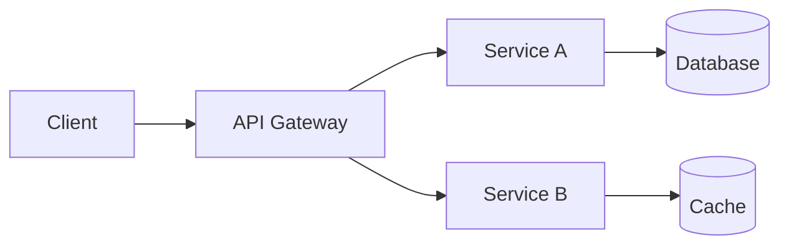

## Overview

Generate a README and GitHub repository description grounded in the actual codebase. Every run writes four files: the English README plus its Japanese, Simplified Chinese and Hong Kong Traditional Chinese translations. Two variants are supported: marketing (default) and assessment (`--variant assessment`). The marketing variant is for a public repository: what the project is, how to install it, how to use it, and where to get help, in that order. The assessment variant reads like an engineering memo: tables for every section and design decisions written as narrative paragraphs. Every claim in both variants is grounded in the actual codebase, and every file the skill writes passes the slop gate in Phase 5. Never invent features.

## When to use

- When starting a new project that needs a professional README.
- When a project has outgrown its initial README and needs a rewrite.
- When preparing a project for public release or portfolio showcase.
- When the README is stale and no longer reflects the codebase.
- When you want the project to stand out on GitHub.

## When NOT to use

- For minor README tweaks like fixing a typo or adding one section.
- When the project has no code yet, just a plan.

## Arguments

This skill accepts optional arguments after `/readme`:

- No arguments: generate a full README and repo description by scanning the entire project. Uses the marketing-grade structure documented in this file.
- `--variant <name>`: pick the README structure variant. Default `marketing`. Currently supported variants:

  | Variant | When to use | Template source |
  |---------|-------------|-----------------|
  | `marketing` | Public release, portfolio, open source. Hero, usage example, quick start, badges. Default | The structure documented inline in this file |
  | `assessment` | Take-home assessments, interview submissions, pre-submission audits, architecture reviews. Technical and explanatory tone. Tables and concrete examples. Design decisions as narrative paragraphs | [`template-assessment.md`](template-assessment.md) in this directory. Also invoked by `/assessment` step 12 |

- `--about-only`: generate only the GitHub repo description and topics, skip README.
- `--section <name>`: regenerate a specific section (e.g., `--section quick-start`).
- `--diff`: update the existing README based on what changed since it was last written. Each translation is updated from the English diff since that translation file's own last commit.
- `--languages <tags>`: extra translations to write beyond the fixed set, as a comma-separated list of BCP 47 tags such as `es`. The fixed set is always written and never asked about: English, `ja`, `zh-Hans` and `zh-HK`. A tag in the flag that is already in the fixed set changes nothing.

When `--variant assessment` is passed, read [`template-assessment.md`](template-assessment.md) for the full structure and rules. The Deep Scan in Phase 1 still runs because the assessment variant also benefits from grounded data, but the structure, tone, and section list come from the assessment template instead of the marketing structure below.

## Steps

### Phase 1: Deep Scan

Read the project thoroughly. Run these **in parallel**:

1. **Project identity**: read `package.json`, `Cargo.toml`, `go.mod`, `pyproject.toml`, `Makefile`, or equivalent to get the project name, version, description, dependencies, and scripts.
2. **Infrastructure and config**: read Terraform files, Docker files, CI/CD configs, `docker-compose.yml`, and deployment configs to understand the infrastructure.
3. **Source code structure**: map the directory tree, `ls -R` or glob to understand the project layout, modules, and organization.
4. **Existing README**: read the current [`README.md`](../../README.md) if it exists, to understand what the user already had and what to improve.
5. **Environment and setup**: read `.env.example`, setup scripts, and Makefile targets to document prerequisites and setup steps.
6. **Git context**: run `git remote -v` and `git log --oneline -10` to get the repo URL, recent activity, and contributor count.
7. **Visual assets**: check for logo files like `logo.png`, `logo.svg`, `banner.png`, `.github/assets/`, or `docs/images/`, and existing screenshots or demos.
8. **License and metadata**: read `LICENSE`, `.github/FUNDING.yml`, badges in existing README.
9. **Community health files**: check for `CONTRIBUTING.md`, `CODE_OF_CONDUCT.md`, `SECURITY.md`, `SUPPORT.md`, `CITATION.cff`, `CODEOWNERS`, and `.github/ISSUE_TEMPLATE/`. GitHub scores the same list in its community profile. A public repo missing all of them reads as unmaintained to anyone evaluating it for adoption.
10. **Release and versioning signals**: run `git tag --list --sort=-v:refname | head -5` and `GH_TOKEN=$(gh auth token --user <account>) gh release list --limit 5`. Read the version field from the manifest. Decide whether the tag history follows semantic versioning, calendar versioning, or no scheme at all.

### Phase 2: Architecture and Identity Analysis

From the scan results, build a project profile:

- **Type**: library, CLI tool, web app, API service, infrastructure, monorepo, dotfiles, or combination.
- **Stack**: languages, frameworks, databases, cloud services, CI/CD tools.
- **Scale signals**: multi-region, microservices, event-driven, serverless, multi-tenant, monorepo with N packages, etc.
- **Differentiators**: what makes this project stand out? Look for unique combinations, unusual scale, well-solved hard problems, or opinionated design choices.
- **Personality**: infer the project's tone from existing docs, comments, and commit messages. Technical and serious? Fun and playful? Opinionated and sharp? Match it.
- **Metrics inventory**: count concrete numbers: modules, services, endpoints, tests, config files, CLI commands, supported platforms, dependencies, lines of code by language. These become the quantified summary.

### Phase 3: Generate README

Write the English README following the structure and style guide below. Every section must be grounded in what was found in Phase 1. If a section doesn't apply, skip it. The goal is a README a developer can act on within a minute: what the project is, how to install it, how to use it, and where to get help, the four questions [GitHub](https://docs.github.com/en/repositories/managing-your-repositorys-settings-and-features/customizing-your-repository/about-readmes) names for a README.

### Phase 3b: Translate

Always. Translate the finished English README into `ja`, `zh-Hans` and `zh-HK`, plus any tag passed with `--languages`, following section 7f. Translate from the English file every time, never from another translation. With `--section` or `--diff`, the same sections change in every translation in the same run, so no translation falls behind the English file.

### Phase 4: Generate GitHub About

Generate a concise repo description, max 350 characters, and a list of topic tags. See the "GitHub About" section below.

### Phase 5: Present and Apply

Before presenting, write the English draft to a scratch file and run the slop gate on it:

```bash
python3 ~/.claude/tools/slop-scan.py <draft-path>
```

Exit 0 is required, and the scan runs again on the written file after approval. The detectors read English only, so read each translation against the same shapes in [`standards/anti-slop.md`](../../standards/anti-slop.md) by hand. Then apply the deletion test from that standard to every paragraph of the English file: a paragraph whose removal changes nothing about what the reader does next is cut.

1. Show the full README, and every translation, to the user for review.
2. Show the GitHub About description and topics.
3. Ask if they want changes before writing.
4. **Resolve account** per [`standards/multi-account-cli.md`](../../standards/multi-account-cli.md) before applying GitHub About: map the owner in `git remote get-url origin` to an authenticated account. Every `gh` call carries `GH_TOKEN=$(gh auth token --user <account>)` inline, and the global active account is never switched.
5. After approval:
   - Write the English README and each `README.<tag>.md`.
   - Apply the GitHub About using `GH_TOKEN=$(gh auth token --user <account>) gh repo edit --description "<desc>"` and `GH_TOKEN=$(gh auth token --user <account>) gh repo edit --add-topic <topic>` commands.

## README Structure

Use this structure as a guide. Skip sections that don't apply. Reorder if it makes more sense for the project.

### 1. Hero Section

The first thing anyone sees. It must create instant visual identity and communicate what the project does in under 5 seconds. The 5-second test is the explicit acceptance criterion: a developer scrolling fast should know what the project is, that it works, and how to try it without reading a single paragraph.

**Light and dark mode logo via `<picture>`.** This is the canonical pattern as of late 2023. The older `#gh-dark-mode-only` fragment hack is deprecated. Drizzle, tRPC, Vite, Supabase, and Next.js all use this form.

The `<strong>` line is the tagline: one line, confident, specific. The badge bar below it follows the cap and allowlist in the Badges section.

```html
<div align="center">

<picture>
  <source media="(prefers-color-scheme: dark)" srcset="path/to/logo-dark.svg">
  <source media="(prefers-color-scheme: light)" srcset="path/to/logo-light.svg">
  
</picture>

<br>
<br>

<strong>What it does, concretely, in one sentence.</strong>

<br>
<br>

[](link)
[](link)
[](link)

</div>

<p align="center">
  <a href="#documentation">Docs</a> &nbsp;|&nbsp;
  <a href="https://discord.gg/..."><strong>Discord</strong></a> &nbsp;|&nbsp;
  <a href="https://twitter.com/..."><strong>Twitter</strong></a> &nbsp;|&nbsp;
  <a href="#contributing">Contributing</a> &nbsp;|&nbsp;
  <a href="https://github.com/.../issues">Issues</a>
</p>
```

The **navigation pill row** under the badges is the pattern Bun, Zod, and Astro use. Zero scroll cost, gives the reader an escape hatch to the deeper docs and the community channels. Skip channels that do not exist for the project.

When the project has only one logo, use a single `` and skip the `<picture>` wrapper. Never use a placeholder. If no logo exists, omit the image entirely and lead with the bold tagline.

After the hero, one plain sentence may state the project's scope in numbers that answer a reader's question, each counted from the source in this run:

```markdown
Nine Terraform modules deploy 31 AWS services across six regions, covered by 214 tests.
```

Never a decorative bar of bolded figures separated by dots, never an approximate `30+` or `~30 min` that was not measured, and never a number that only sounds large. A project with no meaningful count skips the sentence.

**Demo immediately.** The hero stack ends with one of three demo elements: an animated GIF for visual tools, an asciinema cast for CLI tools, or a 5-line code snippet for libraries. Place this within the first scroll. The "demo first" pattern is now baseline. Hyperfine opens with a GIF. Hono opens with a 4-line code example. Zod opens with a `z.object` schema definition.

### 2. Usage

A code block of the most common use, near the top and before the reference sections. [standard-readme](https://github.com/RichardLitt/standard-readme/blob/main/spec.md) requires a Usage section. A CLI shows its common commands with real output. A library shows the import and one call. The block is the feature list's evidence: a reader who sees the call does not need a sentence claiming it is easy.

Never a grid of feature squares. An HTML table of titled cells, each selling one feature, is the layout readers now name as a sign of a generated README, alongside emoji headings and ASCII diagrams, in [this Hacker News thread](https://hn.nuxt.dev/item/47528683). Capabilities that need listing go in the section 5 table, one row each, with the command or option that provides them.

### 3. Comparison With Alternatives, Optional

Include it only when a reader is likely choosing between this project and a named alternative, and only with facts checked against that alternative's current documentation in this run. Skip any "The Problem" or "The Solution" story. A README that argues why the reader should use it reads as a sales pitch, and readers in the same Hacker News thread said that is where they stop reading. One sentence on what the project does that the alternatives do not, followed by the table, is enough. Use plain `Yes` and `No` text instead of emoji to keep the table accessible to screen readers and consistent in fixed-width contexts:

```markdown
| Capability | This Project | Alternative A | Alternative B |
|:-----------|:------------:|:-------------:|:-------------:|
| Feature 1  | Yes          | Yes           | No            |
| Feature 2  | Yes          | No            | Yes           |
| Feature 3  | Yes          | No            | No            |
```

For richer tables, replace `Yes` with a short capability descriptor like "Built-in" or "Plugin" or "Partial" so the cell content tells the reader more than a binary. Never rely on color alone to communicate; screen readers ignore color, and red/green is invisible to about 8% of male readers.

### 4. Architecture

Mermaid diagrams for projects with enough complexity to warrant them. Use the diagram type that best fits:

- **Flowchart**, `graph LR` or `graph TD`: system architecture, data flow between components.
- **Sequence diagram**: request/response flows, multi-service interactions.
- **C4 Context**: high-level system boundaries for larger projects.

````markdown

````

**Diagram rules:**
- Max 15-20 nodes per diagram. Split into multiple if needed.
- Use descriptive labels, not single letters.
- Include the data flow direction.
- For multi-layer architectures, use `subgraph` to group related components.
- Skip this section entirely for simple projects such as CLIs, or small libraries.

### 5. What's Included

Categorized feature list. Group by domain, not by file. Use tables with two columns: feature and description.

```markdown
### Category Name

| Feature | Description |
|:--------|:------------|
| Feature A | What it does, concretely |
| Feature B | What it does, concretely |
```

Categories come from the project's actual domains: Infrastructure, Security, Data Layer, Monitoring, CLI Commands, Components, etc.

### 6. Demo / Screenshots

If the project has visual output such as a web app, CLI with TUI, or desktop app, include the screenshots or recordings the repository already has. If none exist, skip the section and list the missing screenshot as a follow-up. A placeholder image or an empty section is never written.

**For CLI tools**, show terminal output in a code block or reference an asciinema recording:

```markdown
[](https://asciinema.org/a/XXXXX)
```

**For web apps**, use a screenshot with a subtle border:

```html
<div align="center">

</div>
```

**For GitHub light/dark mode support**, when the project has both variants:

```html
<picture>
  <source media="(prefers-color-scheme: dark)" srcset="docs/images/screenshot-dark.png">
  <source media="(prefers-color-scheme: light)" srcset="docs/images/screenshot-light.png">
  
</picture>
```

### 7. Quick Start

The most important section after the hero. It must be prominent, copy-pasteable, and verifiable. A reader should go from zero to running in under 60 seconds.

````markdown
## Quick Start

### Prerequisites

| Tool | Version | Install |
|:-----|:--------|:--------|
| Node.js | >= 20 | [nodejs.org](https://nodejs.org) |
| Docker | >= 24 | [docker.com](https://docker.com) |

### Setup

```bash
git clone https://github.com/user/repo.git
cd repo
npm install
cp .env.example .env
npm run dev
```

### Verify

```bash
curl http://localhost:3000/health
```

Expected output:

```json
{"status":"ok"}
```
````

**Rules:**
- Prerequisites in a table, not a bullet list.
- Setup commands numbered only if order matters, otherwise a single code block.
- Always end with a verification step that proves it works.
- Include the expected output of the verification command.

### 7b. For Contributors and Reviewers

This subsection lowers the cost of contribution and pre-empts PR review back-and-forth. Include it when the project expects external contributors or when the project has more than one regular contributor.

The generated section has five parts.

**Reproducing a bug.** Concrete steps from clone to running a minimal reproducer. Reuse the same commands as the Quick Start verification step, plus any seed scripts or fixture files needed. A reviewer who cannot reproduce a reported bug pushes back harder.

````markdown
### Reproducing a bug

```bash
git clone https://github.com/user/repo.git
cd repo
npm install
cp .env.example .env
npm run db:seed
npm run dev
```

To reproduce reported bugs, follow the steps above and then read the bug report's "Steps to reproduce" section.
````

**Running the tests.** The command that runs the suite, plus one line per suite naming what it covers. A contributor who cannot tell the unit suite from the end-to-end suite runs the slowest one every time, or runs none of them.

```markdown
### Running the tests

| Suite | Command | Covers |
|:------|:--------|:-------|
| Unit | `npm run test:unit` | Pure functions and domain logic |
| Integration | `npm run test:integration` | Real database and queue, no mocks |
| End to end | `npm run test:e2e` | Full user flows through the HTTP layer |
| Lint and format | `npm run lint` | Style and static analysis gates |
```

Take the suite names and commands from the manifest scripts, the Makefile targets, or the CI job matrix found in Phase 1. Never invent a suite the project does not have. When the project ships a single undifferentiated `test` script, show one row and skip the table header ceremony.

**Project conventions.** A table listing concrete conventions detected from the codebase. Surfacing these in the README pre-empts review comments that would otherwise litigate style.

```markdown
### Project conventions

| Convention | Source |
|------------|--------|
| Commit format | [Conventional Commits](https://www.conventionalcommits.org/) |
| Branch naming | `feature/`, `bugfix/`, `hotfix/`, `chore/` prefixes |
| Lint configuration | [.eslintrc.json](.eslintrc.json) |
| Code style | [Prettier](https://prettier.io/) with [prettier.config.mjs](prettier.config.mjs) |
| Review process | One human reviewer + CodeRabbit. Expect first response within 1 business day |
```

**Non-obvious decisions.** A short list of 3 to 5 architectural choices the project made deliberately, with one-line rationale each. These are the choices that reviewers would otherwise spend a thread asking about. This subsection cannot be auto-generated reliably; `/readme` prompts the user with: "Name 3 to 5 architectural choices that newcomers ask about. One sentence each."

```markdown
### Non-obvious decisions

- Single-writer Postgres without sharding. The data fits and the operational cost of sharding outweighs the latency benefit at this scale.
- Synchronous email sending in the request path. The volume is low enough that the queue overhead would dominate.
- Branded `UserId` and `OrderId` types. Mixed-up IDs were the source of two production bugs last year.
```

**Issue tracker.** Link to where bugs and feature requests get filed. Deferred items from PR reviews land here.

```markdown
### Issue tracker

Bugs and feature requests live in [GitHub Issues](https://github.com/user/repo/issues). Please file before opening a PR.
```

#### How /readme produces this subsection

Phase 1 Deep Scan gains these scans:

1. **Detect commit format.** Read recent commits via `git log --oneline -20`. Match against Conventional Commits patterns or any other recognizable format. Record the result for the Project conventions table.
2. **Detect lint and style configs.** Look for `.eslintrc.*`, `prettier.config.*`, `.editorconfig`, `pyproject.toml [tool.ruff]`, `clippy.toml`, `golangci.yml`. Cite the discovered files in the table.
3. **Detect AI review bots.** Look for `.coderabbit.yml`, `.coderabbit.yaml`, `.greptile.yml`, `.cursorrules`, `.cursor/`, `.sourcery.yaml`, `korbit.yml`. List the discovered bots in the conventions table.
4. **Detect issue tracker.** Read repo metadata via `GH_TOKEN=$(gh auth token --user <account>) gh repo view --json hasIssuesEnabled,url`. If issues are disabled, look for `ISSUE_TEMPLATE/` or `BUG_REPORT.md` template files. If neither, omit the section and leave a comment recommending the user add one.
5. **Detect testing instructions.** Look for `make test`, `npm run test`, `pytest`, `go test ./...`, or equivalent. Enumerate every test-related script or target, not only the aggregate one, so the Running the tests table can name each suite and what it covers. The reproducing-a-bug instructions reuse the same command.

#### Skip conditions

If the project is a small CLI tool or a personal dotfiles repo with no expected reviewers, skip the entire "For Contributors and Reviewers" subsection. The signal for skipping: no recent PRs in the repo, or no recent contributors other than the author.

### 7c. GitHub Alerts for Critical Callouts

GitHub-flavored Markdown supports five alert types as of late 2023. Use them sparingly for content that genuinely deserves a visual break. Overuse turns the README into a wall of colored boxes and dilutes their effect.

```markdown
> [!NOTE]
> Useful information that users should know, even when skimming content.

> [!TIP]
> Helpful advice for doing things better or more easily.

> [!IMPORTANT]
> Key information users need to know to achieve their goal.

> [!WARNING]
> Urgent info that needs immediate user attention to avoid problems.

> [!CAUTION]
> Advises about risks or negative outcomes of certain actions.
```

When to use each:

| Alert | Use for |
|-------|---------|
| `NOTE` | Behavior the reader might miss, like a default value or a non-obvious fallback |
| `TIP` | An optimization or shortcut that improves the experience but is not required |
| `IMPORTANT` | A required step or constraint that the reader must internalize, like a peer dependency or minimum runtime version |
| `WARNING` | A footgun or breaking-change announcement that risks production impact |
| `CAUTION` | A destructive operation like database drops, force-pushes, or irreversible config changes |

Two alerts in the entire README is healthy. Five is too many. Reserve them for callouts that would otherwise hide inside a paragraph.

### 7d. Sponsors and Backers

Sustainable open source funding is now expected for projects that ask for serious adoption. The pattern from pnpm, Biome, tRPC, and TanStack Query is a tiered sponsor section with logos rendered at size proportional to the contribution tier.

```markdown
## Sponsors

### Platinum

<a href="https://example.com"></a>

### Gold

<a href="https://example.com"></a>

### Silver

<a href="https://example.com"></a>

### Backers

<a href="https://opencollective.com/your-project"></a>
```

When to include the section:

- The project has a `FUNDING.yml` file in [`.github/`](../../.github).
- The project is on Open Collective, GitHub Sponsors, or Polar.
- The project has at least one existing sponsor or is actively soliciting one.

When to skip:

- Personal projects, dotfiles, internal-only repos.
- New projects with no sponsors and no immediate plans to ask.

Render sponsor logos from a controlled directory like `assets/sponsors/` so the file paths stay stable. Update the section in the same PR that adds the sponsor.

### 7e. AI Companion Files

Modern READMEs ship with companion files that help AI agents and assistants navigate the repo. Two conventions are emerging.

**`llms.txt` at the site root** for documentation sites. Plain-text Markdown file that summarizes the project for LLM consumption. Required structure: H1 with project name, blockquote summary, optional paragraphs, then H2 sections containing markdown links of the form `[name](url): optional notes`. Original spec at `llmstxt.org`. Adoption is around 10% of sites overall, near-100% among developer-facing SaaS. Cursor, Windsurf, Claude Code, and similar IDE agents fetch `/llms.txt` and `/llms-full.txt` when pointed at a documentation domain.

```markdown
# Project Name

> One-paragraph summary of what the project does and who it is for.

## Docs

- [Quick Start](https://example.com/docs/quick-start): get running in 60 seconds
- [API Reference](https://example.com/docs/api): full type signatures and examples

## Examples

- [Basic Example](https://example.com/examples/basic): the 5-line demo
- [Advanced Example](https://example.com/examples/advanced): full-stack walkthrough
```

Generate `llms.txt` when the project has a documentation site distinct from the GitHub README. Skip when the README is the only documentation.

**`AGENTS.md` at the repo root** for in-repo AI agent context. Emerged mid-2025 from a Sourcegraph, OpenAI, Google, and Cursor collaboration, now maintained by the Agentic AI Foundation under the Linux Foundation. Single Markdown file that AI coding agents read for project context: dev commands, conventions, deploy notes, code map. Distinct from `llms.txt`, which is a web standard, and distinct from per-tool files like [`CLAUDE.md`](../../CLAUDE.md) or `.cursor/rules`.

Generate `AGENTS.md` when the project will be touched by AI coding agents. Include: project overview, common commands, test conventions, where to find what, and any non-obvious constraints. Match the tone of a senior engineer briefing a new hire on day one.

### 7f. Multilingual Variants

English is always the source and keeps the plain README file name. Each translation is a separate file named with its [BCP 47](https://www.rfc-editor.org/info/bcp47) tag, the convention [standard-readme](https://github.com/RichardLitt/standard-readme/blob/main/spec.md) specifies.

| Language | Tag | File | Switcher label | Written |
|:---------|:----|:-----|:---------------|:--------|
| English | `en` | README, unchanged | English | Always |
| Japanese | `ja` | `README.ja.md` | 日本語 | Always |
| Chinese, Simplified | `zh-Hans` | `README.zh-Hans.md` | 简体中文 | Always |
| Chinese, Traditional, Hong Kong | `zh-HK` | `README.zh-HK.md` | 繁體中文（香港） | Always |
| Spanish | `es` | `README.es.md` | Español | With `--languages es` |

Any other BCP 47 tag passed to `--languages` follows the same file pattern.

**Language switcher.** It sits inside the centered header block, on its own line directly under the bold tagline and above the badges, as in [gufranco/maeyomi](https://github.com/gufranco/maeyomi). It lists every language in its own name, in the table's order, separated by `&nbsp;|&nbsp;`. The current language is plain text and every other one is a link:

```markdown
English &nbsp;|&nbsp; [日本語](README.ja.md) &nbsp;|&nbsp; [简体中文](README.zh-Hans.md) &nbsp;|&nbsp; [繁體中文（香港）](README.zh-HK.md)
```

The user chose this placement on 2026-10-16, pointing at maeyomi, over an earlier rule that put the switcher on the first line above the title.

GitHub does not negotiate `Accept-Language`, so the reader always picks from this line.

**What a translation keeps unchanged.** Code blocks, commands, flags, file paths, identifiers, environment variable names, URLs, badge images and Mermaid node identifiers. Mermaid labels are translated. Headings are translated, as standard-readme requires, and every file keeps the English section order, so the files can be compared section by section.

**Per-language rules.**

| Tag | Rules |
|:----|:------|
| `es` | Neutral Spanish, which Microsoft publishes its own [style guide](https://aka.ms/spanish-neutral-styleguide) for, avoiding vocabulary specific to one country. One form of address throughout the file. Opening `¿` and `¡` on every question and exclamation |
| `ja` | Polite `です・ます` style throughout, which the [JTF style guide](https://www.ospn.jp/osc2013-spring/pdf/osc2013spring_jtf_style_guide.pdf) says manuals for general readers use. Full-width `、` and `。`, never a period or comma as Japanese punctuation. Half-width letters and digits, full-width symbols, and no space between half-width and full-width characters, all per the same guide |
| `zh-Hans` | Mainland vocabulary. A half-width space between Chinese and Latin characters, full-width punctuation, and no space between a Latin character and a full-width punctuation mark, per the [Chinese technical documentation style guide](https://github.com/ruanyf/document-style-guide) |
| `zh-HK` | Traditional characters with Hong Kong vocabulary and standard written Chinese, never Cantonese colloquial forms. Translated from English, never converted from the Simplified file: automated conversion produces wrong characters and keeps mainland or Taiwan vocabulary, such as 軟體 where Hong Kong writes 軟件. Microsoft publishes one [Traditional Chinese style guide](https://aka.ms/chinese-traditional-styleguide), written for Taiwan, so Hong Kong vocabulary needs a reviewer who reads it natively |

**Keeping translations current.** A translation's last commit is its sync point. In `--diff` mode, `git log -1 --format=%H -- README.<tag>.md` gives that commit and `git diff <commit> -- README.md` gives the English changes to carry over. A section that cannot be translated yet keeps the new English text rather than stale translated text, because an outdated translation misleads where English only slows the reader down.

**Before writing any translation, check parity with the English file:** the same number of headings at each level, the same number of code blocks, byte-identical code blocks, and the same link targets.

### 8. Project Structure

Directory tree with one-line descriptions. For large projects, wrap in a collapsible section.

```html
<details>
<summary><strong>Project structure</strong></summary>

`` `
src/
  api/          REST endpoints and middleware
  services/     Business logic
  models/       Database models and schemas
  utils/        Shared utilities
tests/          Test suites
infra/          Terraform modules
`` `

</details>
```

For smaller projects with under 10 directories, show the tree directly without collapsing.

### 9. Development Commands

Tables grouped by category. Only include if the project has a Makefile, scripts, or task runner.

```markdown
### Development

| Command | Description |
|:--------|:------------|
| `npm run dev` | Start development server with hot reload |
| `npm run test` | Run test suite with coverage |
| `npm run lint` | Lint and format check |

### Infrastructure

| Command | Description |
|:--------|:------------|
| `make deploy` | Deploy to staging |
| `make tf-plan` | Preview infrastructure changes |
```

When the project deploys to a live environment, the Infrastructure group must name the deploy command, the target environment, and the rollback command. A documented deploy path with no documented rollback is a gap; report it as a follow-up rather than leaving the reader to guess.

### 10. Configuration / Environment Variables

Tables with variable name, description, required/optional, and default value.

```markdown
| Variable | Description | Required | Default |
|:---------|:------------|:--------:|:--------|
| `DATABASE_URL` | PostgreSQL connection string | Yes |, |
| `PORT` | Server port | No | `3000` |
| `LOG_LEVEL` | Logging verbosity | No | `info` |
```

### 11. API Reference

For projects with APIs, include endpoint tables. For large APIs, link to external docs and show only the most important endpoints.

```markdown
| Method | Endpoint | Description |
|:-------|:---------|:------------|
| `GET` | `/api/users` | List all users (paginated) |
| `POST` | `/api/users` | Create a new user |
| `GET` | `/api/users/:id` | Get user by ID |
```

### 12. FAQ

4-6 questions a newcomer would ask. Use collapsible sections to keep the page clean.

```html
<details>
<summary><strong>How do I configure X?</strong></summary>
<br>

Direct, useful answer with a code example if applicable.

</details>

<details>
<summary><strong>Why did you choose Y over Z?</strong></summary>
<br>

Honest, technical answer explaining the trade-off.

</details>
```

### 12b. Versioning and Releases

One short block that answers "can I depend on this?". Libraries, CLIs, SDKs, and anything published to a registry must carry it. Applications and internal services may skip it.

```markdown
## Versioning

This project follows [Semantic Versioning](https://semver.org/). Every release is tagged. See [releases](https://github.com/user/repo/releases) for the changelog and upgrade notes.
```

Rules:

- Name the scheme and link its spec. Semantic versioning, calendar versioning, and an explicit "no stability guarantee before 1.0" statement are all acceptable answers. Silence is not.
- Link the releases page or the tag list. Never inline a changelog; the "What NOT to Include" rule against changelogs in the README still holds.
- When the manifest version is `0.x`, say what that means for breaking changes. A `0.x` library that breaks on minor releases must say so where a reader will see it before installing.
- Name the supported range when the project maintains more than one line, for example security fixes on the previous major.
- Skip the section when Phase 1 found no tags and no releases. A versioning promise with nothing published behind it is a claim the repo cannot back.

### 12c. Maintainers, Support, and Community Health

Three questions this block answers: who owns this, where do I ask, and how do I contribute. Include it for any public repo. Skip it for personal dotfiles and internal-only repos.

```markdown
## Support

| Need | Where |
|:-----|:------|
| Bug report | [GitHub Issues](https://github.com/user/repo/issues) |
| Question | [GitHub Discussions](https://github.com/user/repo/discussions) |
| Security report | [Security policy](SECURITY.md) |
| Contributing | [Contribution guide](CONTRIBUTING.md) |
```

Rules:

- Link only the community health files Phase 1 actually found. A link to a file that does not exist is a broken link, which anti-pattern 4 already bans.
- Never inline the content of those files. A contribution guide pasted into the README is the boilerplate wall this skill rejects; the link is the whole deliverable.
- Name a maintainer or an owning team when a reader can reach one. Pull the name from `CODEOWNERS` when present. Skip it when the sole maintainer is the repo owner, since the GitHub header already shows that.
- When the repo is public, takes external contributions, and Phase 1 found none of these files, omit the section and report the gap as a follow-up rather than generating dead links.
- A security reporting path is the one entry that must not be silently dropped for a public repo handling credentials, network input, or user data. When `SECURITY.md` is absent there, say so in the follow-up list.

### 13. License

Short and simple. One line with the license name and a link to the full text.

```markdown
## License

[MIT](LICENSE)
```

## Style Guide

### Voice and Tone

- **Direct.** State what the project does. No hedging such as `might` or `could potentially`.
- **Plain.** Assume the reader is a developer deciding whether to use the project. Every sentence passes the three tests in [`standards/anti-slop.md`](../../standards/anti-slop.md): it could not appear unchanged in another project's README, deleting it would change what the reader does, and the content chose its structure.
- **Show, don't tell.** Instead of "easy to set up", show a 3-line setup. Instead of "fast", show a benchmark with its machine and command. Instead of "flexible", show the configuration options.
- **State a decision with its reason.** "Uses SQLite because the data fits on one disk" tells the reader something; "carefully designed" does not.
- **No self-validation.** Words like `validated`, `confirmed`, `production-grade`, `battle-tested` or `robust` assert quality instead of showing it, and readers read them as generated text. A test count, a coverage figure or a user list shows the same thing.
- **No emoji in headings or bullets, no em dashes, no ASCII diagrams.** Diagrams are Mermaid.

### Visual Hierarchy

The README should be scannable in 10 seconds. A developer scrolling fast should understand what the project does without reading a single paragraph.

1. **Hero**: the name, a one-line description, and the badges.
2. **Usage**: the most common call or command, with real output.
3. **Quick Start**: install, run, and verify.
4. **Architecture diagram**, when the system has enough parts to need one.
5. **Everything else** is reference material below the fold.

### Formatting Rules

- **Centered hero section** using `<div align="center">`. This is the only centered section.
- **Markdown tables for data** such as commands, env vars, endpoints, or prerequisites.
- **Mermaid diagrams** for architecture. Keep them readable, max 20 nodes.
- **Collapsible sections**, `<details>` for verbose content: project structure, FAQ, extended config.
- **Code blocks** for every command. Always include the language identifier.
- **Horizontal rules**, `---` to separate the hero from the content. Use sparingly elsewhere.
- **Consistent alignment**: use `:--------` for left-align, `:--------:` for center-align in tables. Align columns purposefully: names left, statuses center, descriptions left.

### Badges

Only for verifiable, meaningful facts. Grouped and ordered consistently. Cap at 5 to 8 badges in the hero. More than 8 dilutes signal and pushes content below the fold.

**Order**: build status, version and release, downloads, license, then optional extras like coverage, bundle size, and community.

**High-signal allowlist.** Each badge in this list earns its slot because it answers a real trust question.

| Badge | What it tells the reader | Source |
|-------|--------------------------|--------|
| CI status | "Does it build?" | GitHub Actions, CircleCI |
| Package version | "What version is current?" | npm, PyPI, crates.io, JSR |
| Downloads per month or week | "Is anyone using it?" | npm, PyPI, GitHub Releases |
| License | "Can I use it?" | shields.io static badge |
| Coverage | "Are the tests honest?" | Codecov, Coveralls |
| Bundle size | "Will it bloat my app?" | Bundlephobia, size-limit |
| Community count | "Is there help when I get stuck?" | Discord, Slack |
| OpenSSF Scorecard | "Is the supply chain audited?" | scorecard.dev |
| Star History snapshot | "Is momentum building?" | Use only after the project crosses ~1k stars |

**OpenSSF Scorecard badge format** for security-sensitive projects:

```markdown
[](https://scorecard.dev/viewer/?uri=github.com/{owner}/{repo})
```

The badge requires the `scorecard-action:v2` GitHub Action with `publish_results: true` and `id-token: write` permission.

**Denylist.** These add noise without trust signal and should never appear:

- "Made with love", "Built with passion", "FORTHEBADGE" decorative tags
- "Awesome" badges that link to nothing or to a placeholder list
- Generic technology stack badges for the project's primary language. The language is already visible in the GitHub repo header
- Badges for tools that are not central to the project's value proposition
- Broken or outdated badges that show error states or that point at deleted services

**Style consistency.** Pick one shields.io style and keep it across every badge. Common choices: `flat`, `flat-square`, `for-the-badge`. Mixing styles looks unfinished.

**Color semantics.** Green for healthy or positive, red for failing or critical, blue for informational. Shields.io defaults map status colors automatically.

**Alt text on every badge.** The `[](link)` markdown form includes alt text inside the brackets by default. Custom HTML `` badges need explicit `alt=""`. Screen readers stay silent on image-only badges.

### Quantification

Use specific numbers where they answer a reader's question, such as how many platforms, how large the binary is, or how long a deploy takes.

- Number of modules, services, components, or packages.
- Number of cloud services, regions, or resources managed.
- Lines of Terraform, tests, or endpoints.
- Concrete metrics: "deploys in 27 minutes on the last 10 runs", "0.5-128 ACU scaling range", "6 regions".
- Performance: "cold start of 84 ms measured with hyperfine", "4.2 MB binary".
- Reliability: "99.9% uptime SLO", "96% line coverage", each read from its source in this run.

**Never estimate. Count from the source.**

### What NOT to Include

- **No inlined contribution guide.** A "Contributing" section that restates setup, branch naming, and review process is a boilerplate wall. Link the file instead, per the "Maintainers, Support, and Community Health" section, and omit the block entirely when no such file exists and the repo takes no external contributions. Anti-pattern 7 counts a missing contribution-guide link as a defect, so the link and the wall are different things.
- **No "Acknowledgments" section** unless the user asks for it.
- **No version history or changelog** in the README. Link to releases instead.
- **No chronology of how the work went.** A README describes the finished thing to somebody deciding whether to use it. It does not narrate the order things were discovered in, what was believed and later disproved, or how long a problem took. "I started this in 2021", "the first attempt failed because", and "this took most of a day to find" all belong elsewhere. The test: would this sentence still be written if the project had been right on the first try? If not, cut it. A README that grows without this constraint turns into a log, and the specification a reader came for ends up buried inside it.
- **No approaches that were tried and abandoned.** A measured rejection is real engineering knowledge and it still does not go here. Someone evaluating the project needs what it does, not the search that found it. This covers "measured and dropped" subsections, failed optimisations, and mechanisms that were built and then removed.
- **No working notes, and no pointer to them.** When the two rules above move content out, the README does not link to where it went, name the destination, or hint that a fuller record exists. See [`../../rules/no-ai-process-leak.md`](../../rules/no-ai-process-leak.md): the cross-reference is itself the leak, and it is the one that gets written by accident because it feels like courtesy.
- **No "Built with" section** that just lists logos. The badges and stack description cover this.
- **No placeholder text.** If information is unknown, skip the section entirely.
- **No AI attribution.** Never add "Generated by AI" or similar markers.
- **No marketing fluff words.** See [`standards/tone-and-writing.md`](../../standards/tone-and-writing.md) "Banned Phrases" for the full list, and [`standards/anti-slop.md`](../../standards/anti-slop.md) for the sentence shapes. Let the numbers and features speak.
- **No search narration.** Never which sources were checked, what was not found, or when something was verified. The README states what exists.

## GitHub About

The About description renders as the meta-description in Google SERP snippets. Topics drive GitHub search relevance and Topic-page rankings. The social preview image is what every Twitter, Slack, Discord, and LinkedIn unfurl will show. These three fields are the single highest-impact SEO surface in a GitHub repo.

### Description

- Max 350 characters.
- Made from the README's one-line description, which also matches the package manifest's `description` field, as standard-readme requires. The README is the source and the About copies it; never write a separate sentence for the About.
- Format: `[What it is] + [key differentiator] + [quantified scope]`.
- Front-load the most-searched keyword. The first 70 characters get the heaviest SEO weight and appear unwrapped in most listing UIs.
- No emojis. No trailing period.
- Example: `Multi-region AWS infrastructure as code. 9 Terraform modules deploy 31 AWS services across 6 regions with one terraform apply`

### Topics

GitHub enforces a hard limit of **20 topics per repo**, each up to **50 characters**, lowercase letters, numbers, and hyphens only. Underscores are not permitted. Use all 20 slots.

- **Use all 20 slots.** Mix broad terms, `javascript`, `web-development` with narrow ones, `react-component`, `ui-library`. Topics function as LSI keywords and tie the repo to GitHub's related-concepts graph.
- **Drop terms already in the About or repo name.** GitHub already gives those high weight; topics that duplicate them waste slots.
- **Skip the primary language.** GitHub auto-detects and surfaces it separately.
- **Lowercase and hyphens only.** `multi-region`, not `MultiRegion` or `multi_region`. Hyphens are the GitHub convention; underscores are rejected.
- **No generic tags.** `code`, `project`, `awesome`, `app`. These hurt rather than help because they match millions of unrelated repos.
- **Order by specificity, most distinctive first.** GitHub may truncate the list in some UIs; the leading topics get the most visibility.

Apply via `GH_TOKEN=$(gh auth token --user <account>) gh repo edit --add-topic <topic>`, with the account resolved in Phase 5.

### Social Preview Image

The image GitHub shows on Twitter, Slack, Discord, LinkedIn, and any other platform that unfurls the repo URL. A repo without a social preview falls back to a generic GitHub-grid screenshot, which is the unmistakable signal of an unfinished project.

- **GitHub minimum**: 640x320 pixels. **Recommended**: 1280x640 pixels.
- **File**: PNG, JPG, or GIF. Under 1 MB.
- **Universal cross-platform sweet spot**: 1200x630 pixels with text inside the center 80% safe zone. This shape works on Twitter, Facebook, LinkedIn, Discord, and Slack without cropping.
- **Solid background**, not transparent. Transparent renders unpredictably on dark-mode platforms.
- **High contrast** between text and background. 4.5:1 minimum for normal text, 3:1 for large text.
- **Include the project name and one-line value prop**. The image is often viewed without the surrounding text, so it has to stand alone.
- **Apply via the repo settings UI**, since the API does not currently expose social preview upload.

## File References (MANDATORY)

Every file mention in generated README content is a clickable link to the actual file. The full rule lives at [`rules/markdown-links.md`](../../rules/markdown-links.md), which now governs every published markdown file in the repo. Validator at [`.github/scripts/validate-markdown-links.py`](../../.github/scripts/validate-markdown-links.py). Hook at [`hooks/markdown-link-discipline.py`](../../hooks/markdown-link-discipline.py).

Quick reference for README generation:

- Plain link: `[file.ext](file.ext)`. Code-styled link: `` [`file.ext`](file.ext) ``.
- Tables in the README always link the file column.
- Fenced code blocks stay bare; compensate with a linked summary line above or below.
- Repeat mentions in the same section: link the first occurrence only.

After generating the README, the validator must report zero findings before presenting to the user.

## Accessibility

READMEs render in browsers, screen readers, and increasingly in AI assistants reading the repo. The legal risk has risen since the European Accessibility Act took effect 2025-06-28. WebAIM's 2024 Million study found color contrast violations on 83.6% of sites surveyed.

- **Every image has alt text.** Including badges. The bracket `` form puts the alt text inside the brackets by default. For decorative-only images, use empty alt `alt=""` so screen readers skip them. Otherwise, screen readers cut off around 125 characters of alt text.
- **Color contrast at 4.5:1 for normal text and 3:1 for large text.** Applies to any custom HTML in the README, especially the centered hero `<div>` with a background color.
- **Never rely on color alone.** Screen readers ignore color. Comparison tables that use only red and green cells without `Yes` and `No` text fail. Pair every color signal with a text or icon label.
- **Heading order matters.** One H1, then H2 for top-level sections, then H3. Screen reader users navigate by heading. Skipping levels breaks the outline. The `<div align="center"><h1>` pattern preserves order while centering.
- **Image-only badges leave screen readers silent.** Shields.io badges include alt text in the markdown form by default. Custom HTML `` badges need explicit `alt=""`.

## Measurement

A README upgrade should show up in measurable repo signals within 30 days. Capture a baseline before the upgrade and compare after.

| Signal | Tool | Notes |
|--------|------|-------|
| Unique visitors and page views | GitHub Insights | 14-day rolling window. Requires push access |
| Clones | GitHub Insights | Leading indicator of intent to use |
| Star trajectory | star-history.com | Embeddable chart, optional in the README itself once the project crosses 1k stars |
| Referral sources | GitHub Insights | Shows what's driving traffic, useful when paired with social posts |
| Long-term history | repohistory.com | Extends GitHub Insights past the 14-day window |
| Daily stars detail | emanuelef/daily-stars-explorer | Deeper star-trajectory analysis |
| Conversion ratios | Manual | Repo views to clones (intent), clones to stars (worth bookmarking), stars to contributors (worth contributing to) |

Capture before the upgrade: baseline star count, weekly view count, clone count. Capture again after 30 days. Significant change correlates with the upgrade if no external mention on HN, Reddit, or Twitter coincided. View counts move first, stars follow.

## Anti-Patterns

| # | Anti-pattern | Why it hurts |
|---|-------------|--------------|
| 1 | Wall of text with no headings | Kills scannability. Use H2 or H3 every screenful |
| 2 | Vanity badges like "MADE WITH LOVE", "FORTHEBADGE", or "Awesome" without an actual Awesome-list link | Aesthetic noise without trust signal. Dilutes the high-signal badges |
| 3 | "TODO: write this section" left in published README | Signals an abandoned or unfinished project |
| 4 | Broken images and dead links | Often after a logo rename. Lint with `markdown-link-check` in CI |
| 5 | 2000-line wall instead of linking out to a docs site | READMEs over 500 lines should split into a separate docs folder or a dedicated documentation site |
| 6 | Wrong project name in clone command after a repo rename | Breaks the 60-second quick start |
| 7 | Missing LICENSE or contribution guide link | A repo without LICENSE is legally toxic for consumers. Awesome-list inclusion requires one |
| 8 | Outdated screenshots showing prior major versions | Suggests the maintainer no longer touches the README. Auto-generate with Playwright in CI when possible |
| 9 | No demo, no image, no GIF | Pure-text READMEs read as low-effort. The demo-first pattern is now baseline |
| 10 | Overly personal tone like "just something I made real quick lol" | Undercuts the technical content. Match the project's category: technical for libraries, slightly warmer for end-user apps |
| 11 | A grid of feature squares, emoji headings, or an ASCII diagram | Readers now name these as signs of a generated README and stop reading |
| 12 | A Problem and Solution pitch, or self-validating words like `validated` and `production-grade` | The README argues for itself instead of showing the usage and the numbers |
| 13 | A translation converted from another translation, or Traditional Chinese converted from Simplified | Wrong characters and the wrong region's vocabulary |
| 14 | A translation older than the English README with no English fallback for the changed sections | The reader acts on instructions that no longer work |

## Common Rationalizations

- "The feature is obviously there, the scan just missed it": a claim with no file behind it is invented. Read the file or cut the claim.
- "A placeholder screenshot is fine until the real one exists": a broken image is worse than none. Skip the element and list it as a follow-up.
- "Every section in the structure applies": a small CLI padded to the full template reads as filler. Match the project's scale.
- "The Quick Start commands worked last time": scripts and targets get renamed. Check each one exists in this run.
- "The user will review it after it is written": the write and `gh repo edit` wait for an approved draft.

## Rules

- **Evidence-based only.** Every feature, service, or capability mentioned must exist in the codebase. Read the actual files.
- **Every file name is a link.** See the "File References" section above. Unlinked file names outside code blocks are a defect.
- **No invented features.** If you didn't find it in the code, don't write about it.
- **Verify commands.** Every setup command in Quick Start must work. Check that referenced scripts and Makefile targets exist.
- **Check paths.** Every file path in the directory tree must exist. Use glob or ls to verify.
- **Quantify accurately.** Count modules, services, and endpoints from the source. Don't estimate.
- **Match project scale.** A small CLI tool gets a focused README with fewer sections. A multi-region infra project gets the full treatment. Never pad a small project with unnecessary sections.
- **Preserve user customizations.** If the user already has sections they wrote, like a specific "About" or custom badges, keep them unless asked to replace.
- **Visual assets must exist.** Never reference an image, logo, or screenshot that doesn't exist in the repo. If no visual assets exist, skip those elements and note it as a follow-up.
- **Test the visual output.** After generating, mentally render the Markdown. Check that HTML tables, Mermaid diagrams, and collapsible sections are properly closed and will render on GitHub.
- **5-second test.** A developer scrolling fast should know what the project does, that it works, and how to try it within 5 seconds of landing. If the hero stack does not pass this test, restructure.
- **Cap the hero at 5-8 badges.** More than 8 dilutes signal. Pull the rest into a "Status" section below the fold if they earn the slot.
- **Demo-first.** A GIF, asciinema cast, or 5-line code snippet within the first scroll. No exceptions.
- **Slop gate.** [`tools/slop-scan.py`](../../tools/slop-scan.py) exits 0 on the English README, and every translation was read against the same shapes.
- **Translations follow 7f.** `README.ja.md`, `README.zh-Hans.md` and `README.zh-HK.md` on every run, plus one file per extra tag, each translated from English, with the switcher under the tagline in the centered header and parity with the English file.

## Red Flags

- Stop and remove the claim when a feature, metric, or path in the draft has no match in the Phase 1 scan.
- Stop and drop the element when the logo, screenshot, or demo file it references does not exist, and list it as a follow-up.
- Stop and cut the sentence when it narrates how the work went, describes an abandoned approach, or points at working notes.
- Stop and translate from English when a translation is about to be produced from another translation or by converting Simplified Chinese to Traditional.
- Stop and ask the user when the README write or `gh repo edit` is about to run before they approved the draft.
- Stop and resolve the account per [`standards/multi-account-cli.md`](../../standards/multi-account-cli.md) when a `gh` command is about to run without an inline `GH_TOKEN` for the account matched from the remote.

## Verification

- The markdown-link validator reports zero findings on the generated README and on every translation.
- `python3 ~/.claude/tools/slop-scan.py README.md` exits 0.
- `README.ja.md`, `README.zh-Hans.md`, `README.zh-HK.md` and one `README.<tag>.md` per extra tag exist. Every file, English included, carries the switcher line under its tagline, and each translation matches the English file in heading count per level, code block count, code block content, and link targets.
- Every Quick Start command maps to a script or Makefile target that exists, and the section ends with a verification command and its expected output.
- Every path in the project structure tree and every referenced image exists on disk.
- Every number in the scope sentence was counted from the source in this run.
- The hero carries at most 8 badges and a demo within the first scroll.
- The About description is at most 350 characters with no trailing period, and the topics are at most 20, lowercase, and hyphenated.
- The user approved the draft before the write, and every `gh` call that applied the About carried an inline `GH_TOKEN` for the account matched from the remote.

## Related skills

- `/ship commit` - Commit the README changes.
- `/ship pr` - Create a PR with the README update.
- `/assessment` - Audit the implementation for completeness before documenting it.
