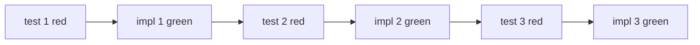
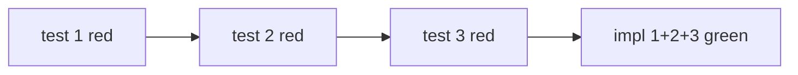

## Overview

Red-green-refactor loop. One behavior at a time. The test must fail before any production code is written.

## When to Use

- The user says "tdd", "test first", "red green refactor", or "write the test first".
- One behavior is small enough to state in a single sentence with a single observable outcome, such as `/tdd user.create rejects empty email`.
- A bug fix needs a reproduction test that fails before the fix lands.

For backfilling tests over existing code, use `/test`; for diagnosing a failure that already exists, use `/investigate`; for designing a feature before the first cycle, use `/plan`.

## Anti-pattern: write-all-tests-then-all-code

Never write the full test suite first and then implement against it in one batch. That pattern produces tests that describe an imagined shape, not the actual behavior the code ends up needing. The tests pass on shape and fail on behavior; they fail on shape and pass on behavior. Either way they stop being a safety net.

Always work in vertical slices: one test, then the smallest implementation that turns the test green, then the next test.

Not this:

When tests use domain terms (`createCustomer`, `applyDiscount`), pull the terms from the project glossary if one exists. See [`rules/project-glossary.md`](../../rules/project-glossary.md).

## Arguments

- `<description>`: the behavior to implement, in plain English. Example: `/tdd user.create rejects empty email`.
- `--no-refactor`: skip the refactor step. Useful when the green code is already minimal.

## Process

### 1. Clarify the behavior

State the behavior in one sentence. If it covers more than one assertion, split into multiple `/tdd` runs. One behavior, one test.

Identify:
- The function or class under test.
- The input that triggers the behavior.
- The expected observable outcome, return value, thrown error, side effect.
- The seams under test: the public boundaries where the test observes the behavior. Give each seam a one-line note on what it catches and what it misses, e.g. "HTTP handler: catches validation and serialization, misses the queue consumer".

If the function, the input, or the outcome is unclear, ask one question and stop. When an approved plan already names the seams, use them without asking; otherwise confirm the seam list with the user before writing the test.

### 2. Locate or create the test file

Match the project's test colocation pattern. Read 2 nearby tests to confirm:
- Naming convention, `*.test.ts`, `*_test.go`, `test_*.py`.
- Test runner imports.
- Setup and teardown style.
- Fake data approach. Apply the Test Data section of [`standards/testing.md`](../../standards/testing.md).

Add the test file if missing. Match the existing folder layout exactly.

### 3. Red: write the failing test

- Shape the body per the Test Structure section of [`standards/testing.md`](../../standards/testing.md): three blocks opened by the bare markers `Arrange`, `Act`, `Assert` in the language's comment syntax, one blank line between them, exactly one call to the unit under test with its result bound to a name. The markers are the only comments; the test name states the behavior. An expected throw binds the pending call in Act and asserts on it.
- Use the most specific assertion available. No `toBeTruthy`. Apply the Assertion Specificity section of [`standards/testing.md`](../../standards/testing.md).
- Seed any fake data generator deterministically.

Run the single test. Confirm it fails.

| Failure type | What it means |
|--------------|---------------|
| Assertion failure | Expected. Proceed to step 4 |
| Compile or import error | Test setup is wrong. Fix before continuing |
| Test passes | The behavior already exists, or the test does not exercise it. Stop and reassess |

### 4. Green: minimum production code

Write the smallest change that makes the test pass. Resist the urge to add nearby features, generalize, or refactor at this step.

- No new error handling beyond what the test asserts.
- No new abstractions.
- No "while I'm here" cleanup.
- Stay surgical. See [`rules/surgical-edits.md`](../../rules/surgical-edits.md).

Run the test. Confirm it passes. Run the full test file to confirm no regressions on neighbors.

### 5. Refactor: improve with the test as safety net

Skip if `--no-refactor` was passed.

Refactor only on green. When any test is red, return to step 4 and make it pass before changing structure, because a refactor under a red test cannot tell a broken behavior from a broken refactor.

Look for:
- Duplication introduced in step 4.
- Names that no longer match the new behavior.
- Functions that grew past the file's typical size.

Run the full test file after every refactor change. The bar is zero failing tests, zero new warnings.

### 6. Verify gates

- Format, lint, typecheck, full test suite, build. Apply the Local Quality Gate section of [`standards/git-workflow.md`](../../standards/git-workflow.md).
- Coverage for the changed file at 95% or higher. Apply the Coverage section of [`standards/testing.md`](../../standards/testing.md).

Report a one-line summary: behavior implemented, test name, files changed, coverage on changed file.

## Anti-patterns

- Writing production code before the failing test. The whole point is the red step proves the test exercises the behavior.
- Writing a test that passes on the first run. The test is not measuring what you think.
- Writing a tautological assertion that recomputes the expected value the way the code does, such as `expect(add(a, b)).toBe(a + b)`. It passes by construction. Take the expected value from a known-good literal, a worked example, or the spec. Apply [`standards/testing.md`](../../standards/testing.md) Tautological Assertions.
- Adding multiple assertions for unrelated behaviors in one test. Split into separate `/tdd` runs.
- Skipping the refactor step on every cycle. The codebase decays without it.
- Mocking internal infrastructure to make the test cheap. Apply the Mocks Policy section of [`standards/testing.md`](../../standards/testing.md).

## Rules

- One behavior per cycle. No exceptions.
- Test must fail before production code is written. No exceptions.
- The green step writes the minimum. Generalization belongs in refactor or in a later cycle.
- Never refactor while red. Get to green first.
- Test what a user would notice broken, and never what the type system already proves. Apply [`standards/testing.md`](../../standards/testing.md) What To Test.
- Use the project's real test infrastructure. Never mock the database, queue, or your own services.
- Apply existing rules: [`rules/testing.md`](../../rules/testing.md), [`rules/surgical-edits.md`](../../rules/surgical-edits.md), [`rules/git-workflow.md`](../../rules/git-workflow.md).

## Red Flags

- Stop and reassess the test when it passes on its first run.
- Stop and fix the test setup when the red step fails on a compile or import error rather than an assertion.
- Stop and split into separate `/tdd` runs when the behavior sentence needs "and" to describe two outcomes.
- Stop and revert to the minimum when the green diff adds error handling, an abstraction, or cleanup the test does not assert.
- Stop and ask one question when the function, the input, or the expected outcome is unclear.
- Stop the refactor and return to green when any test turns red mid-refactor.

## Verification

- The red run output shows an assertion failure for the new test, captured before any production edit.
- The green run output shows the new test passing and the full test file passing.
- The test body has three blocks opened by the bare `Arrange`, `Act`, `Assert` markers, separated by single blank lines, and no other comment.
- Format, lint, type check, the full suite, and the build exit 0, with zero new warnings.
- Coverage on the changed file is 95% or higher.

## Related skills

- `/test` for running the suite, coverage, lint, scan.
- `/investigate` for debugging an existing failure rather than writing a new test.
- `/plan` for designing a feature before any TDD cycle starts.
